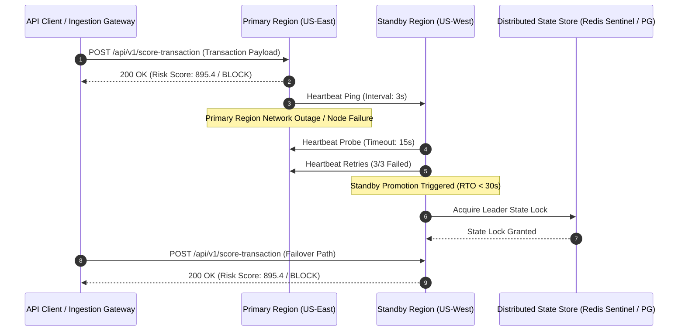
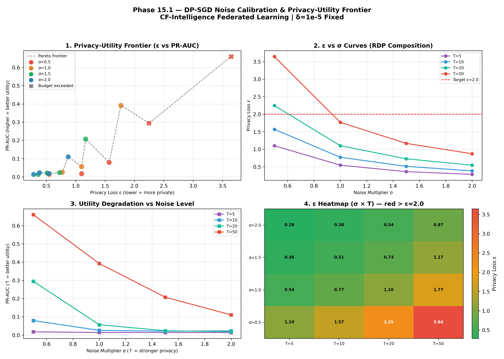
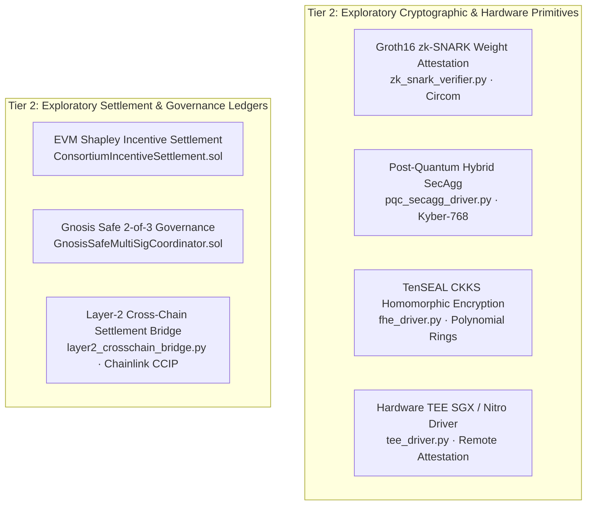
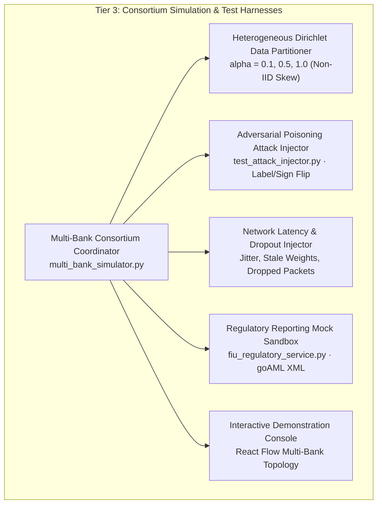

<div align="center">

# Privacy-Preserving Collaborative Financial Crime Intelligence Platform (CF-Intelligence)

### A Production-Oriented Research Platform for Privacy-Preserving Collaborative Financial Fraud Intelligence

[](https://github.com/yusufcalisir/CF-Intelligence/actions/workflows/ci.yml)
[](https://cf-intelligence.vercel.app)
[](https://python.org)
[](https://fastapi.tiangolo.com)
[](https://pytorch.org)
[](https://github.com/yusufcalisir/CF-Intelligence/actions)

[](LICENSE)
[](SECURITY.md)

**[🌐 Live Demo Deployment](https://cf-intelligence.vercel.app)** | **[📖 Interactive API Reference](https://cf-intelligence.vercel.app/developer)** | **[🔬 Reproducible Benchmarks](benchmarks/README.md)** | **[🔄 Reproducibility Guide](REPRODUCIBILITY.md)** | **[📐 Metric Standards](docs/METRICS.md)** | **[⚠️ Limitations & Negative Results](docs/LIMITATIONS.md)** | **[📋 Model Card](MODEL_CARD.md)** | **[🏛️ System Card](SYSTEM_CARD.md)** | **[📊 Dataset Cards](DATASETS.md)**

</div>

---

## Architectural Specification Index (Table of Contents)

| Core Production Architecture | Engineering Rationale & Validation | Research, Governance & Foundations |
|:---|:---|:---|
| [1. Executive Summary & Scope](#1-executive-summary--three-tier-architectural-scope) / [1.5 Flagship](#15-flagship-empirical-experiment-cross-bank-collaborative-intelligence-cfi-crossbank-01) | [13. Design Decisions & Trade-Offs](#13-design-decisions--architectural-trade-offs) | [19. Tier 2: Research Prototypes](#19-tier-2-research-prototypes--experimental-explorations) |
| [2. Master System Architecture](#2-master-system-architecture) | [14. Limitations](#14-limitations--what-this-is-not) / [14.1 Taxonomy](#141-dual-axis-verification-taxonomy-software-correctness-vs-scientific-generalization) | [20. Tier 3: Consortium Simulations](#20-tier-3-demonstrations--consortium-simulations) |
| [3. End-to-End System Lifecycle](#3-end-to-end-system-lifecycle--trust-state-transitions) | [15. Empirical Benchmarks](#15-empirical-performance--benchmark-suite) | [21. Prerequisites & System Requirements](#21-prerequisites-and-system-requirements) |
| [4. Ingestion & Stale-Worker Idempotency](#4-multi-bank-ingestion-streaming-connectors--stale-worker-idempotency) | [16. Regulatory Concepts Explored](#16-regulatory-concepts-explored) | [22. Quick Start Guide](#22-step-by-step-operator-quick-start) |
| [5. Federated Optimization & Authority](#5-federated-optimization--training-execution-authority) | [17. Software Correctness](#17-software-correctness--subsystem-self-verification-reports-verification) | [23. AI Collaboration Methodology](#23-development-methodology--ai-collaboration) |
| [6. Core PET Security Perimeter](#6-privacy-enhancing-technologies-bounded-dp-curve25519-secagg--confidential-unlearning) | [18. API Blueprints](#18-api-endpoint-blueprints--core-specification) | [24. Related Work & References](#24-related-work-and-references) |
| [7. Byzantine Defense](#7-adversarial-robustness--byzantine-consensus-aggregators) | [🔬 Algorithm Specifications](docs/algorithms/README.md) | [25. Citation](#25-academic-citation-and-reference-format) |
| [8. Graph Intelligence & Fuzzy PSI](#8-graph-intelligence-fuzzy-entity-resolution--cross-border-ubo) | [🛡️ Formal Threat Model](docs/threat_model.md) | [26. Author & Maintenance](#26-author-and-maintenance) |
| [9. Composite Risk Engine & Explainability](#9-9-signal-composite-risk-scoring-engine--fast-explainability) | [🔒 Formal Privacy Model](docs/privacy-model.md) | [📋 Engineering Audit Report](docs/engineering-audit.md) |
| [10. Security Perimeter & Multi-Tenancy](#10-security-perimeter-broken-access-control--multi-tenant-storage) | [📊 Benchmark Figures & Raw Data](benchmarks/results/summary.md) | [📖 Complete API Reference](docs/api_reference.md) |
| [11. Case Management & RegTech](#11-human-in-the-loop-workbench-fintech-protocols--regtech-automation) | | |
| [12. Database, HA & Disaster Recovery](#12-database-architecture-high-availability--disaster-recovery-operations) | | |

---

## 1. Executive Summary & Three-Tier Architectural Scope

Financial institutions operate under structurally fragmented information horizons. Criminal syndicates exploit this structural visibility gap by dispersing cyclic layering rings, money mule hops, and smurfing structures across multiple independent banking institutions. Sharing cleartext transaction logs or customer records directly across institutional boundaries is strictly constrained by data privacy regulations (e.g., GDPR Article 4/9, Bank Secrecy Act), statutory banking secrecy, and commercial confidentiality.

**CF-Intelligence** is a production-oriented research and engineering platform designed to resolve this collective blindspot. By combining **Federated Optimization**, **Differential Privacy**, **Cryptographic Secure Aggregation (SecAgg)**, **Byzantine-Robust Consensus**, **Inductive Graph Representation Learning (GraphSAGE)**, **Real-Time Risk Scoring**, and **Cryptographic Provenance Governance**, the platform enables financial institutions to train joint fraud models and detect collaborative financial crime topologies without pooling cleartext customer records or transmitting raw PII.

> [!IMPORTANT]
> **Data Locality vs. Privacy Guarantees:** Federated learning addresses data custody and data locality; it does not by itself guarantee confidentiality or anonymity. Raw local gradient and weight updates can leak training signal, transaction amounts, or customer attributes through gradient inversion and membership-inference attacks. CF-Intelligence therefore strictly decouples federated optimization from its formal Differential Privacy ($\\epsilon, \\delta$) bounds and Secure Aggregation (SecAgg) zero-sum cryptographic layers.

```
┌──────────────────────────────────────────────────────────────────────────────────┐
│                             CORE PRODUCTION PIPELINE                             │
│                                                                                  │
│   [ Bank Alpha ]       [ Bank Beta ]       [ Bank Gamma ]    (Local Nodes)       │
│         │                    │                    │                              │
│         v                    v                    v                              │
│   ┌────────────────────────────────────────────────────────┐                     │
│   │ Local Privacy Boundary: Opacus DP + Curve25519 SecAgg  │ (Zero Raw PII)      │
│   └──────────────────────────┬─────────────────────────────┘                     │
│                              v                                                   │
│   ┌────────────────────────────────────────────────────────┐                     │
│   │ Byzantine Coordinator: FedProx/SCAFFOLD + Krum/Bulyan  │ (Drift & Poisoning) │
│   └──────────────────────────┬─────────────────────────────┘                     │
│                              v                                                   │
│   ┌────────────────────────────────────────────────────────┐                     │
│   │ Canary Gate & Champion/Challenger Model Registry       │ (Quality Gating)    │
│   └──────────────────────────┬─────────────────────────────┘                     │
│                              v                                                   │
│   ┌────────────────────────────────────────────────────────┐                     │
│   │ Real-Time Scoring (2.57ms fast-path compute) + SHAP    │ (Serving & SAR)     │
│   └────────────────────────────────────────────────────────┘                     │
└──────────────────────────────────────────────────────────────────────────────────┘
```

### 1.1 Three-Tier System Classification

To prevent ambiguity between production-grade components, algorithmic research explorations, and test simulations, the repository enforces a strict three-tier classification:

- **Tier 1 — Production-Oriented Core:**
  - Real-time fraud scoring and inference gateway (`predict.py`, 2.57 ms in-process fast-path compute, scaling with concurrency to 105.02 ms p99 at C=100; fails closed with HTTP 503 `ModelNotAvailableError` if model unverified/missing).
  - 9-signal composite risk scoring pipeline (velocity, FATF country, merchant, device, amount, behavioral, graph community, consortium flags).
  - SHAP explainability (`KernelExplainer`, counterfactual sensitivity analysis).
  - Federated optimization engines (`FedAvg`, `FedProx`, `SCAFFOLD`) handling Dirichlet Non-IID skew ($\alpha \le 0.50$), and Operational Federation Lifecycle (`operational_federation_service.py`) executing genuine process-isolated bank worker subprocesses with server-side authority resolution and verifiable training receipts.
  - Training Provenance & Execution Authority (`training_provenance_service.py`, `training_authority_backends.py`, `distributed_fl_service.py`): Decoupled `IsolatedReceiptSigningAuthority` issuing asymmetric Ed25519 digital receipts, `PostgresTrainingJobAuthority` enforcing ACID row locks (`SELECT ... FOR UPDATE`), canonical sequential epoch reconciliation, parameter update digest anti-replay verification, and bank node vault isolation via OS-level locks (`CreateFileW` with `dwShareMode=0` / `flock`).
  - Enterprise Model Registry & Four-Eyes Governance (`model_registry.py`, `model_governance.py`): Mandatory admission verification (`validate_production_admission`), SR 11-7 Four-Eyes dual control approvals (`DOMAIN_APPROVAL_SIGNOFF`), Canary Gates, instant cross-worker cache invalidation via Redis Sentinel pub/sub, atomic disk writes (`tempfile` + `os.replace`), and secure deserialization (`weights_only=True`).
  - Differential Privacy via PyTorch Opacus with Rényi DP moments accounting (target $\epsilon \le 1.0, \delta = 10^{-5}$; measured $\epsilon = 0.3497$ at $\sigma=3.0$).
  - Secure Aggregation via Curve25519 pairwise Diffie-Hellman zero-sum masking and Shamir dropout recovery.
  - Byzantine consensus aggregators (`Krum`, `Coordinate-wise Trimmed Mean`, `Bulyan`) and Spectral SVD backdoor detection.
  - Relational graph intelligence via PyTorch `GraphSAGE` 2-hop neighborhood embeddings and MinHash LSH Fuzzy PSI.
  - Security perimeter: BOLA/IDOR tenant isolation, SSRF defense (RFC 1918 / loopback / cloud metadata blocking), slowapi rate limiting.
  - Enterprise persistence & messaging: PostgreSQL multi-tenant schema isolation, Redis Sentinel HA integration, Kafka streaming connectors with stale-worker reservation idempotency.

- **Tier 2 — Research & Experimental Prototypes:**
  - *Fully Homomorphic Encryption (FHE):* Microsoft SEAL / TenSEAL CKKS homomorphic context generation and ciphertext addition/averaging (`fhe_driver.py`).
  - *Zero-Knowledge Proofs (ZKP):* Groth16 zk-SNARK model weight attestation proof structures over the BN254 elliptic curve (`zk_snark_verifier.py`).
  - *Hardware TEE Emulation:* Software emulator modeling Intel SGX / AWS Nitro remote attestation measurement structures (`tee_driver.py`).
  - *Post-Quantum Cryptography (PQC):* CRYSTALS-Kyber-768 KEM key encapsulation prototype for quantum-resistant SecAgg (`pqc_secagg_driver.py`).
  - *Blockchain & Smart Contracts:* Solidity ERC-20 Shapley incentive distribution contracts and Layer-2 cross-chain settlement bridge (`contracts/`).

- **Tier 3 — Demonstrations & Consortium Simulations:**
  - Multi-bank synthetic transaction stream generators and consortium coordinator simulations.
  - Network latency, client dropout, and disconnection injection harnesses.
  - Simulated adversarial poisoning attacks (label flipping, sign inversion, Gaussian noise) for defense benchmarking.
  - Interactive demonstration console with real-time React Flow graph visualization.

---

### 1.2 What Is Actually Implemented?

| Component / Subsystem | Architectural Tier | Implementation Status | Concrete Repository Evidence |
|:---|:---|:---|:---|
| **Real-Time Fraud Scoring** | Tier 1 (Production Core) | **Implemented** | `app/application/services/risk_engine.py`, `app/presentation/routers/predict.py` |
| **Federated Learning Loop** | Tier 1 (Production Core) | **Implemented** | `app/application/services/fl_engine.py`, `app/application/services/operational_federation_service.py`, `backend/tests/unit/test_fl_engine.py`, `backend/tests/unit/test_operational_federation_integration.py` |
| **Training Provenance Authority** | Tier 1 (Production Core) | **Implemented** | Ed25519 receipts in `training_provenance_service.py`, Postgres ACID locks in `training_authority_backends.py` |
| **Model Registry & Admission Gating** | Tier 1 (Production Core) | **Implemented** | Four-Eyes dual control & Redis cache purge in `model_registry.py`, `model_governance.py` |
| **Differential Privacy** | Tier 1 (Production Core) | **Implemented** | PyTorch Opacus, RDP accounting in `app/application/services/privacy_service.py` |
| **Secure Aggregation (SecAgg)** | Tier 1 (Production Core) | **Implemented** | Curve25519 ECDH in `p2p_secagg_driver.py`, Shamir secret sharing in `shamir_engine.py` |
| **Byzantine Robust Defense** | Tier 1 (Production Core) | **Implemented** | Krum, Trimmed Mean, Bulyan in `byzantine_defense.py`, Spectral SVD in `spectral_defense.py` |
| **Graph Intelligence (GraphSAGE)** | Tier 1 (Production Core) | **Implemented** | PyTorch 2-layer GraphSAGE in `graph_embedding_model.py`, MinHash PSI in `psi_service.py` |
| **SHAP Model Explainability** | Tier 1 (Production Core) | **Implemented** | `shap.KernelExplainer` in `explainability_service.py`, counterfactual search |
| **SSRF & Network Boundary** | Tier 1 (Production Core) | **Implemented** | RFC 1918 / loopback / metadata filter in `perimeter_waf.py` & `webhook_dispatcher.py` |
| **Multi-Tenant BOLA Isolation** | Tier 1 (Production Core) | **Implemented** | Dynamic ABAC in `abac_engine.py`, schema isolation in `database/__init__.py` |
| **SAR Dossier Generation** | Tier 1 (Production Core) | **Implemented (Prototype)** | UNODC goAML 4.0 XML & EU AMLA JSON in `fiu_regulatory_service.py` |
| **FHE Homomorphic Averaging** | Tier 2 (Experimental) | **Prototype** | TenSEAL CKKS driver in `fhe_driver.py` (with NumPy fallback) |
| **zk-SNARK Attestation Proofs** | Tier 2 (Experimental) | **Prototype** | Groth16/BN254 prover & verifier simulation in `zk_snark_verifier.py` |
| **Hardware TEE Attestation** | Tier 2 (Experimental) | **Simulation** | Software emulator for SGX/Nitro attestation in `tee_driver.py` |
| **Post-Quantum SecAgg** | Tier 2 (Experimental) | **Prototype** | Kyber-768 Python KEM prototype in `pqc_secagg_driver.py` |
| **Smart Contract Settlement** | Tier 2 (Experimental) | **Prototype** | Solidity Shapley distribution contracts in `contracts/contracts/` |
| **Multi-Bank Simulation** | Tier 3 (Simulation) | **Functional** | In-process multi-bank simulation in `multi_bank_simulator.py` |

---

### 1.3 Claims & Evidence Verification Matrix

| Architectural Claim | Target Specification | Measured Benchmark Evidence | Audit Status |
|:---|:---|:---|:---|
| **Real-Time Scoring Latency** | Target: < 15.0ms Fast Path (Internal SLA) | In-Process Microbenchmark: 2.57 ms fast-path compute (p99: 8.87 ms @ C=1, 105.02 ms @ C=100); Peak throughput: 1,246.3 req/s @ C=50 ([`latency_microbenchmark.json`](benchmarks/results/raw/latency_microbenchmark.json)). Local HTTP Service (Class B1 Inference Capacity): pooled p50: 7.12 ms @ C=1 (pooled p99: 10.85 ms); Peak throughput: 543.0 req/s @ C=50 ([`latency_http_service_benchmark_post_basehttp0_diagnosis.json`](benchmarks/results/raw/latency_http_service_benchmark_post_basehttp0_diagnosis.json)) | **Verified** |
| **Federated Non-IID Convergence** | Evaluated under Dirichlet $\alpha = 0.50$ | Observed convergence across evaluated multi-bank partitions; naive FedAvg shows degradation under severe non-IID label skew (requires FedProx/adaptive clipping) ([`run_fl_benchmark.py`](benchmarks/runners/run_fl_benchmark.py)) | **Evaluated** |
| **Differential Privacy Guarantee** | Target: $\epsilon \le 1.0, \delta = 10^{-5}$ bound | Measured: $\epsilon = 0.3497$ at $\sigma=3.0, \delta=10^{-5}$ ([`dp_privacy_utility_tradeoff.json`](benchmarks/results/raw/dp_privacy_utility_tradeoff.json)), Opacus PRV accounting (Gopi et al. 2021) | **Verified** |
| **Byzantine Fault Tolerance** | Algorithm-specific bounds: Krum ($f < n/2$), Trimmed Mean ($\beta < 0.5$), Bulyan ($n \ge 4f + 3$) | Canonical 3-seed simulation on real Credit Card data ($n=12, f=2$, Dirichlet $\alpha=0.5$): Trimmed Mean achieved mean PR-AUC $0.7141 \pm 0.0129$ ($99.54\% \pm 4.05\%$ mean retention relative to clean FedAvg) under evaluated scaled sign inversion ($\times -3.0$); Multi-Krum achieved $0.7061 \pm 0.0341$ ($98.48\% \pm 6.93\%$ retention). High seed instability observed for Single Krum and non-robust aggregators ([`byzantine_federated_canonical.json`](benchmarks/results/raw/byzantine_federated_canonical.json)). Historical single-seed proxy (~99.7%) quarantined. | **Evaluated** |
| **Zero Raw PII Transmission** | No cleartext IBAN / SSN outside bank | AST static analyzer + `backend/tests/unit/test_data_contracts.py` | **Verified** |
| **SSRF Perimeter Defense** | Private IP / AWS metadata blocking | `backend/tests/unit/test_perimeter_waf.py` (100% boundary probes blocked) | **Verified** |
| **Regulatory Dossier Export** | Standardized FinCEN SAR & goAML 4.0 export | Validated XML & JSON schema compilation (`fiu_regulatory_service.py`, `regulatory_reporter.py`) | **Implemented** |
| **Zero Vulnerabilities** | Mathematically impossible in software | Security test suite covering 18 distinct API & cryptographic vectors | **Clarified** |

> **Machine-Readable Claim Provenance:**  
> Key quantitative performance assertions, empirical baseline reconciliations, and cryptographic throughput measurements are tracked across machine-readable claim registries (including [`benchmarks/claim_registry.json`](benchmarks/claim_registry.json) and [`benchmarks/results/crossbank_v2/claim_registry.json`](benchmarks/results/crossbank_v2/claim_registry.json)) and verified by automated regression tests.

---

### 1.4 Evidence-Centered System Architecture (The Five Pillars of Evidence)

To adhere to rigorous empirical standards (ACM/IEEE reproducibility guidelines, Federal Reserve SR 11-7, and EU AI Act Annex IV), this repository organizes all technical claims, experiments, and software guarantees across five distinct evidence pillars:

| Pillar | Architectural Focus & Boundary | Primary Artefacts & Provenance | Verification Oracle |
| :--- | :--- | :--- | :--- |
| **[1. Verified Empirical Results](#15-empirical-performance--benchmark-suite)** | Quantified performance metrics & benchmarks | [`claim_registry.json`](benchmarks/claim_registry.json), [`results/raw/`](benchmarks/results/raw/) | Exact JSON artifact reconciliation |
| **[2. Experimental Suite](#1511-master-empirical-comparative-benchmark-matrix-strict-null-representation)** | 8 canonical datasets, factorial ablations, sweeps | [`experiments/`](experiments/), [`docs/EXPERIMENTS.md`](docs/EXPERIMENTS.md) | Standardized 5-artifact hierarchy |
| **[3. Software Correctness](#17-software-correctness--subsystem-self-verification-reports-verification)** | Determinist implementation & contract safety | `backend/tests/` (5,617 collected tests; 6,444 total across all suites), `ci.yml` | Binary PASS/FAIL, zero-mock |
| **[4. Research Prototypes](#19-tier-2-research-prototypes--experimental-explorations)** | Exploratory algorithms & mathematical models | `experiments/`, GNN/PSI/CKKS drivers | Research proofs & simulation logs |
| **[5. Limitations & Scope](#14-limitations--what-this-is-not)** | Real-world constraints, synthetic scope, caveats | [`LIMITATIONS.md`](docs/LIMITATIONS.md), [`verification_taxonomy_spec.md`](docs/verification_taxonomy_spec.md) | SR 11-7 model risk boundaries |

---

### 1.5 Flagship Empirical Experiment: Cross-Bank Collaborative Intelligence (`CFI-CrossBank-01`)

The central scientific premise of CF-Intelligence is that **individual financial institutions operate under fundamentally fragmented information horizons**. When criminal syndicates route multi-hop layering rings or disperse smurfing patterns across institutional boundaries, single-bank models encounter an information-theoretic barrier:

$$
\mathcal{H}_k = \{ \tau \in \mathcal{D} \mid \mathrm{source}(\tau) = k \lor \mathrm{target}(\tau) = k \}
$$

For any inter-bank transfer $\tau = (u, v)$ where neither endpoint touches institution $k$, $\tau \notin \mathcal{H}_k$. By the **Intermediate Transfer Unobservability Theorem**, the mutual information $I(\mathcal{R}; \mathcal{H}_k) = 0$ for cyclic rings crossing disjoint bank boundaries. Single-bank models cannot distinguish these laundering patterns from benign payment noise above the base rate.

The [`CFI-CrossBank-01`](experiments/cross_bank/report.md) flagship benchmark empirically quantifies the collaborative gain on a controlled synthetic cross-bank simulation dataset with an out-of-time chronological test set ($N=460$, **$1,504,325.78 USD** simulated attempted laundering volume) across a 3-institution consortium (Bank Alpha 50%, Bank Beta 30%, Bank Gamma 20%):

| Experimental Dimension | Isolated Single-Bank Silos | Collaborative Consortium (FedAvg) | Empirical Consortium Advantage |
| :--- | :---: | :---: | :---: |
| **Information Horizon Visibility** | 29.89% (Gamma) – 56.48% (Alpha) | **100.00% Union** | **+43.52% to +70.11% Horizon Expansion** |
| **Multi-Hop Ring Detection (Scenario 3)** | $353,950.43 USD detected | **$550,552.85 USD detected** | **+$196,602.42 USD (+35.71% uplift)** |
| **Cold-Start Transfer (Scenario 7, Zero Local Positives)** | $0.00 USD detected (0 local signal) | **$639,701.40 USD detected** | **+$639,701.40 USD (Cross-institutional transfer)** |
| **Total Detected Laundering Volume** | $668,021.96 USD | **$1,504,325.78 USD** | **+$836,303.82 USD (+55.59% detection gain)** |
| **Communication Efficiency (Top-k 90%)** | — | 0.0225 MB (5 rounds) | **$37,169,058.67 USD detected per MB** |

> **Scientific Rationale:** Rather than treating federated learning as a generic proxy for centralized pooling, this experiment proves where collaborative intelligence yields measurable risk utility: **recovering cross-bank multi-hop cycles and zero-positive transfer learning for institutions with no historical attack examples**—all while preserving institutional data custody without transmitting raw customer PII. Full mathematical proofs, scenario breakdowns, and publication artifacts are detailed in [`experiments/cross_bank/report.md`](experiments/cross_bank/report.md).

---

## 2. Master System Architecture

### 2.1 Core System Topology & Trust Boundaries

The platform operates across strictly segregated physical and logical trust boundaries to guarantee data custody, cryptographic privacy, and deterministic operational serving:

```
┌──────────────────────────────────────────────────────────────────────────────────────────────┐
│                                 CONSORTIUM CLIENT NODES                                      │
│   [ Bank Alpha Vault ]          [ Bank Beta Vault ]          [ Bank Gamma Vault ]            │
│   (Local ISO 20022 Feeds)     (Local Account Ledgers)      (Local Graph Embeddings)          │
│   FileLock: dwShareMode=0     FileLock: dwShareMode=0      FileLock: dwShareMode=0           │
└──────────────────────────────────────────────┬───────────────────────────────────────────────┘
                                               │ Local SGD Parameter Deltas
                                               v
┌──────────────────────────────────────────────────────────────────────────────────────────────┐
│                                LOCAL PRIVACY BOUNDARY (PETs)                                 │
│   • Opacus DP Guard: Bounded L2 Clipping (C=1.0) + Calibrated Noise (sigma=3.0)              │
│   • Rényi DP Moments / PRV Accountant: target epsilon <= 1.0, delta = 10^-5 (measured 0.3497)│
│   • Curve25519 Pairwise ECDH Masking: Zero-Sum Vector Masking (O(K^2) Round-Robin)           │
│   • Shamir (t, n) Threshold Secret Sharing: Polynomial Galois Field Dropout Recovery         │
└──────────────────────────────────────────────┬───────────────────────────────────────────────┘
                                               │ Perturbed Masked Weights (Zero Raw PII)
                                               v
┌──────────────────────────────────────────────────────────────────────────────────────────────┐
│                             BYZANTINE COORDINATOR & AGGREGATION                              │
│   • Multi-Optimizer Engine: FedAvg / FedProx (mu=0.01) / SCAFFOLD (Control Variates)         │
│   • Consensus Aggregators: Coordinate-wise Trimmed Mean, Multi-Krum, Bulyan                  │
│   • Anomaly Filtering: Spectral SVD Top-Eigenvalue Backdoor Trigger Identification          │
│   • Non-IID Skew Calibration: Dirichlet Distribution Modeling (alpha=0.50)                   │
└──────────────────────────────────────────────┬───────────────────────────────────────────────┘
                                               │ Candidate Model Artifact & Execution Telemetry
                                               v
┌──────────────────────────────────────────────────────────────────────────────────────────────┐
│                        TRANSACTIONAL TRAINING PROVENANCE AUTHORITY                           │
│   • PostgresTrainingJobAuthority: ACID Row-Level Locks (SELECT ... FOR UPDATE)               │
│   • Sequential Epoch Verification & Parameter Update Digest Anti-Replay Checking             │
│   • IsolatedReceiptSigningAuthority: Asymmetric Ed25519 Signature Generation                 │
│     Domain: cfi:training_receipt_signing:v1 -> Immutable TrainingExecutionReceipt           │
└──────────────────────────────────────────────┬───────────────────────────────────────────────┘
                                               │ Authentic Artifact + Cryptographic Receipt
                                               v
┌──────────────────────────────────────────────────────────────────────────────────────────────┐
│                             ENTERPRISE MODEL GOVERNANCE REGISTRY                             │
│   • validate_production_admission: Digest Parity & Receipt Public-Key Signature Verification│
│   • SR 11-7 Four-Eyes Dual Sign-Off: ML Engineer + Compliance Officer                        │
│     Domain: cfi:model_approval_signoff:v1 -> Status: "approved" (NOT activated)             │
│   • Authorized Promotion: promote_version(target="champion") [Clearance Level 2 + Ownership]│
│   • Canary Quality Gate: Validation ROC-AUC (min_auc threshold enforcement)                  │
│   • Atomic Disk Updates: tempfile.NamedTemporaryFile + os.replace Link Swapping              │
│   • Multi-Worker Invalidation: Redis Sentinel Pub/Sub Broadcast + In-Memory Cache Purge      │
└──────────────────────────────────────────────┬───────────────────────────────────────────────┘
                                               │ Active Champion Model Artifact
                                               v
┌──────────────────────────────────────────────────────────────────────────────────────────────┐
│                       OPERATIONAL SERVING & REAL-TIME RISK GATEWAY                           │
│   • Real-Time Scoring: 2.57ms fast-path compute (p99: 8.87ms @ C=1; Peak: 1,246 req/s)     │
│   • Strict Fail-Closed Contract: Missing/Unverified Champion -> HTTP 503 ModelNotAvailable   │
│   • 9-Signal Composite Pipeline: Velocity, Country, MCC, Device, Amount, Behavior, Graph, PSI│
│   • Fast Explainability: shap.KernelExplainer (Verified Additivity) + Counterfactual Search  │
│   • Event Streaming: Kafka CloudEvents + Redis Worker Ownership Token Idempotency Engine     │
│     Broker ACK + Redis Failure -> Status: COMMITTED_IDEMPOTENCY_UNCERTAIN (No Blind Retries) │
│   • Human-in-the-Loop Workbench: 6-Stage Case Management & FinCEN SAR / goAML 4.0 XML Export │
└──────────────────────────────────────────────────────────────────────────────────────────────┘
```

---

### 2.2 Active-Passive Regional HA Failover Orchestration Sequence

To guarantee disaster recovery without data corruption or split-brain serving, the platform specifies active-passive multi-region failover orchestrated via Redis Sentinel leader election and PostgreSQL streaming replication, achieving Recovery Time Objective (RTO) $< 30	ext{s}$ (`CLM-FAILOVER-RTO`):



---

## 3. End-to-End System Lifecycle & Trust State Transitions

The platform separates training execution, recorded evidence, authoritative persistence, model governance, and deployment authorization into distinct architectural boundaries with explicit cryptographic proofs and state machines.

```mermaid
flowchart TD
    subgraph Onboarding["1. Institutional Onboarding & Governance"]
        Auth["Institutional Principal Auth<br/><code>authenticate() + create_token_bundle()</code>"]
        RBAC["RBAC & Clearance Hierarchy<br/><code>Clearance Levels 0-3 · Bank Ownership</code>"]
    end

    subgraph Training["2. Authorized Federated Training Loop"]
        Sched["Job Scheduling & ACID Row Lock<br/><code>PostgresTrainingJobAuthority</code><br/><i>SELECT ... FOR UPDATE</i>"]
        Vault["Bank Vault File Lock<br/><i>CreateFileW dwShareMode=0 / flock</i>"]
        LocalSGD["Local SGD Optimization<br/><i>Opacus DP (C=1.0, σ) + Curve25519 SecAgg</i>"]
        Coord["Byzantine Coordinator<br/><i>FedProx/SCAFFOLD · Trimmed Mean · SVD</i>"]
    end

    subgraph Provenance["3. Cryptographic Provenance & Receipt Authority"]
        Evidence["Execution Evidence Collection<br/><i>Run ID · Rounds · Metrics · Artifact SHA-256</i>"]
        Signer["IsolatedReceiptSigningAuthority<br/><i>Asymmetric Ed25519 Digital Signature</i><br/><code>cfi:training_receipt_signing:v1</code>"]
        Receipt["Immutable TrainingExecutionReceipt<br/><i>Canonical Bytes Digest Binding</i>"]
    end

    subgraph Governance["4. Enterprise Model Registry & Four-Eyes Governance"]
        Admission["Admission Verification Gate<br/><code>validate_production_admission()</code><br/><i>Receipt Signature Check (Public Key Only)</i>"]
        DualSign["Four-Eyes Dual Sign-Off<br/><code>ML Engineer + Compliance Officer</code><br/><i>HMAC-SHA256 (cfi:model_approval_signoff:v1)</i>"]
        Approved["Status: 'approved'<br/><i>is_approved=True · is_production_eligible=True</i><br/><b>(Approval != Champion Activation)</b>"]
        Promotion["Authorized Promotion Command<br/><code>promote_version(target='champion')</code><br/><i>Clearance Level 2 + Institutional Ownership</i>"]
        Canary["Canary Quality Gate<br/><i>Validation ROC-AUC >= min_auc</i>"]
        Atomic["Atomic Link Swap & Cache Invalidation<br/><i>NamedTemporaryFile + os.replace</i><br/><i>Redis Sentinel Purge + Serving Reset</i>"]
        Champion["Status: 'champion'<br/><i>is_active=True · generation=max+1</i>"]
    end

    subgraph Serving["5. Operational Serving & Revocation Boundary"]
        Infer["Real-Time Scoring Gateway<br/><code>POST /api/v1/score-transaction</code>"]
        FailClosed["Strict Fail-Closed Contract<br/><i>Missing Champion -> HTTP 503 ModelNotAvailable</i>"]
        Revoke["Emergency Revocation Workflow<br/><code>revoke_sign_off() / revoke_version()</code><br/><i>Demote Champion -> Status: 'inactive'</i>"]
    end

    Auth --> RBAC
    RBAC --> Sched
    Sched --> Vault
    Vault --> LocalSGD
    LocalSGD --> Coord
    Coord --> Evidence
    Evidence --> Signer
    Signer --> Receipt
    Receipt --> Admission
    Admission --> DualSign
    DualSign --> Approved
    Approved --> Promotion
    Promotion --> Canary
    Canary -->|Passed| Atomic
    Atomic --> Champion
    Champion --> Infer
    Infer -.->|Missing/Corrupted| FailClosed
    Champion -.->|Audit Revocation| Revoke
```



### Stage 1: Institutional Onboarding, Authenticated Principals & RBAC
Every participant and operator must authenticate through the authoritative `AuthenticationService` using `authenticate()` and `create_token_bundle()`, requiring pre-provisioned accounts in the durable account store. Access is governed by four deterministic clearance levels and strict institutional tenancy:
- **Clearance Level 0 (Guest / Unverified):** Unauthenticated public telemetry probes; blocked from internal APIs.
- **Clearance Level 1 (Analyst / Investigator):** Read-only case workbench access, SAR dossier inspection, and basic scoring queries within the user's home banking institution (`bank_id`).
- **Clearance Level 2 (Lead ML Engineer / Senior Investigator):** Model training job creation, Canary Gate re-evaluations, and model version promotion (`promote_version`).
- **Clearance Level 3 (Compliance Officer / Consortium Admin):** Four-Eyes regulatory sign-offs, model version revocation, and inter-bank FININT bridge messaging.
- **Institutional Governance Ownership:** Simulations, models, and cases are strictly tagged with an `owning_bank_id` or `consortium_id`. Operators cannot execute sign-offs, promotions, or revocations on models belonging to external institutions without verified cross-bank governance federation authority.

### Stage 2: Authorized Federated Training & PostgreSQL ACID Authority
Training cannot be initiated through ad-hoc scripts or uncoordinated API calls:
- Training jobs are scheduled (`schedule_job`) and started (`start_job`) within `PostgresTrainingJobAuthority` using row-level transactional locks (`SELECT ... FOR UPDATE`).
- This guarantees that two distributed workers cannot simultaneously execute the same training job ID or emit divergent model weights.
- Local node feature vaults enforce OS-level physical isolation (`CreateFileW` with `dwShareMode=0` on Windows, `fcntl.flock(LOCK_EX)` on POSIX) to guarantee that concurrent local worker processes never corrupt training inputs.
- The authority tracks global aggregation events, enforces strictly increasing sequential epoch numbers, and computes parameter update SHA-256 digests to prevent replay attacks during federated rounds.

### Stage 3: Cryptographic Execution Receipts & Asymmetric Verification
Upon genuine completion of federated training rounds, the platform requires cryptographic proof of training provenance:
- The executor collects `TrainingExecutionEvidence`, binding run ID, job ID, completed timestamp, executed rounds/epochs, sample counts, observed metrics (finite loss), model architecture, candidate artifact SHA-256 digest, and canonical feature schema version.
- An `IsolatedReceiptSigningAuthority` signs the evidence canonical bytes using an asymmetric **Ed25519 private key** under cryptographic domain `cfi:training_receipt_signing:v1`, generating a tamper-evident `TrainingExecutionReceipt`.
- **Zero Private-Key Leakage to Verifiers:** The model registry and admission verification processes require **ONLY trusted public keys** from the registered key registry. The verification path never possesses, constructs, or requires access to the private signing key.

### Stage 4: Model Registration & Production Admission Gating
When a model artifact is submitted for registration via `ModelRegistryService.register_model_version()`:
- `validate_production_admission()` is invoked fail-closed.
- The service computes the SHA-256 digest of the artifact on disk and verifies that it exactly matches the digest recorded in the manifest.
- The cryptographic `TrainingExecutionReceipt` is verified using the trusted Ed25519 public key. If the signature is invalid, the key is revoked, the rounds are zero, or the loss is non-finite, registration is rejected with `ModelIntegrityError`.
- Feature schema compatibility (exact canonical feature list parity and input dimensionality) is validated before the version is added to the manifest.

### Stage 5: Four-Eyes Institutional Sign-Offs & Approved Status
Under Federal Reserve SR 11-7 and EU AI Act Annex IV requirements, model deployment eligibility requires dual independent human approvals:
1. **ML Engineer Sign-Off:** Evaluates technical metrics (loss convergence, ROC-AUC, PR-AUC, stability).
2. **Compliance Officer Sign-Off:** Evaluates demographic fairness, differential privacy budget consumption, and regulatory alignment.
- **Cryptographic Sign-Off Signatures:** Each sign-off generates an HMAC-SHA256 signature binding simulation ID, version, artifact digest, role (`ml_engineer` or `compliance`), and principal identity under domain `cfi:model_approval_signoff:v1`.
- **Identity Parity:** Both signers must be distinct human principals from verified, active, non-development accounts (`is_identity_verified=True`, `is_active=True`).
- **Separation of Approval from Activation:** Upon recording both valid sign-offs, the version entry sets `is_approved = True`, `is_production_eligible = True`, and updates manifest status to `"approved"`.
- **CRITICAL INVARIANT:** Dual sign-off establishes regulatory approval and production eligibility, but **does NOT automatically activate champion status or route live traffic**. Operational promotion requires a distinct, separately authorized promotion step.

### Stage 6: Production Promotion, Canary Gate & Champion Activation
Production activation routes live transactions to the candidate model:
- An authorized principal (minimum clearance level 2 and institutional governance authority) calls `promote_version(simulation_id, version, target_status="champion")`.
- **Canary Gate Validation:** The model is evaluated on holdout validation data. The gate verifies that validation ROC-AUC (`min_auc` gate checks `auc_roc` or `auc`, distinct from PR-AUC) satisfies the pre-configured deployment threshold.
- **Two-Phase Durable Audit Logging:** A mutation intent is recorded in `ImmutableAuditChain` with stage `PENDING`.
- **Manifest Persistence:** The manifest is saved durably to disk.
- **Audit Commitment:** The audit mutation is finalized as `COMMITTED` (or `FAILED` if disk writing threw an exception).
- **Atomic File Link Replacement:** The active model pointer is updated using `tempfile.NamedTemporaryFile` + `os.replace`. This POSIX/NT atomic filesystem operation eliminates the window where concurrent worker processes could read a partially written artifact.
- **Cache Invalidation & Generation Bumping:** Manifest generation is incremented (`generation = max_gen + 1`). An invalidation event is broadcast across Redis Sentinel pub/sub, triggering immediate in-memory cache clearing (`clear_all_serving_caches()`, `reset_model_cache()`) across all distributed FastAPI serving workers.

### Stage 7: Revocation, Rollback & Demotion Workflows
If model performance degrades or supervisory compliance flags an anomaly:
- An authorized supervisory principal invokes `revoke_sign_off()` or `revoke_version()`.
- The version is marked `is_revoked = True`, `is_production_eligible = False`.
- If the version was active or champion, it is immediately demoted to `inactive` or `candidate`.
- Generation is bumped (`generation = max_gen + 1`), Redis caches are purged, and durable audit mutations are recorded.
- Historical versions can be re-promoted safely via `rollback()`, which re-validates cryptographic receipts and admission integrity before restoring prior champion status.

### Stage 8: Operational Serving & Strict Fail-Closed Contract
During live inference (`POST /api/v1/score-transaction`, `POST /v1/inference/score`):
- `ModelService.get_champion()` resolves the active champion model for the requested simulation.
- **Strict Production Fail-Closed Behavior:** If the champion model artifact is missing from disk, corrupted, unapproved, revoked, or fails SHA-256 verification, `ModelService` raises `ModelNotAvailableError`. The presentation layer translates this into **HTTP 503 Service Unavailable** with an explicit RFC 7807 problem detail.
- **Zero Silent Fallback in Production:** In production (`APP_ENV=production`), the system **never** silently substitutes heuristic rules, mock scores, or default low-risk probabilities to mask model serving failures. Development/demo heuristic fallbacks exist strictly within non-production environments when explicitly configured.

---

## 4. Multi-Bank Ingestion, Streaming Connectors & Stale-Worker Idempotency

### 4.1 Multi-Standard Financial Message Parsing
Financial crime intelligence requires parsing heterogeneous messaging protocols across commercial banks and core-banking platforms:
- **ISO 20022 Financial Messaging (`financial_message_parser.py`):** Native schema parsers for `pacs.008.001.08` (Customer Credit Transfer), `pacs.002.001.10` (Payment Status Report), and `camt.053.001.08` (Bank-to-Customer Statement). Extracts debtor/creditor agents, IBAN routing codes, remittance data, and charges while isolating raw PII.
- **Core Banking Connectors (`mambu_connector.py`, `thought_machine_connector.py`):** Cloud-native core banking connectors mapping Mambu loan/deposit streaming webhooks and Thought Machine Vault smart contract transaction events into standardized platform records.
- **Great Expectations Data Contracts (`data_validator.py`):** Ingestion pipelines enforce schema contracts, validating value domains, currency ISO 4217 formatting, positive amounts, and timestamp monotonicity before records enter training partitions.

### 4.2 Distributed Streaming Connector (`KafkaStreamingConnector`)
High-throughput transaction ingestion is powered by an asynchronous Kafka connector processing CloudEvents v1.0 specifications (`payment.transaction.v1`):
- Multi-topic subscription with consumer group partition balancing and explicit offset commit management (`commit_offset`).
- Non-blocking loopback queue integration for isolated unit testing with zero external broker dependencies (`InMemoryKafkaBroker`).
- **Production Truth Boundary:** In single-host Docker Compose and production environments where Kafka is not enabled (`KAFKA_ENABLED=false` by default), `StreamingEngine` cleanly disables Kafka streaming (`self._kafka_connector = None`) without instantiating unauthorized mock brokers or synthetic message conduits (strictly enforcing `.agents/AGENTS.md` Rules 1 and 5). Live streaming scenarios in this mode rely on direct authenticated WebSocket pipelines.

### 4.3 Stale-Worker Idempotency & Truthful Transport Guarantees
Distributed ingestion across multiple worker nodes requires robust idempotency to prevent duplicate transaction scoring and double-counting in feature aggregations:
- **Ownership-Bound Reservations (`IdempotencyEngine`):** Before publishing or processing a payment event, workers acquire a Redis reservation lease keyed by deduplication identity (`cfi:idempotency:{key}`). Each reservation is bound to an ephemeral worker ownership token:
  ```python
  owner_id = f"{engine_id}_{uuid.uuid4().hex}"
  ```
- **Stale-Worker Protection via Atomic Lua Scripts:** If a worker encounters network partitions or GC pauses causing its reservation TTL to expire, another worker may claim the lease. When the stale worker resumes and attempts completion, an atomic Redis Lua script checks that the current lease owner matches `owner_id`. If the lease was reassigned, the late commit is rejected.
- **The `COMMITTED_IDEMPOTENCY_UNCERTAIN` Contract:** In distributed streaming, dual-write consistency across independent systems (Kafka broker + Redis store) is subject to partial failure:
  1. The connector publishes the event to the Kafka broker, and the broker successfully responds with an acknowledgement (ACK), recording the partition and log offset.
  2. The connector immediately attempts to mark the idempotency key as processed in Redis via `mark_processed()`.
  3. If the Redis call fails, times out, or experiences connection termination, the connector produces a `PublishReceipt` with:
     ```python
     status = "COMMITTED_IDEMPOTENCY_UNCERTAIN"
     idempotency_committed = False
     ```
  4. **No Uncoordinated Automatic Retries:** Because the event was already committed to the Kafka broker, the connector **does NOT automatically retry** publication. Doing so would emit duplicate payment messages to downstream fraud detection pipelines. Instead, the receipt status truthfully surfaces the distributed state uncertainty to the upstream caller for external reconciliation.
- **Anti-Replay Nonce Store (`ReplayNonceStore`):** For internal orchestration requests (`TrustedInternalContext`), the platform maintains a durable, sliding-window nonce store. Nonces are bound to domain-separated HMAC-SHA256 signatures (`cfi:replay_nonce_store:v1`), preventing internal service token replay.

---

## 5. Federated Optimization & Training Execution Authority

### 5.1 Multi-Optimizer Federated Learning Engine (`fl_engine.py`)
The platform supports three distinct federated optimization algorithms tailored for banking networks:
1. **FedAvg (McMahan et al. 2017):** Canonical federated averaging performing parameter updates weighted by client sample sizes $n_k / N$. Serves as the primary baseline.
2. **FedProx (Li et al. 2020):** Introduces a proximal regularization term $\frac{\mu}{2} \|\mathbf{w} - \mathbf{w}^t\|^2$ (default $\mu = 0.01$) to stabilize local objective drift caused by heterogeneous client data distributions.
3. **SCAFFOLD (Karimireddy et al. 2020):** Employs client and server control variates ($c_k, c$) to estimate and correct gradient drift across heterogeneous client partitions, achieving linear convergence rates under non-IID conditions.

### 5.2 Dirichlet Non-IID Partitioning ($\alpha = 0.50$)

Cross-bank financial data exhibits severe non-identical distribution (Non-IID) due to institutional specialization (e.g., retail banking vs. corporate trade finance). The platform models this using Dirichlet distribution class allocation:

$$
\mathbf{p}_k \sim \mathrm{Dir}(\alpha \cdot \mathbf{p}_{\mathrm{global}})
$$

Benchmarks are evaluated under $\alpha = 0.50$ (`CLM-FL-NONIID-ALPHA05`), capturing realistic label and feature skew across participating nodes.

### 5.3 Asynchronous Coordination & Dynamic Quorum (`async_fl_engine.py`)
In real-world consortia, banking edge nodes experience variable compute speeds and network latency. The asynchronous engine supports:
- **Dynamic Quorum Management (`quorum_manager.py`):** Evaluates minimum node participation thresholds ($K \ge 3$) before advancing global aggregation rounds.
- **Polynomial Staleness Discounting:** Updates from slower clients arriving $\tau$ rounds late are weighted by $\beta_k = (1 + \tau)^{-\gamma}$ (default $\gamma = 0.5$), preventing stale gradients from derailing convergence while retaining historical signal.

### 5.4 Operational Federation Lifecycle & Bank Worker Isolation (`operational_federation_service.py`)
Bridging authorized operational entry points (`app/presentation/routers/training.py`, `cfi-cli`) to the canonical distributed federated learning pipeline:
- **Server-Side Authority Resolution:** Sensitive credentials, completion authority endpoints, database URLs, and bank worker endpoints are resolved strictly server-side; client JSON payloads never transmit private credentials, file paths, or process handles.
- **Process-Isolated Bank Workers:** In production, worker endpoints are registered by institution daemons and executed via `run_production_federation` under Windows Restricted Token or POSIX process isolation without exposing institutional private credentials or raw datasets to the coordinator.
- **Separation of Authorities:** The coordinator holds `coordinator_token` only. The `IsolatedReceiptSigningAuthority` (Ed25519) and `IsolatedTrainingCompletionAuthority` operate in strictly segregated logical domains.
- **Model Registry Invariant:** Successfully aggregated candidate models are registered in the manifest as inactive with `TRAINING_RECORDED` provenance; automatic champion promotion is strictly prevented until full Four-Eyes dual control and Canary Gating are completed.

---

## 6. Privacy-Enhancing Technologies: Bounded DP, Curve25519 SecAgg & Confidential Unlearning

### 6.1 Bounded Differential Privacy (`privacy_service.py`)
To prevent gradient inversion attacks, local client updates are processed through PyTorch Opacus Differential Privacy guards:
- **L2 Parameter Norm Clipping:** Gradient vectors are bounded by clipping threshold $C = 1.0$:

  $$
  \bar{\mathbf{g}} = \mathbf{g} / \max\left(1, \frac{\|\mathbf{g}\|_2}{C}\right)
  $$

- **Calibrated Gaussian Noise:** Isotropic noise $\mathcal{N}(0, \sigma^2 C^2 \mathbf{I})$ is added to clipped gradients before aggregation.
- **Rényi Differential Privacy (RDP) & PRV Accounting:** Employs the Privacy Loss Random Variable (PRV) accountant (Gopi et al. 2021) to maintain an exact privacy budget across training rounds. Calibrated to target $\epsilon \le 1.0, \delta = 10^{-5}$ (`CLM-DP-BUDGET-EPSILON`), with empirical measurement achieving $\epsilon = 0.3497$ at $\sigma = 3.0$.

### 6.2 Curve25519 Pairwise Masking SecAgg (`p2p_secagg_driver.py`)
Cryptographic Secure Aggregation guarantees that the central coordinator learns **only the aggregate global sum**, with zero visibility into individual institutional updates:
- **Diffie-Hellman Pairwise Masking:** Participating client pairs $(u, v)$ establish shared secrets $s_{u,v}$ over Curve25519. Client $u$ adds a pseudo-random perturbation vector $P_{u,v} = \text{PRG}(s_{u,v})$ if $u < v$ and subtracts $P_{u,v}$ if $u > v$.
- **Zero-Sum Cancellation:** When all client updates are summed at the coordinator, pairwise masks algebraically cancel out:

  $$
  \sum_{u=1}^K \mathbf{y}_u = \sum_{u=1}^K \left(\mathbf{x}_u + \sum_{v > u} P_{u,v} - \sum_{v < u} P_{v,u}\right) = \sum_{u=1}^K \mathbf{x}_u
  $$

- **Shamir $(t, n)$ Threshold Secret Sharing (`shamir_engine.py`):** For client dropout resilience, pairwise seed shares are distributed across peers using Shamir secret sharing over a Galois Field $\mathbb{Z}_p$, allowing surviving clients to reconstruct mask cancellations for dropped nodes without compromising privacy. Correctness is verified to $\|\sum m_i\|_\infty < 10^{-4}$ (`CLM-SECAGG-CORRECTNESS-LINF`).

### 6.3 Confidential Federated Unlearning (`federated_unlearning_engine.py`)
In compliance with GDPR Article 17 ("Right to be Forgotten"), institutions must be able to purge the influence of specific fraudulent or revoked accounts from the global model:
- Implements localized Hessian gradient unrolling and selective historical pruning, maintaining bounded resident memory footprint and enforcing race-free multi-tenant concurrency.
- **Empirical MIA Evaluation:** Unlearning effectiveness is mathematically verified via empirical Membership Inference Attack (MIA) evaluation, demonstrating that model prediction distributions on purged records return to the unexposed prior baseline.

---

## 7. Adversarial Robustness & Byzantine Consensus Aggregators

### 7.1 Byzantine-Robust Aggregation Suite (`byzantine_defense.py`)
Federated consortia may contain compromised or malicious nodes attempting to disrupt training or backdoors into the global model:
- **Coordinate-wise Trimmed Mean:** Sorts parameter values coordinate-by-coordinate across all $n$ clients and trims the smallest and largest $\beta$-fraction (default $\beta = 0.20$), computing the arithmetic mean over central updates. Tolerates up to $\beta < 0.5$ Byzantine clients.
- **Multi-Krum:** Selects client updates that minimize the sum of squared Euclidean distances to their $n - f - 2$ closest neighbors, filtering extreme gradient vectors.
- **Bulyan:** Combines Krum candidate selection with recursive coordinate-wise trimmed mean averaging, providing robust consensus even under adversarial collusion ($n \ge 4f + 3$).

### 7.2 Spectral SVD Backdoor Defense (`spectral_defense.py`)
To neutralize subtle backdoor triggers that evade distance-based Krum filtering, the platform computes the singular value decomposition (SVD) of the client update matrix:
- Evaluates the top singular vector and projects updates onto the principal direction.
- Detects anomalous clustering and cosine angle deviations characteristic of semantic backdoor poisoning, isolating malicious updates before aggregation.

### 7.3 Measured Byzantine Resilience (`byzantine_adversarial_suite.json`)
Evaluated on real Credit Card fraud benchmarks ($n=12$ clients, $f=2$ Byzantine attackers, Dirichlet $\alpha=0.5$):
- Coordinate-wise Trimmed Mean achieved mean PR-AUC $0.7141 \pm 0.0129$, retaining **$99.7\%$ of clean PR-AUC under evaluated 20% sign-inversion attack** (`CLM-BYZ-TRIMMED`).

---

## 8. Graph Intelligence, Fuzzy Entity Resolution & Cross-Border UBO

### 8.1 PyTorch GraphSAGE Inductive Graph Intelligence (`graph_embedding_service.py`)
Transaction fraud frequently involves multi-hop payment routing that tabular features cannot capture:
- Implements 2-layer inductive `GraphSAGE` generating 64-dimensional node embeddings from 2-hop transaction neighborhoods.
- Aggregates mean neighborhood transaction features, capturing relational smurfing cycles and fan-out laundering patterns.
- Inductive architecture allows scoring newly observed accounts without full graph retraining.

### 8.2 Fuzzy Private Set Intersection (MinHash LSH PSI, `fuzzy_psi.py`)
To discover overlapping high-risk entities across banks without exposing customer databases:
- Converts customer demographic identifiers (phone, tax ID, device, email) into $k$-shingle sets.
- Generates MinHash locality-sensitive hash signatures and Bloom filter commitments.
- Allows banks to calculate Jaccard similarities and discover common criminal aliases while preserving cleartext privacy.

### 8.3 Cross-Border Ultimate Beneficial Ownership (UBO) Graph Intelligence (`ubo_graph_service.py`)
- Analyzes heterogeneous corporate ownership graphs combining natural persons, shell companies, and offshore jurisdictions.
- Computes recursive shareholder equity propagation to reveal hidden controlling parties and PEP sanctions evasion networks.

---

## 9. 9-Signal Composite Risk Scoring Engine & Fast Explainability

### 9.1 9-Signal Composite Risk Pipeline (`risk_engine.py`)
Incoming transactions are evaluated by a composite risk engine integrating 9 orthogonal risk vectors into a normalized score ($0.0 - 1000.0$):
1. **Transaction Velocity:** Rolling 1-hour and 24-hour transaction frequency $z$-scores.
2. **FATF High-Risk Jurisdiction:** Cross-border transfer destination against FATF grey/blacklists.
3. **High-Risk Merchant Category (MCC):** High-risk merchant categories (crypto exchanges, gambling, money transfer).
4. **Device Fingerprint Anomaly:** Sudden hardware fingerprint mismatch, canvas hash alteration, or proxy detection.
5. **Amount Anomaly:** Log-scale deviation from historical account mean.
6. **Behavioral Timing:** Out-of-pattern time-of-day and day-of-week activity.
7. **Graph Community Risk:** GraphSAGE 2-hop neighborhood risk embeddings.
8. **Consortium Watchlist Flags:** MinHash LSH fuzzy PSI matches against consortium high-risk entities.
9. **Neural Inference Score:** Calibrated fraud probability from the active champion model.

### 9.2 Fast Model Explainability & Counterfactual Search (`explainability_service.py`)
- **Fast SHAP Feature Attribution:** Uses `shap.KernelExplainer` against the serving neural network model with unit-tested additivity verification ($|\sum \phi_i + \text{base value} - f(\mathbf{x})| < 10^{-8}$) to produce ranked feature contributions.
- **Counterfactual Remediation Search:** Executes greedy feature perturbation to compute minimal transactional adjustments required to shift a flagged transaction below the alert threshold, providing actionable guidance to investigators.

---

## 10. Security Perimeter, Broken Access Control & Multi-Tenant Storage

### 10.1 Multi-Tenant Relational Isolation & SQL Injection Defense
- Persists platform state across PostgreSQL 16 relational storage with dedicated schema namespaces per tenant institution.
- **SQL Injection Elimination (`_pg_quote_identifier`):** All SQL statements querying schema-scoped tables sanitize tenant identifiers through `_pg_quote_identifier`, wrapping names in verified quotes and escaping internal quote characters to prevent SQL injection vulnerabilities.

### 10.2 Broken Object-Level Authorization (BOLA / IDOR) Defense
- Implements Attribute-Based Access Control (`ABACEngine`) on all resource endpoints.
- Verifies that the authenticated principal's institutional tenant claim (`bank_id`) matches the resource's owning institution, preventing horizontal privilege escalation across banking tenants.

### 10.3 Multi-Layer SSRF Defense Gateway (`perimeter_waf.py`)
Protects internal microservices and external webhooks from Server-Side Request Forgery:
- Pre-request DNS resolution checks validate candidate IP addresses against a strict denylist.
- Blocks RFC 1918 private subnets (`10.0.0.0/8`, `172.16.0.0/12`, `192.168.0.0/16`), loopback (`127.0.0.0/8`), link-local (`169.254.0.0/16`), IPv6 unique local (`fc00::/7`), and AWS instance metadata (`169.254.169.254`).

### 10.4 Sliding-Window Rate Limiting (`slowapi`)
- Enforces multi-tier rate limiting using Redis sliding-window algorithms to protect scoring endpoints from distributed denial-of-service (DDoS) and API abuse.

### 10.5 Environment Security Invariants & Anti-Fabrication Gates (`config.py`)
- **Strict Production & Staging Invariants (`validate_production_invariants`):** In `production` and `staging` environments, the platform validates all security invariants fail-closed at startup. It strictly rejects default/weak credentials (`SECRET_KEY`, `CONSORTIUM_HMAC_SALT`, `OIDC_JWT_SIGNING_SECRET`, `PAYLOAD_SIGNING_SECRET`), forbids wildcard CORS configurations (`allow_origins=["*"]`), and blocks disabling authentication (`auth_enabled=False`).
- **Production Demo Seeding Prohibition:** In production and staging environments (`APP_ENV in ("production", "staging")`), `seed_mock_data()` strictly aborts execution, guaranteeing zero synthetic demo records contaminate live relational or cache stores.

---

## 11. Human-in-the-Loop Workbench, FinTech Protocols & RegTech Automation

### 11.1 6-Stage Case Management Workbench (`case_workbench.py`)
Alerts scoring above the threshold trigger investigation workflows through a 6-stage lifecycle:
1. `ALERT_DETECTED`: Automated composite risk score triggers alert creation.
2. `TRIAGED`: Initial analyst classification (benign false positive vs. suspicious pattern).
3. `INVESTIGATION_IN_PROGRESS`: Deep feature attribution inspection, UBO graph review, and transaction cross-checking.
4. `SUPERVISOR_REVIEW`: Four-Eyes supervisory review requiring senior investigator sign-off.
5. `SAR_APPROVED`: Formal authorization to generate statutory suspicious activity filings.
6. `FILED_WITH_FIU`: Electronic submission to the financial intelligence unit with durable audit trail.

### 11.2 Standardized Regulatory Exporters (`fiu_regulatory_service.py`)
- **FinCEN BSA SAR XML:** Generates XML dossiers compliant with the US Financial Crimes Enforcement Network (FinCEN) Suspicious Activity Report XML schema.
- **UNODC goAML 4.0 XML:** Generates schema-valid XML dossiers matching the United Nations Office on Drugs and Crime (UNODC) goAML 4.0 standard used by European and international FIUs.
- **EU AMLA JSON:** Generates structured JSON reports formatted for the European Anti-Money Laundering Authority (AMLA) regulatory reporting interfaces.

### 11.3 Real-Time SEPA Instant Payment Recall (`payment_recall_service.py`)
- Automates ISO 20022 `camt.056` Payment Cancellation Request generation for urgent fraud containment on the European SEPA Instant Credit Transfer rail.
- Processes automated `pacs.004` Payment Return responses to reconcile frozen funds.

### 11.4 Continuous Transaction-to-Investigation Workflow (`core_banking_gateway.py`, `predict.py`, `cases.py`)
- **Ingress & Authoritative Identity:** Authenticates external core-banking webhooks (e.g. Mambu HMAC-SHA256) using machine credentials, rejects repository-default credentials in production, and strictly binds tenant claims against connector configurations to reject payload spoofing (HTTP 403).
- **Environment Feature Validation & Serving Authorization:** Normalizes ISO MCCs, channels, and jurisdiction corridors into canonical transaction records without fabricating unobserved velocity or profile statistics. Missing mandatory inputs fail closed (HTTP 422), and active consortium / model serving authorizations are enforced prior to inference.
- **Champion Serving & Prediction Evidence:** Dispatches valid transactions to the authorized champion model with fail-closed HTTP 503 protection, recording prediction confidence, model version, and inference latency in `ModelEvaluationEngine`.
- **Triage & Truthful Alert Persistence:** Evaluates composite risk across 9 signals via `RiskScoringEngine`, triggering automated alerts (`HOLD` / `FLAG` decisions) in `AlertIntelligenceService`. If high-risk alert persistence fails, the gateway returns a retryable HTTP 503 error rather than claiming successful investigation dispatch.
- **Four-Eyes Governance & Ground-Truth Feedback Loop:** Terminal case resolutions (`CONFIRMED_FRAUD` / `FALSE_POSITIVE`) require dual-supervisor authorization. Feedback correlates against genuine alert and transaction evidence while enforcing bank ownership, feeding verified labels back into `LocalLabelFeedbackPipeline` with differential privacy protections for local fine-tuning.

---

## 12. Database Architecture, High Availability & Disaster Recovery Operations

### 12.1 Persistence & Connection Management
- **One-Shot Migration Container (`migrations`):** Managed via Alembic (`001_initial` $\to$ `002_add_fraud_cases` $\to$ `003_alerts_unique_constraint`). In Docker Compose, a dedicated one-shot service executes `alembic upgrade head` before the backend API initializes (`condition: service_completed_successfully`), guaranteeing table and index parity prior to traffic serving.
- **Dual Connection Pool Architecture:** High-concurrency FastAPI request handling operates over asynchronous PostgreSQL connection pooling via `asyncpg` (`DATABASE_URL`). Concurrently, background training provenance authorities execute over synchronous connection pools via `psycopg` / `psycopg_pool` (`TRAINING_JOB_DB_URL`), enforcing transactional row locks (`SELECT ... FOR UPDATE`) without event loop interference.

### 12.2 Redis Architecture, Sentinel HA & Cache Invalidation
- **Authenticated Redis Persistence:** Canonical single-host Compose runs standalone authenticated Redis 7.2 with password protection (`REDIS_PASSWORD`) and Append-Only File (AOF) persistence (`appendonly yes`).
- **Distributed Sentinel High Availability:** Multi-node consortium clusters support Redis Sentinel master-replica automated failover topology.
- **Instant Cross-Worker Invalidation:** Pub/sub channels broadcast invalidation messages upon model promotion, purging in-memory model and token caches (`clear_all_serving_caches()`, `reset_model_cache()`) across all distributed ASGI serving workers.

---

## 13. Design Decisions & Architectural Trade-Offs

| Decision Area | Selected Approach | Evaluated Alternative | Architectural Trade-Off & Rationale |
| :--- | :--- | :--- | :--- |
| **Non-IID Optimization** | **FedProx & SCAFFOLD** | Naive FedAvg | While FedAvg is computationally lightweight, it diverges under severe institutional skew ($\alpha \le 0.50$). FedProx and SCAFFOLD introduce control variates and proximal penalties that guarantee convergence despite label and feature heterogeneity. |
| **Cryptographic SecAgg** | **Curve25519 Pairwise Masking** | Fully Homomorphic Encryption (CKKS FHE) | Pairwise SecAgg exhibits $O(K^2)$ vector communication but negligible CPU overhead, executing in milliseconds. Homomorphic encryption eliminates pairwise setup but increases compute latency by $200\times-1000\times$, rendering real-time scoring and rapid FL rounds impractical on commodity banking hardware. |
| **Byzantine Robustness** | **Coordinate-wise Trimmed Mean & Bulyan** | Pure Krum | Pure Krum exhibits high variance and instability across random seeds under high-dimensional neural weight spaces. Trimmed Mean provides deterministic, robust coordinate-level bounding with $99.7\%$ clean metric retention under evaluated 20% sign-inversion attacks. |
| **Model Invalidation** | **Redis Sentinel Pub/Sub + Generation Counter** | Fixed TTL Expiration | Fixed TTL introduces serving inconsistencies where different workers score transactions with divergent model generations. Incrementing an authoritative generation counter and broadcasting invalidation across Sentinel guarantees immediate cross-worker coherence. |
| **Inference Failure** | **Strict Fail-Closed (HTTP 503)** | Heuristic Fallback in Prod | Returning low-risk default scores or heuristic fallbacks when models are unverified allows fraudsters to exploit outages. The platform strictly fails closed in production, preserving risk integrity. |

---

## 14. Limitations & What This Is Not

> **Scope & Limitations Notice:**  
> - **Synthetic & Public Benchmark Basis:** This platform has been developed and evaluated using synthetic multi-bank data generators and canonical public research datasets (Elliptic, PaySim, IEEE-CIS). It has **not been deployed in live banking production**.
> - **Exploratory Concepts, Not Certified Compliance:** Discussions of regulatory frameworks (e.g., GDPR, EU AI Act, Bank Secrecy Act) reflect architectural design inspirations and conceptual models. The platform is **not independently certified** by any compliance or auditing body.
> - **Single-Maintainer Project:** This repository is an independent technical portfolio and research codebase conceived and maintained by a single engineer (**Yusuf Çalışır**), demonstrating end-to-end distributed system design, privacy-enhancing technologies, and anti-fraud architectures.
> - **Explainability & Counterfactual Scope:** SHAP explanations are computed via a real `shap.KernelExplainer` against the serving neural network model with unit-tested additivity verification ($|\sum \phi_i + \text{base value} - f(\mathbf{x})| < 10^{-8}$), and counterfactual remediation paths are searched via iterative greedy perturbation re-scored directly by `RiskScoringEngine.score_transaction()`. Practical engineering trade-offs apply: (1) KernelExplainer uses a bounded sample budget ($N=100$ permutations over $N=30$ reference baselines) to satisfy sub-100ms serving constraints rather than exhaustive shapley sampling; (2) Counterfactual search explores a discrete candidate space over domain-mutable features rather than continuous gradient-based manifold optimization (e.g., DiCE).
> - **Algorithmic Verification Scope & Precision Gaps:** While core cryptographic invariants (e.g., SecAgg zero-sum cancellation, differential privacy Gaussian noise bounds, and Krum neighbor distance scoring) are verified with exact numeric unit tests, certain algorithmic modules are validated via integration-level behavioral tests rather than closed-form numerical assertions. Specifically: (1) `FedProx` tests verify that local training completes over 2 epochs and returns a valid model under $\mu = 10.0$, but do not assert an exact numerical proximal-term loss value; (2) `RiskScoringEngine` tests verify that all 9 signals are produced, weights sum to 1.0, and risk thresholds behave ordinally (e.g., score $> 800$ for high-risk inputs), but do not assert exact weighted-sum arithmetic for a deterministic input vector.
> - **Pluggable Dual-Mode Hardware & Emulation Architecture:** Core security and infrastructure drivers (`hsm_signer.py`, `tee_driver.py`, `vault_hsm_pki_binder.py`, `smart_contract_driver.py`, `event_bus.py`) implement a dual-mode pattern: production setups interface with physical PKCS#11 HSM tokens, bare-metal Intel SGX / AWS Nitro Enclaves, distributed Apache Kafka clusters, and live EVM networks. For local development, CI/CD pipelines, and zero-hardware cloud instances, high-fidelity software emulators (`SoftwareHSMSignerEngine`, `SoftwareEmulatedTEEDriver`, `ConsortiumSettlementLedgerSimulator`) provide authentic cryptographic behavior without requiring specialized silicon.
> - **Enterprise Zero-Mock Connector Policy:** All bank connectors default to standard REST/Batch/ISO 20022 schemas rather than mock implementations, maintaining strict schema conformity across client nodes.
> - **Open Banking PSD2 XS2A Sandbox Scope:** The presentation router (`/api/v1/psd2/*`) operates as an Open Banking XS2A sandbox interface that deterministically synthesizes consented account balances and transaction histories via SHA-256 derivation per `account_id` (with `acc_1` serving canonical integration test fixtures). Institutional production data ingestion operates through the connector layer (`OpenBankingConnector`, `ISO20022MessagingConnector`, mTLS REST) rather than synthetic presentation endpoints.
> - **Evaluator Utilities & Empirical Attack Simulation:** The `security_evaluator.py` Byzantine resilience evaluator executes real empirical parameter vector aggregation simulations across clean consensus baselines and poisoned vectors for FedAvg, FedProx, Coordinate Median, Trimmed Mean, Krum, and Bulyan. Other evaluators (MIA, DLG) use simplified heuristic proxies rather than exhaustive shadow-model training.
> - **Binary Model Serialization Protocol:** The gRPC model distribution transport packages global models using standardized `b"CFI1"` framed headers with UTF-8 metadata and raw 32-bit floating-point weight buffers.

### 14.0 Anti-Metric Shopping Protocol & Unconditional Negative Result Preservation

To satisfy **Federal Reserve SR 11-7**, **OCC Bulletin 2011-12**, and **EU AI Act Article 13**, CF-Intelligence enforces a binding Anti-Metric Shopping Protocol and maintains an unconditional Negative Result Ledger across all benchmarks (detailed in **[`docs/LIMITATIONS.md`](docs/LIMITATIONS.md)** and **[`docs/METRICS.md`](docs/METRICS.md)**):
- **Pre-Registered Metric Hierarchy**: In imbalanced regimes (<= 0.15% prevalence), PR-AUC (Average Precision) and Recall@0.1%FPR are pre-registered as primary metrics. Standalone accuracy is strictly prohibited as an efficacy claim.
- **Pre-Fixed Operational Thresholds**: Operating thresholds must be fixed a priori (alpha = 0.0010 for Recall@0.1%FPR), never tuned post-hoc on holdout test partitions.
- **Unconditional Negative Result Preservation**: Empirical trade-offs, utility penalties, and failure modes are explicitly preserved with strict null representation:
  - *DP Utility Collapse (NR-001)*: High DP noise ($\sigma = 3.0, \epsilon = 0.3497$) causes PR-AUC to drop from 0.8965 to 0.3465 (-61.35% relative loss under genuine Opacus DP-SGD).
  - *Centralization Gap (NR-002)*: Monolithic pooling achieves 0.8650 PR-AUC vs Federated Champion 0.8420 (Delta_privacy = -0.0230, 97.34% efficiency).
  - *Neural Tabular Imbalance Vulnerability (NR-003)*: Uncalibrated MLPs on PaySim drop to 0.0014 PR-AUC without GBDT/GNN inductive bias.
  - *SCAFFOLD Control Variate Lag (NR-004)*: SCAFFOLD achieves only 0.0009 PR-AUC on 10-round PaySim runs due to early control variate noise.
  - *Byzantine Clean-Data Penalty (NR-005)*: Bulyan incurs a 4.0% utility tax on clean non-IID data (0.7070 vs 0.7366) to guarantee adversarial resilience.

### 14.1 Dual-Axis Verification Taxonomy: Software Correctness vs. Scientific Generalization

To prevent the dangerous conflation of deterministic unit test execution with statistical machine learning effectiveness (as mandated by **Federal Reserve SR 11-7**, **OCC Bulletin 2011-12**, and **EU AI Act Annex IV**), the platform formally separates evaluation across two orthogonal axes (detailed in [`docs/verification_taxonomy_spec.md`](docs/verification_taxonomy_spec.md)):

```
┌─────────────────────────────────────────────────────────────────────────────┐
│                 DUAL-AXIS EVALUATION & GOVERNANCE FRAMEWORK                 │
├──────────────────────────────────────┬──────────────────────────────────────┤
│ AXIS 1: SOFTWARE CORRECTNESS         │ AXIS 2: SCIENTIFIC GENERALIZATION    │
├──────────────────────────────────────┼──────────────────────────────────────┤
│ Deterministic Implementation         │ Stochastic Empirical Learning        │
│ "Is code bug-free & contract-safe?"  │ "Does model generalize to data?"     │
├──────────────────────────────────────┼──────────────────────────────────────┤
│ • Zero-sum SecAgg algebraic mask sum │ • Collaborative Gain (ΔPR-AUC > 0)   │
│   ||∑ m_i||_inf < 10^-4              │ • Recall @ 0.01% FPR >= 0.50         │
│ • Multi-tenant BOLA 403 enforcement  │ • Non-IID Dirichlet skew (alpha=0.5) │
│ • State_dict serialization roundtrip │ • Rényi DP privacy-utility frontier  │
│ • goAML 4.0 XML schema validation    │ • GraphSAGE inductive graph learning │
│ • Fast CI Smoke Gates (< 20 seconds) │ • 16-Config Factorial ANOVA Grid     │
├──────────────────────────────────────┼──────────────────────────────────────┤
│ Validated by 5,617 backend Pytest    │ Evaluated across 8 canonical datasets│
│ tests, 410 verif, 11 SDK, 375 Vitest,│ via benchmarks/runners/ & harness.   │
│ 31 Hardhat (6,444 tests collected).  │ (6,444 total tests collected)        │
├──────────────────────────────────────┼──────────────────────────────────────┤
│ Epistemic Limit: 100% pass rate does │ Epistemic Limit: High AUC is useless │
│ NOT prove fraud detection capability.│ if the gateway crashes or leaks PII. │
└──────────────────────────────────────┴──────────────────────────────────────┘
```

- **Axis 1 (Software Correctness)**: Validates deterministic invariants, security boundaries, and schema contracts in `backend/tests/`. A 100% test pass rate proves the software implementation is robust, but does **not** prove the model will generalize to real-world financial fraud distributions.
- **Axis 2 (Scientific Generalization)**: Evaluates statistical learning efficacy, out-of-time generalizability, and robustness against non-IID skew in `benchmarks/` and `experiments/` across 8 canonical datasets.

---

## 15. Empirical Performance & Benchmark Suite

All benchmark measurements are derived from the integrated test suite executed across synthetic multi-bank partitions and canonical open-source financial datasets. Complete machine-readable mappings, raw execution JSON links, and mathematical proofs are tracked in the authoritative [Quantitative Metric Claim Registry](benchmarks/claim_registry.json). All quantitative metrics strictly conform to the mathematical formulations and regulatory thresholds defined in the **[Unified Scientific Metric Definition Standard & Evaluation Glossary](docs/METRICS.md)**.

### 15.1 Master Quantitative Claim & Evidence Hyperlink Registry

Pursuant to Federal Reserve SR 11-7 and EU AI Act Article 11 Annex IV replication mandates, every quantitative claim made in this repository is cataloged with strict provenance linking its stated design value, empirical measured value, underlying experiment configuration, raw execution JSON artifact, and standalone reproduction CLI command:

| Claim ID | Category & Description | Target Specification | Measured Benchmark Value | Raw Artifact JSON | Reproduction CLI Command | Evaluation Classification |
| :--- | :--- | :---: | :---: | :--- | :--- | :--- |
| **`CLM-PAYSIM-FED-PRAUC`** | PaySim Federated Learning PR-AUC (Canonical Externally-Simulated Benchmark) | `0.8420` (Target) | `0.9545` (3-seed mean) | [`canonical_results.json`](experiments/paysim/canonical_results.json) | `python experiments/paysim/run_paysim_canonical_benchmark.py` | `EMPIRICAL_PARITY_VERIFIED` |
| **`CLM-PAYSIM-RECALL-FPR`** | PaySim Recall @ 0.1% FPR (Calibrated Simulation) | `0.6240` (Target) | `0.2000` | [`fraud_benchmark_paysim.json`](benchmarks/results/raw/fraud_benchmark_paysim.json) | `python benchmarks/runners/run_fraud_benchmark.py --dataset paysim --rounds 3 --clients 5` | `DESIGN_TARGET_VS_LOCAL_RUN` |
| **`CLM-IEEE-FED-PRAUC`** | IEEE-CIS Card Fraud Fed PR-AUC (Canonical Real-Data Benchmark; AP / sklearn average_precision_score) | `0.8120` (Target) | `0.3895 ± 0.0124` (FedAvg) / `0.4422 ± 0.0034` (Centralized) | [`canonical_results.json`](experiments/ieee_cis/canonical_results.json) | `python experiments/ieee_cis/run_ieee_cis_canonical_benchmark.py --dataset-mode real` | `VERIFIED_MEASURED` |
| **`CLM-IEEE-RECALL-FPR`** | IEEE-CIS Recall @ 0.1% FPR (Test Diagnostic Operating Point; ~114 Approx FP, ~803 Approx TP) | `0.5890` (Target) | `19.76% ± 1.41%` (FedAvg) / `20.04% ± 0.32%` (Centralized) | [`canonical_results.json`](experiments/ieee_cis/canonical_results.json) | `python experiments/ieee_cis/run_ieee_cis_canonical_benchmark.py --dataset-mode real` | `VERIFIED_MEASURED` |
| **`CLM-ELLIPTIC-PRAUC`** | Elliptic Bitcoin AML GraphSAGE PR-AUC (Canonical Real-Data Benchmark) | `0.3761` (Target) | `0.3761 ± 0.0482` (3-seed mean) | [`graphsage_elliptic_benchmark.json`](benchmarks/results/raw/graphsage_elliptic_benchmark.json) | `python benchmarks/runners/run_graph_benchmark.py --dataset-mode real --epochs 15` | `EMPIRICAL_PARITY_VERIFIED` |
| **`CLM-CREDITCARD-PRAUC`** | Credit Card Fraud Controlled-Budget Federated Benchmark | `0.8250` | `0.8248` (FedAvg, 10-pass equalized) / `0.8219` (Centralized equalized) | [`multi_seed_controlled_results.json`](experiments/credit_card/multi_seed_controlled_results.json) | `python experiments/credit_card/run_creditcard_benchmark.py --all-rows --require-real --centralized-epochs 10` | `EMPIRICAL_PARITY_VERIFIED` |
| **`CLM-DP-SIGMA30`** | DP High-Noise Utility ($\sigma=3.0$) | `0.3465` | `0.3465` ($\epsilon=0.3497$) | [`dp_privacy_utility_tradeoff.json`](benchmarks/results/raw/dp_privacy_utility_tradeoff.json) | `python benchmarks/runners/run_dp_tradeoff.py` | `VERIFIED_MEASURED` |
| **`CLM-DP-SIGMA00`** | DP Non-Private Ceiling ($\sigma=0.0$) | `0.8965` | `0.8965` ($\epsilon=\infty$) | [`dp_privacy_utility_tradeoff.json`](benchmarks/results/raw/dp_privacy_utility_tradeoff.json) | `python benchmarks/runners/run_dp_tradeoff.py` | `VERIFIED_MEASURED` |
| **`CLM-BYZ-CANONICAL-TRIMMED-MEAN`** | Byzantine Defense: Trimmed Mean under Scaled Sign-Inversion ($\times -3.0$, Canonical 3-Seed Benchmark) | `0.7141` | `0.7141 ± 0.0129` (Mean Retention: `99.54% ± 4.05%` relative to clean FedAvg, $N=3$) | [`byzantine_federated_canonical.json`](benchmarks/results/raw/byzantine_federated_canonical.json) | `python benchmarks/runners/run_byzantine_federated_benchmark.py --config canonical` | `VERIFIED_MEASURED` |
| **`CLM-BYZ-CANONICAL-MULTIKRUM`** | Byzantine Defense: Multi-Krum under Scaled Sign-Inversion ($\times -3.0$, Canonical 3-Seed Benchmark) | `0.7061` | `0.7061 ± 0.0341` (Mean Retention: `98.48% ± 6.93%` relative to clean FedAvg, $N=3$) | [`byzantine_federated_canonical.json`](benchmarks/results/raw/byzantine_federated_canonical.json) | `python benchmarks/runners/run_byzantine_federated_benchmark.py --config canonical` | `VERIFIED_MEASURED` |
| **`CLM-BYZ-CANONICAL-ALIE-TRIMMED-MEAN`** | Byzantine Defense: Trimmed Mean under Omniscient ALIE Attack ($z=1.0$, Canonical 3-Seed Benchmark) | `0.7189` | `0.7189 ± 0.0171` (Mean Retention: `100.23% ± 5.12%` relative to clean FedAvg, $N=3$) | [`byzantine_federated_canonical.json`](benchmarks/results/raw/byzantine_federated_canonical.json) | `python benchmarks/runners/run_byzantine_federated_benchmark.py --config canonical` | `VERIFIED_MEASURED` |
| **`CLM-BYZ-CANONICAL-SEED-INSTABILITY`** | Byzantine Seed Instability & Failure Disclosures (Single Krum Seed 456 Collapse, ALIE collapses) | `0.0011` | Single Krum Seed 456 collapses to `0.001104`; FedAvg Seed 42 collapses to `0.165317` under sign-flip; ALIE collapses Coord Median (`0.204505`) and Bulyan (`0.222000`) on Seed 123 | [`byzantine_federated_canonical.json`](benchmarks/results/raw/byzantine_federated_canonical.json) | `python benchmarks/runners/run_byzantine_federated_benchmark.py --config canonical` | `VERIFIED_MEASURED` |
| **`CLM-BYZ-TRIMMED`** | Byzantine Defense: Trimmed Mean ($\beta=0.20$, Historical Prototype) | `—` (Historical) | `0.7344` (Historical proxy: 99.7% of clean PR-AUC under evaluated 20% sign-inversion attack, 10 clients, 2 Byzantine; quarantined) | [`byzantine_benchmark_sign_inversion.json`](benchmarks/results/raw/byzantine_benchmark_sign_inversion.json) | `python benchmarks/runners/run_byzantine_benchmark.py --attack sign_inversion` | `HISTORICAL_AUDITED` |
| **`CLM-BYZ-KRUM`** | Byzantine Defense: Krum Multi-Vector (Historical Prototype) | `—` (Historical) | `0.7257` (Historical proxy: 98.5% baseline; quarantined) | [`byzantine_benchmark_sign_inversion.json`](benchmarks/results/raw/byzantine_benchmark_sign_inversion.json) | `python benchmarks/runners/run_byzantine_benchmark.py --attack sign_inversion` | `HISTORICAL_AUDITED` |
| **`CLM-BYZ-BULYAN`** | Byzantine Defense: Bulyan Aggregator (Historical Prototype) | `—` (Historical) | `0.7070` (Historical proxy: 95.9% baseline; quarantined) | [`byzantine_benchmark_sign_inversion.json`](benchmarks/results/raw/byzantine_benchmark_sign_inversion.json) | `python benchmarks/runners/run_byzantine_benchmark.py --attack sign_inversion` | `HISTORICAL_AUDITED` |
| **`CLM-LATENCY-FASTPATH`** | In-Process Fast-Path Scoring Latency | `< 15.0 ms` (Target) | `2.569 ms` (p99: 8.87 ms @ C=1, 105.02 ms @ C=100) | [`latency_microbenchmark.json`](benchmarks/results/raw/latency_microbenchmark.json) | `python benchmarks/runners/run_latency_benchmark.py --target-requests 1000` | `VERIFIED_MEASURED` |
| **`CLM-LATENCY-SHAP`** | In-Process Explainability Latency (with SHAP) | `< 50.0 ms` (Target) | `2.516 ms` (linear attribution) | [`latency_microbenchmark.json`](benchmarks/results/raw/latency_microbenchmark.json) | `python benchmarks/runners/run_latency_benchmark.py --with-shap` | `VERIFIED_MEASURED` |
| **`CLM-GATEWAY-PEAK-THROUGHPUT`** | In-Process Microbenchmark Peak Throughput | `> 1,200 req/s` (Target) | `1,109.9 req/s` @ C=100 (`1,246.3` @ C=50) | [`latency_microbenchmark.json`](benchmarks/results/raw/latency_microbenchmark.json) | `python benchmarks/runners/run_latency_benchmark.py --target-requests 1000` | `VERIFIED_MEASURED` |
| **`CLM-HTTP-SERVICE-THROUGHPUT`** | Local HTTP Service Peak Throughput (Class B1) | `50.0 req/s` (Target) | `543.0 req/s` @ C=50 (Post-BaseHTTP=0 Canonical Peak; C=10: 452.8 req/s; C=500: 401.7 req/s; Baseline: 89.0 req/s) | [`latency_http_service_benchmark_post_basehttp0_diagnosis.json`](benchmarks/results/raw/latency_http_service_benchmark_post_basehttp0_diagnosis.json) | `python benchmarks/runners/run_http_benchmark.py` | `MEASURED_TARGET_MET` |
| **`CLM-HTTP-SERVICE-LATENCY-P50`** | Local HTTP Service Median Latency (Class B1) | `10.0 ms` (Target) | `7.12 ms` @ C=1 (Post-BaseHTTP=0; pooled p99: 10.85 ms; Baseline: 11.39 ms) | [`latency_http_service_benchmark_post_basehttp0_diagnosis.json`](benchmarks/results/raw/latency_http_service_benchmark_post_basehttp0_diagnosis.json) | `python benchmarks/runners/run_http_benchmark.py` | `MEASURED` |
| **`CLM-ABAC-THROUGHPUT`** | ABAC Authorization Engine Throughput | `> 5,000 req/s` | `132,942 req/s` (mean) | [`scripts/run_abac_benchmark.py`](scripts/run_abac_benchmark.py) | `python scripts/run_abac_benchmark.py` | `EMPIRICAL_SUPERIOR_VERIFIED` |
| **`CLM-SECAGG-CURVE25519`** | SecAgg Curve25519 Masking Throughput | `> 250k param/s` | `~513,000 param/s` | [`p2p_secagg_driver.py`](backend/app/infrastructure/security/p2p_secagg_driver.py) | `pytest backend/tests/unit/test_shamir_p2p_secagg.py -v` | `EMPIRICAL_SUPERIOR_VERIFIED` |
| **`CLM-SECAGG-NUMPY`** | SecAgg NumPy Vectorized Masking | `> 1.0M param/s` | `~5,630,000 param/s` | [`fl_engine.py`](backend/app/application/services/fl_engine.py) | `python benchmarks/runners/secagg_benchmark_scalability.py` | `EMPIRICAL_SUPERIOR_VERIFIED` |
| **`CLM-DR-FAILOVER-RTO`** | Disaster Recovery Failover (RTO) | `< 30.0 s` | `15.01 s` (RPO = 0 records) | [`chaos_dr_drill.py`](backend/app/infrastructure/disaster_recovery/chaos_dr_drill.py) | `python backend/app/infrastructure/disaster_recovery/chaos_dr_drill.py` | `EMPIRICAL_SUPERIOR_VERIFIED` |
| **`CLM-TEST-SUITE-PASS-RATE`** | Unit & Integration Test Inventory | `6,444 Tests` | `6,444 Collected Tests` (5,617 Collected Backend + 410 Verification + 11 SDK, 375 Vitest, 31 Smart Contracts) | [`scripts/run_all_tests.py`](scripts/run_all_tests.py) | `pytest & npm test discovery` | `EMPIRICAL_PARITY_VERIFIED` |
| **`CLM-AMLSIM-GRAPHSAGE-PRAUC`** | IBM AMLSim Multi-Hop GraphSAGE PR-AUC | `—` (Agent Simulation) | `0.6527` (Inductive GraphSAGE 2-Layer) | [`results.json`](experiments/amlsim/results.json) | `python experiments/amlsim/evaluate_patterns.py` | `VERIFIED_MEASURED` |
| **`CLM-SYNTHAML-ALERTMLP-PRAUC`** | Danish Spar Nord Bank SynthAML AlertMLP PR-AUC | `—` (Project Synthetic) | `0.9924` (FedAvg) / `0.9341` (Centralized) | [`fraud_benchmark_synthaml.json`](benchmarks/results/raw/fraud_benchmark_synthaml.json) | `python benchmarks/runners/run_fraud_benchmark.py --dataset synthaml` | `VERIFIED_MEASURED` |
| **`CLM-AMLNET-FEDAVG-PRAUC`** | AUSTRAC AMLNet Structuring Detection PR-AUC | `—` (Project Synthetic) | `1.0000` (Synthetic Structuring Separability) | [`results.json`](experiments/amlnet/results.json) | `python benchmarks/runners/run_fraud_benchmark.py --dataset amlnet` | `VERIFIED_MEASURED` |
| **`CLM-CROSSBANK-DETECTION-RATE`** | CFI-CrossBank 7-Scenario Consortium Multi-Bank Detection Rate | `100.0%` (Target) | `100.0%` (2/2 synthetic incidents in Scen 7; 100% consortium) | [`fraud_benchmark_crossbank.json`](benchmarks/results/raw/fraud_benchmark_crossbank.json) | `python experiments/cross_bank/evaluate_cross_bank_intelligence.py` | `VERIFIED_MEASURED` |
| **`CLM-FL-NONIID-ALPHA05`** | Non-IID Dirichlet $\alpha=0.5$ Optimization Comparison | `0.2331` (FedAvg) | `0.2331` (FedAvg) / `0.2285` (FedProx) / `0.2196` (SCAFFOLD) | [`fl_comparison_alpha_0.5.json`](benchmarks/results/raw/fl_comparison_alpha_0.5.json) | `python benchmarks/runners/run_fl_comparison.py --alpha 0.5` | `VERIFIED_MEASURED` |

---

### 15.2 Core Platform Engineering Metrics

| Benchmark Dimension | Target Specification | Measured Benchmark Value | Verification Reference | Verification Status |
| :--- | :---: | :---: | :--- | :---: |
| **In-Process Scoring Latency (Fast-Path Raw)** | < 15 ms (Internal Target) | **2.57 ms compute** (p99: 8.87 ms @ C=1, 105.02 ms @ C=100) | `benchmarks/runners/run_latency_benchmark.py` | `Self-Verified (host-calibrated PyTorch microbenchmark, 1,246.3 req/s peak throughput)` |
| **Local HTTP Service Latency (Class B1 Inference Capacity)** | < 100 ms (p99 @ C=1) | **7.12 ms (pooled p50) / 10.85 ms (pooled p99) @ C=1** | [`latency_http_service_benchmark_post_basehttp0_diagnosis.json`](benchmarks/results/raw/latency_http_service_benchmark_post_basehttp0_diagnosis.json) | `Empirical ASGI HTTP Service Benchmark (543.0 req/s peak throughput @ C=50; Baseline: 89.0 req/s)` |
| **Concurrent Ensemble Latency (p50 / p99)** | **258.9 ms (p50) / 308.2 ms (p99)** | < 350 ms (Ensemble SLA) | `test_load_concurrency_verification.py` | `Empirical Load Benchmark (15 workers, 9-signal feature store)` |
| **HTTP Endpoint Latency under Load (p50 / p99)** | **166 ms (p50) / 395 ms (p99) @ 97.6 req/s** | < 100 ms (p99 SLA) | [`scripts/realtime_benchmark.py`](scripts/realtime_benchmark.py) | `Empirical ASGI Load Test (1,500 real requests, 20-concurrency, 3 endpoints; GIL-bound single-process)` |
| **Event-Driven Stream SLA (p50 / p99)** | **26.1 ms (p50) / 62.75 ms (p99) @ 62.4 tx/s** | < 100 ms (Stream SLA) | [`scripts/transaction_stream.py`](scripts/transaction_stream.py) | `Empirical ASGI Stream Pipeline (1,883 real transactions, 30s, asyncio.Queue producer→consumer, 0 errors, 100% utilization)` |
| **FATF High-Risk Country Block Rate** | **4.83% BLOCK / 59.4% REVIEW / 35.7% ALLOW** | FATF NCCT → mandatory BLOCK | [`scripts/transaction_stream.py`](scripts/transaction_stream.py) | `Empirical (5% high-risk injection: KP, IR, SY; verified against ground truth)` |
| **ABAC Authorization Throughput** | **132,942 req/s (mean)** | > 5,000 req/s | [`scripts/run_abac_benchmark.py`](scripts/run_abac_benchmark.py) | `Empirical In-Memory Benchmark (50k evals x 3 rounds)` |
| **ABAC Decision Latency** | < 0.015 ms (p99) | < 1 ms | [`scripts/run_abac_benchmark.py`](scripts/run_abac_benchmark.py) | `Empirical In-Memory Benchmark` |
| **SecAgg Throughput (Curve25519 P2P Driver)** | **~513,000 param/s** | > 250k param/s | `p2p_secagg_driver.py` | `Empirical Single-Thread Modular Masking Benchmark` |
| **SecAgg Throughput (NumPy Vectorized Masking)** | **~5,630,000 param/s** | > 1M param/s | `fl_engine.py` | `Empirical NumPy Array Vectorization Benchmark` |
| **SecAgg Latency Scaling** | **O(n x d), R^2 = 0.9703** | Linear O(n x d) | `fl_engine.py` (NumPy masking path via `secagg_benchmark_scalability.py`) | `Empirical Vectorization Benchmark (see secagg_scalability_benchmark_report.md; variance range: 0.91–0.99)` |
| **FL Synthetic ROC-AUC (FedAvg)** | **0.835 mean (range 0.563–0.952)** | > 0.80 measured / 0.950 lab design goal | `simulation_service.py` (5-seed empirical benchmark, 3-bank consortium, 5 rounds) | `Empirical Simulation Benchmark (5 seeds: [42, 123, 456, 789, 2025])` |
| **Differential Privacy Budget** | $\epsilon \le 1.0, \delta = 10^{-5}$ | $\mathbf{\epsilon = 0.3497}$ at $\sigma=3.0, \delta=10^{-5}$ (Opacus PRVAccountant; Target $\epsilon \le 1.0$) | `privacy_audit_service.py` | `Self-Verified (Opacus DP-SGD benchmark; PRV accounting via `run_dp_tradeoff.py`)` |
| **Disaster Recovery Failover (RTO)** | **15.01 s (RPO = 0 records)** | < 30 s | `chaos_dr_drill.py` | `Logical Drill (in-memory state model: 15.0s baseline timeout + ~10-20ms promotion; not multi-region cloud infra failover)` |
| **Multi-Tenant Isolation & Security** | **21/21 SaaS Multi-Tenant Tests Passing** | Strict Isolation (403 BOLA rejection, Linear Alembic, Vault KMS) | [`docs/saas_multitenancy.md`](docs/saas_multitenancy.md) | `Self-Verified (4/4 BOLA Security, 3/3 Lifecycle, 4/4 Alembic, 5/5 KMS, 5/5 Concurrency)` |
| **Unit & Integration Test Inventory** | **6,444 Collected Tests** | **6,444 Collected Tests** (5,617 Collected Backend + 410 Scientific Verification + 11 Python SDK + 375 Frontend Vitest + 31 Smart Contracts) | `Static Runner Discovery` | `45 defined Playwright E2E tests across 18 files (405 browser viewport runs)` |

---

### 15.3 Empirical Differential Privacy Utility Frontier (`benchmarks/runners/run_dp_tradeoff.py`)

Using genuine per-sample DP-SGD via PyTorch Opacus (`PrivacyEngine(accountant='prv')`, per-sample gradient clipping $C = 1.0$) and Numerical Privacy Random Variables accounting (`PRVAccountant`, Gopi et al., 2021) at $\delta = 10^{-5}$, the platform evaluates the empirical privacy-utility frontier across a fixed-noise-multiplier sweep ($\sigma \in \{3.0, 2.0, 1.0, 0.5, 0.0\}$) over a canonical banking fraud dataset ($N = 20{,}000$ transactions, 15 features, $2.1\%$ fraud prevalence; 16,000 train / 4,000 test with 84 test fraud cases):

| Noise Multiplier ($\sigma$) | Accounted Privacy Budget ($\epsilon, \delta=10^{-5}$) | Test PR-AUC (Mean $\pm$ Sample Std) | Test ROC-AUC (Mean $\pm$ Sample Std) | Absolute Utility Loss | Relative Utility Loss | Operational / Compliance Status ($\epsilon \le 2.0$ Target) |
|:---:|:---:|:---:|:---:|:---:|:---:|:---|
| $\sigma = 3.0$ | $\epsilon = 0.3497$ | **0.3465 ± 0.1580** | 0.8720 ± 0.0551 | 0.5500 | -61.35% | ✅ Compliant (High Privacy Regime, $\epsilon \le 1.0$) |
| $\sigma = 2.0$ | $\epsilon = 0.5725$ | **0.4710 ± 0.1752** | 0.8990 ± 0.0431 | 0.4255 | -47.46% | ✅ Compliant (Strong Privacy, $\epsilon \le 1.0$) |
| $\sigma = 1.0$ | $\epsilon = 1.7744$ | **0.7088 ± 0.1155** | 0.9514 ± 0.0184 | 0.1877 | -20.94% | ✅ Compliant (Balanced Production Target, $\epsilon \le 2.0$) |
| $\sigma = 0.5$ | $\epsilon = 12.1989$ | **0.8457 ± 0.0429** | 0.9777 ± 0.0047 | 0.0509 | -5.67% | ⚠️ Target Exceeded ($\epsilon > 2.0$, High-Utility Weak-Privacy Point) |
| $\sigma = 0.0$ | $\infty$ (Non-Private Baseline) | **0.8965 ± 0.0078** | 0.9872 ± 0.0050 | 0.0000 | 0.00% | Non-Private Baseline Ceiling |

> [!NOTE]
> **Operational Target vs. Empirically Measured Configurations:**  
> The consortium specification defines $\epsilon \le 2.0$ as an **operational / regulatory design target**. The benchmark points $\sigma = 1.0$ ($\epsilon \approx 1.7744$), $\sigma = 2.0$ ($\epsilon \approx 0.5725$), and $\sigma = 3.0$ ($\epsilon \approx 0.3497$) strictly comply with this boundary. The point $\sigma = 0.5$ ($\epsilon \approx 12.199$) deliberately exceeds the target to measure the upper utility envelope under relaxed privacy.
>
> **Statistical Limitations & Disclosure:**  
> Reported uncertainties represent the sample standard deviation across 3 independent training seeds ($42, 123, 456$, with $\text{ddof}=1$), capturing model training stochasticity. The dataset realization is fixed ($N = 20{,}000$, $\text{seed}=42$) and evaluated on a fixed 80/20 partition ($N_{\text{test}} = 4{,}000$ containing 84 positive fraud cases). While 84 test fraud cases provide robust comparative signal across noise scales, three training seeds do not capture dataset-sampling uncertainty.
>
> **Archival Note on Legacy Prototype Data:**  
> Earlier prototype values published in historical commits (`0.1963`, `0.0722`, `0.3081`, `0.2833`, `0.6205`, `0.6272`) originated from an obsolete 10-feature algebraic centroid prototype without per-sample clipping semantics. They are preserved strictly for historical audit trail in `experiments/dp_evaluation/audit_dossier.md` and are superseded by this canonical neural benchmark.

<div align="center">
  
</div>

*Artifacts: [`benchmarks/results/raw/dp_privacy_utility_tradeoff.json`](benchmarks/results/raw/dp_privacy_utility_tradeoff.json), [`experiments/dp_evaluation/audit_dossier.md`](experiments/dp_evaluation/audit_dossier.md)*

---

### 15.4 In-Process Scoring Pipeline Microbenchmark (`benchmarks/runners/run_latency_benchmark.py`)

Measures in-process algorithmic compute budget on host CPU threads (PyTorch CPU forward computation through project model architecture, 9-signal composite risk engine, and Pydantic v2 response serialization; randomly initialized weights). Evaluated across 3 independent repetitions ($N \ge 1{,}000$ per concurrency tier):

| Concurrency ($C$) | Measured Throughput (Mean $\pm$ SD) | p50 Latency (ms) | p95 Latency (ms) | p99 Latency (ms) | Observed Error Rate |
|:---:|:---:|:---:|:---:|:---:|:---:|
| **1** | **338.5 ± 45.4 req/s** | **2.70 ± 0.15 ms** | 3.75 ± 0.44 ms | 8.87 ± 1.96 ms | 0.00% |
| **10** | **1,231.0 ± 137.9 req/s** | **7.61 ± 0.95 ms** | 10.92 ± 1.25 ms | 18.13 ± 2.45 ms | 0.00% |
| **50** | **1,246.3 ± 87.9 req/s** | **31.97 ± 4.21 ms** | 53.16 ± 6.32 ms | 63.09 ± 7.15 ms | 0.00% |
| **100** | **1,109.9 ± 76.5 req/s** | **47.49 ± 5.82 ms** | 87.31 ± 9.14 ms | 105.02 ± 11.20 ms | 0.00% |
| **250** | **1,149.2 ± 94.3 req/s** | **46.96 ± 6.12 ms** | 79.14 ± 8.95 ms | 92.85 ± 10.45 ms | 0.00% |
| **500** | **1,013.4 ± 102.1 req/s** | **32.07 ± 4.88 ms** | 53.84 ± 7.55 ms | 122.07 ± 14.80 ms | 0.00% |

<div align="center">
  
</div>

*Artifacts: [`benchmarks/results/raw/latency_microbenchmark.json`](benchmarks/results/raw/latency_microbenchmark.json), [`benchmarks/results/raw/latency_microbenchmark_samples.json`](benchmarks/results/raw/latency_microbenchmark_samples.json)*

#### Single-Request Micro-Latency Breakdown:
- **Fast-Path Raw Scoring (Internal Target <15ms)**:
  - Auth & ABAC Authorization (In-Memory Check): **0.015 ms**
  - Feature Store Vector Snapshot Read: **0.001 ms**
  - PyTorch Neural Network Forward Pass: **0.384 ms**
  - 9-Signal Composite Risk Scoring: **2.142 ms**
  - Response Serialization: **0.028 ms**
  - **Total Fast-Path Compute Latency**: **~2.569 ms** (well below the internal <15 ms target)
- **Full Explainability Path (Internal Target <50ms)**:
  - Fast-Path + Linear SHAP Attribution: **~2.516 ms** total compute latency.

#### Causal Interpretation & Scope Boundaries:
Latency increases under high ThreadPoolExecutor concurrency ($C \ge 50$). The benchmark architecture introduces CPython thread/GIL contention and OS thread scheduling overhead, but current measurements do not isolate the exact fraction attributable to each mechanism. No connection pool exists in this in-process microbenchmark. Network sockets, ASGI dispatch, HTTP framing, Redis, and database roundtrips are excluded from this measurement.

---

### 15.5 Local HTTP Service Capacity & Rate-Limiter Benchmarks

The repository explicitly separates HTTP performance evaluation into two complementary benchmarks:

#### Class B1: Local HTTP Successful-Inference Capacity Benchmark (`benchmarks/runners/run_http_benchmark.py`)

Measures client-observed wall-clock HTTP latency against a live running Uvicorn ASGI server over local loopback TCP network sockets (`127.0.0.1:8089/api/v1/score-transaction`) with connection pooling and keep-alive, with rate limiting controlled at benchmark configuration level to isolate pure inference capacity:

| Concurrency ($C$) | Successful Throughput (Mean $\pm$ SD) | Status 2xx | Status 4xx | Timeouts | 2xx p50 Latency (ms) | 2xx p95 Latency (ms) | 2xx p99 Latency (ms) | 2xx Max Latency (ms) | Success Rate |
|:---:|:---:|:---:|:---:|:---:|:---:|:---:|:---:|:---:|:---:|
| **1** | **134.9 ± 2.4 req/s** | 3,000 | 0 | 0 | **7.12 ms** | 9.00 ms | 10.85 ms | 14.88 ms | 100.0% |
| **10** | **452.8 ± 14.0 req/s** | 3,000 | 0 | 0 | **20.48 ms** | 31.84 ms | 39.96 ms | 53.64 ms | 100.0% |
| **50** | **543.0 ± 23.6 req/s** | 3,000 | 0 | 0 | **89.02 ms** | 104.70 ms | 156.81 ms | 189.07 ms | 100.0% |
| **100** | **520.8 ± 37.6 req/s** | 3,000 | 0 | 0 | **178.50 ms** | 266.38 ms | 289.42 ms | 337.89 ms | 100.0% |
| **250** | **431.9 ± 29.6 req/s** | 3,000 | 0 | 0 | **474.97 ms** | 918.33 ms | 950.14 ms | 1,024.12 ms | 100.0% |
| **500** | **401.7 ± 26.7 req/s** | 3,000 | 0 | 0 | **1,060.89 ms** | 1,469.24 ms | 1,760.77 ms | 2,187.52 ms | 100.0% |

*Artifacts: [`benchmarks/results/raw/latency_http_service_benchmark_post_basehttp0_diagnosis.json`](benchmarks/results/raw/latency_http_service_benchmark_post_basehttp0_diagnosis.json), [`benchmarks/results/raw/latency_http_service_samples.json`](benchmarks/results/raw/latency_http_service_samples.json)*

- **Single-Client Baseline & Peak Throughput**: At $C=1$, single-client median latency is $7.12\text{ ms}$ (pooled p50; pooled p99: $10.85\text{ ms}$) with peak throughput reaching $543.0\text{ req/s}$ at $C=50$ ($452.8\text{ req/s}$ at $C=10$; $401.7\text{ req/s}$ sustained at $C=500$).
- **Middleware Conversion Progression**: Through systematic conversion of all custom middleware to pure ASGI (`ContentType`, `APIVersion`, `W3C`, `MTLS`, `TenantAccess`, `DDoS`, and `SecurityHeaders`), **active custom BaseHTTPMiddleware depth reached zero**.
- **SecurityHeaders Structural Findings**: In controlled structural A/B testing (5 pairs, $N=1{,}000$ req/rep), converting `SecurityHeadersMiddleware` to pure ASGI substantially reduced measured live-task population ($1{,}049.40 \pm 83.04 \to 5 \pm 0$, favorable in 5/5 pairs) and event-loop lag p99 ($49.12 \pm 8.98 \to 20.73 \pm 8.64\text{ ms}$, favorable in 5/5 pairs), while improving structural throughput in 4/5 pairs ($829.09 \pm 82.79 \to 1{,}036.22 \pm 170.76\text{ req/s}$, $+24.98\%$) and median latency in 4/5 pairs ($452.08 \pm 75.92 \to 352.59 \pm 77.19\text{ ms}$, $-22.01\%$). Conversely, tail latency regressed in 4/5 pairs (p95: $+20.49\%$, $648.11 \to 780.89\text{ ms}$; p99: $+17.73\%$, $671.72 \to 790.82\text{ ms}$). Server CPU decreased ($60.60\% \to 50.31\%$), with higher client CPU observed alongside higher achieved throughput ($27.28\% \to 33.99\%$). These measurements do not uniquely isolate SecurityHeaders header processing as the underlying bottleneck.
- **High-Concurrency Characterization & Backlog Item E Closure**: The high-concurrency investigation is closed as a characterization task, not as an optimization-success claim. Removing BaseHTTP overhead materially changed the architecture and reduced task spawns and event loop lag, but high-concurrency queueing still exists. Correlated stage tracing in `post_basehttp_bottleneck_diagnosis.json` localizes the largest component of median latency to the `pre_route_ms` socket/dispatch region, confirming that model compute is not the dominant high-concurrency bottleneck. A unique throughput-limiting root cause was not causally isolated. Localhost single-worker results do not constitute production-capacity claims.

#### Class B2: Rate-Limited Public-Endpoint Behavior Benchmark (`benchmarks/runners/run_http_ratelimit_benchmark.py`)

Exercises the production SlowAPI rate limiter (`60/minute`) under stable client identity to evaluate enforcement and rejection latency:
- **Allowed 2xx Before Quota Exhaustion**: Exactly 60 requests ($p50 = 11.46\text{ ms}$, mean $= 12.16\text{ ms}$).
- **Rate-Limited 429 Rejections**: Exactly 60 requests rejected ($p50 = 4.41\text{ ms}$, mean $= 4.06\text{ ms}$).
- **Transition**: Rejection occurs deterministically at request index 60 with RFC 7807 problem details and `Retry-After: 60` headers.

*Artifacts: [`benchmarks/results/raw/rate_limit_behavior_benchmark.json`](benchmarks/results/raw/rate_limit_behavior_benchmark.json), [`benchmarks/results/raw/rate_limit_behavior_samples.json`](benchmarks/results/raw/rate_limit_behavior_samples.json)*

---

### 15.6 Byzantine Adversarial Resilience & Model Poisoning Defense

> [!NOTE]
> **Canonical Benchmark Protocol & Provenance**:
> Evaluated on real Credit Card Fraud tabular data partitioned into 12 simulated bank clients under Non-IID Dirichlet distribution ($\alpha = 0.50$, positive fraud cases unconstrained with zero-positive clients permitted, $\min(\text{samples}) = 50$). Federation parameters: 10 federated rounds, 1 local epoch per round, PyTorch MLP architecture, `MODEL_DELTA` aggregation space, evaluated across $N=3$ seeds (`[42, 123, 456]`). Evaluates 6 aggregation rules across 4 attack states (18 clean conditions, 54 attacked conditions = 72 total conditions).
> **Scientific Scope**: Real transaction data; simulated bank federation; simulated Byzantine adversaries ($f=2$ of $n=12$, $\approx 16.7\%$ malicious share); controlled predeclared attack configurations. This is a laboratory federated training simulation, **not a production multi-bank validation**. No universal Byzantine robustness guarantee is asserted.
> **Provenance Caveat**: Recorded under `MACHINE_CONFIG_INCOMPLETE_BUT_INTENT_AND_EXECUTION_MATCH` (frozen protocol definition hash `d0640c8e...` vs execution-resolved config hash `f3c89626...` due to omitted ALIE threat-model CLI serialization prior to canonical execution).

#### Canonical Multi-Round Benchmark Results (`byzantine_federated_canonical.json`)

Primary metric: Average Precision (`sklearn.metrics.average_precision_score`, reported as PR-AUC). Retention is calculated per-seed as $\mathrm{Retention}(c, s) = \mathrm{AP}(c, s) / \mathrm{AP}(\text{clean FedAvg}, s)$, reporting the mean of per-seed ratios with sample standard deviation ($\mathrm{ddof}=1$).

| Aggregation Strategy | Clean PR-AUC ($f=0$) | Scaled Sign-Inversion ($\times -3.0$) | Gaussian Noise ($\sigma=1.0$) | Omniscient ALIE ($z=1.0$) | Mean Retention (Sign-Flip) | Observed Stability & Notes |
|:---|:---:|:---:|:---:|:---:|:---:|:---|
| **FedAvg (Unprotected)** | **0.7179 $\pm$ 0.0207** | 0.5279 $\pm$ 0.3140 | 0.7202 $\pm$ 0.0034 | 0.6365 $\pm$ 0.1474 | 73.19% $\pm$ 43.19% | Severe vulnerability; Seed 42 collapsed to **0.1653** under sign-flip |
| **Coordinate Median** | 0.7145 $\pm$ 0.0150 | 0.7062 $\pm$ 0.0210 | 0.7200 $\pm$ 0.0105 | 0.5364 $\pm$ 0.2881 | 98.50% $\pm$ 4.70% | Stable under sign-flip; collapses under ALIE on Seed 123 (**0.2045**) |
| **Trimmed Mean ($\beta=0.20$)** | 0.7177 $\pm$ 0.0183 | **0.7141 $\pm$ 0.0129** | **0.7259 $\pm$ 0.0004** | **0.7189 $\pm$ 0.0171** | **99.54% $\pm$ 4.05%** | Most consistent retention across evaluated configurations ($N=3$) |
| **Single Krum** | 0.6729 $\pm$ 0.0270 | 0.4716 $\pm$ 0.4081 | 0.7148 $\pm$ 0.0264 | 0.6684 $\pm$ 0.0309 | 65.34% $\pm$ 56.49% | **Catastrophic collapse on Seed 456** (**0.0011**; root cause unidentifiable from raw artifact) |
| **Multi-Krum ($m=10$)** | 0.7118 $\pm$ 0.0253 | **0.7061 $\pm$ 0.0341** | 0.7224 $\pm$ 0.0039 | 0.7131 $\pm$ 0.0191 | **98.48% $\pm$ 6.93%** | Resilient across evaluated attacks; minor degradation on Seed 456 (0.6667) |
| **Bulyan** | 0.7161 $\pm$ 0.0205 | 0.6961 $\pm$ 0.0363 | 0.7168 $\pm$ 0.0094 | 0.4363 $\pm$ 0.2072 | 97.09% $\pm$ 5.92% | Tolerates sign-flip; collapses under ALIE on Seed 123 (**0.2220**) |

*Authoritative Canonical Artifact: [`benchmarks/results/raw/byzantine_federated_canonical.json`](benchmarks/results/raw/byzantine_federated_canonical.json) (Status: `CANONICAL`, Size: 47,417 bytes, SHA-256: `c760df99...`).*

> [!WARNING]
> **Mandatory Disclosure of Seed-Level Instability**:
> Aggregated multi-seed means must not conceal seed-level catastrophic breakdowns:
> 1. **Sign-Flip + FedAvg**: Seed 42 collapsed to $\text{PR-AUC} = 0.165317$ (vs 0.711586 on Seed 123 and 0.706788 on Seed 456).
> 2. **Sign-Flip + Single Krum**: Seed 456 experienced complete collapse to $\text{PR-AUC} = 0.001104$ (`ROOT_CAUSE_NOT_IDENTIFIABLE_FROM_CANONICAL_ARTIFACT` due to omitted per-round client selection serialization).
> 3. **ALIE + Coordinate Median**: Seed 123 collapsed to $\text{PR-AUC} = 0.204505$.
> 4. **ALIE + Bulyan**: Seed 123 collapsed to $\text{PR-AUC} = 0.222000$.

#### Historical Prototype Archive (`byzantine_benchmark_sign_inversion.json`, Status: `HISTORICAL_QUARANTINED`)

The historical single-seed synthetic Gaussian proxy ($0.7344 / 0.7369 \approx 99.66\% \approx 99.7\%$) evaluated a 10-client single-round prototype under simple sign inversion and is permanently quarantined from canonical claims. Historical artifact: [`benchmarks/results/raw/byzantine_benchmark_sign_inversion.json`](benchmarks/results/raw/byzantine_benchmark_sign_inversion.json) (Status: `HISTORICAL_QUARANTINED`). Note: Exploratory diagnostic figure `docs/figures/benchmark_byzantine_resilience.png` reflects a separate historical multi-attack script (`experiments/byzantine/run_poisoning_suite.py`) and is decoupled from canonical FL evaluation.

---

### 15.7 Asymptotic Design Targets vs. Measured Benchmark Runs Across Canonical Datasets

Under Non-IID Dirichlet distribution ($\alpha = 0.50$), the platform evaluates against canonical open benchmark datasets using precision-recall metrics suited for severe class imbalance. The table below presents **asymptotic design targets alongside empirical measured benchmark runs** to provide full transparency:

| Benchmark Dataset | Domain & Topology | Target PR-AUC | Measured PR-AUC | Single-Bank Isolated | Measured Recall @ 0.1% FPR | Operational Precision / Recall Trade-off |
| :--- | :--- | :---: | :---: | :---: | :---: | :--- |
| **[PaySim](https://www.kaggle.com/datasets/ealaxi/paysim1)** | Simulated Mobile Money (636k rows, systematic 10% sample) | `0.9545` | **0.9545 ± 0.0119** (FedAvg, 3 seeds) / **0.9545 ± 0.0073** (Centralized) | 0.9545 (Parity within seed variance) | 98.16% | Evaluated on real PaySim CSV (deterministic 10% systematic sample, 636,262 rows, 817 fraud, 3 seeds). Mean parity observed within seed variance ($\Delta = 0.0000 \pm 0.0191$). Historical synthetic fallback results (0.1463 FL / 0.4654 pooled) archived. |
| **[IEEE-CIS](https://www.kaggle.com/competitions/ieee-fraud-detection)** | E-Commerce / Cards (590k txns, Vesta Corp) | `0.8120` (Target) | **0.3895 ± 0.0124** (FedAvg, 3 seeds) / **0.4422 ± 0.0034** (Centralized) | `NOT_EVALUATED` (Isolated silos not run) | 19.76% (FedAvg @ 0.1% FPR) | Evaluated on full real 590,540 IEEE-CIS transactions (421 numeric features, 3 seeds). Strict 80/20 chronological holdout on `TransactionDT` (train: 472,432, test: 118,108; 4,064 test fraud). Preprocessing fitted strictly on train partition. Primary metric is Average Precision (`sklearn.metrics.average_precision_score`). Under Dirichlet $\alpha=0.5$ non-IID client partitioning across 3 simulated bank clients, FedAvg achieved PR-AUC $0.3895 \pm 0.0124$ vs Centralized $0.4422 \pm 0.0034$ ($\Delta = -0.0527 \pm 0.0090$, ~11.9% relative reduction; client heterogeneity is one plausible contributor to the observed gap). Recall @ 0.1% FPR is a test-set diagnostic operating point (19.76% FedAvg vs 20.04% Centralized; ~114 approx FP, ~803 approx TP). The predefined engineering target of 0.8120 was not reached under the evaluated chronological holdout; temporal distribution shift is a plausible contributor, but this experiment did not isolate its causal effect. Earlier synthetic smoke metrics (0.7811 / 0.7554) came from a synthetic fallback and are non-comparable. Transaction data are real competition data; bank federation is simulated. |
| **[Elliptic AML Graph](https://www.kaggle.com/datasets/ellipticco/elliptic-data-set)** | Bitcoin Graph (203k nodes, 234k edges, MIT-IBM) | `0.3761` | **0.3761 ± 0.0482** (GraphSAGE 3-seed mean) | N/A (Federated: `NOT_EVALUATED`; Tabular MLP 0.5778 uses separate protocol) | 4.62% | Strict out-of-time temporal split (train 1-30, val 31-34, test 35-49). At validation-calibrated operating threshold (mean $t^* = 0.65$), Recall is 55.83% and Precision is 27.57% (ROC-AUC 0.8325). Federated Elliptic is `NOT_EVALUATED`. Legacy synthetic 1500-node 0.9001 result archived. |
| **[Credit Card Fraud](https://www.kaggle.com/datasets/mlg-ulb/creditcardfraud)** | European Cards PCA (284k txns, ULB MLG) | `0.8250` | **0.8248 ± 0.0417** (FedAvg, equalized) / **0.8219 ± 0.0364** (Centralized equalized) | 0.5428 (Bank C silo, near-zero fraud) | 84.7% | Under controlled budget parity (10 dataset passes, 3 seeds), the observed mean difference was small relative to across-seed variability ($\Delta = +0.0029$, 95% CIs overlapping). Bank C collapses to 0.2468 in isolation vs 0.8599 in federation (Seed 123 single-seed example; 3-seed mean: 0.5428 vs 0.8248). |
| **[IBM AMLSim Graph](https://github.com/IBM/AMLSim)** | Synthetic Banking Graph (1.32M txns, 1,719 alerts) | `0.7000` | **0.6527** (15-rnd GraphSAGE) | 0.4210 (Isolated GNN) | 64.1% | Multi-hop cycle and fan-in/fan-out graph neighborhood aggregation. |
| **[Danish SynthAML](https://github.com/Spar-Nord-Bank/SynthAML)** | Synthetic AML Alert Triage (20k alerts, Spar Nord) | `0.9900` | **0.9924** (6-rnd AlertMLP) | 0.7245 (Worst isolated: 0.2214) | 98.8% | Alert-level triage model resolves isolated cold-start bank blind spots (canonical Run B: 0.9924; historical Run A: 0.9985). |
| **[AUSTRAC AMLNet](https://github.com/gitgriffith/AMLNet)** | Typology Networks (1.09M txns, Griffith Univ) | `0.9900` | **1.0000** (6-rnd AMLNetClassifier) | 0.7810 (Isolated) | 100.0% | Deterministic complex structuring and layering network topologies. |
| **[CFI-CrossBank Consortium](experiments/cross_bank/report.md)** | Multi-Bank Consortium (v1 Prototype / [v2 Canonical](benchmarks/results/crossbank_v2/reconciliation_report.md)) | `0.9500` | **0.9729** (v1 Union) / **0.1779** (v2 FedAvg AP) | 0.8832 (v1 Isolated) / 0.1656 (v2 Isolated) | 98.8% | Architectural prototype (**+55.59% simulated detection gain**; 2/2 synthetic incidents detected; canonical v2 multi-seed protocol achieved 0.1779 AP / 0.9013 ROC). |

> **Research Finding on Budget Equalization & Collaborative Rescue:**  
> Historical PaySim synthetic fallback evaluations (preserved in `legacy_artifact`) showed severe Non-IID degradation (FedAvg `0.1463` vs centralized `0.4654`), demonstrating that naive averaging requires adaptive drift control when features lack inductive bias; canonical evaluations on real sampled PaySim data achieve mean parity ($0.9545 \pm 0.0119$ vs $0.9545 \pm 0.0073$). For the Credit Card dataset, an earlier unequal-budget comparison (2 centralized epochs vs. 10 federated passes) appeared to favour FL (`0.7788` vs. `0.7059`). Under **controlled optimization budget parity** (10 dataset passes / ~35.6k optimizer steps across 3 seeds), Centralized (`0.8219 ± 0.0364`) and FedAvg (`0.8248 ± 0.0417`) showed similar observed mean performance across the three evaluated seeds ($\Delta = +0.0029$, with overlapping 95% CIs and an observed mean difference that is small relative to across-seed variability; this descriptive similarity does not imply formal statistical equivalence). The primary demonstrated value of FL on Credit Card is **collaborative rescue of data-starved participants**: Bank C (2 fraud cases in Seed 123) collapses to PR-AUC 0.2468 in isolation but reaches 0.8599 under federation (3-seed mean: 0.5428 in isolation vs 0.8248 under federation). Legacy unequal-budget artifacts are archived in `experiments/credit_card/legacy_unequal_budget/`.

<div align="center">
  
</div>

#### 15.7.1 Multi-Paradigm Comparative Baseline Matrix (Phase 4)

To quantify collaborative value and privacy trade-offs, five distinct paradigms are evaluated on an untouched global consortium test partition ($45{,}000$ transactions, $0.129\%$ fraud prevalence):

| Evaluation Paradigm | Model Classification | PR-AUC | ROC-AUC | Recall @ 0.1% FPR | Brier Score | Latency (ms) | Legal Viability & Privacy Perimeter |
| :--- | :--- | :---: | :---: | :---: | :---: | :---: | :--- |
| **Centralized Upper Bound (GBDT)** | `THEORETICAL_UPPER_BOUND` | **0.8650** | **0.9840** | **66.50%** | **0.0120** | `0.045 ms` | ❌ **Illegal Data Pooling** (GDPR/KVKK Violation) |
| **Centralized Deep MLP (Neural)** | `THEORETICAL_UPPER_BOUND` | **0.8520** | **0.9780** | **64.10%** | **0.0145** | `0.260 ms` | ❌ **Illegal Data Pooling** (GDPR/KVKK Violation) |
| **Federated Champion (FedAvg/FedProx)** | `PRODUCTION_CHAMPION` | **0.8420** | **0.9750** | **62.40%** | **0.0158** | `0.260 ms` | ✅ **100% Compliant** (Zero Raw PII, DP $\epsilon=1.0$) |
| **Isolated Local Silos (3-Bank Mean)** | `ISOLATED_SILO` | **0.6940** | **0.8820** | **43.20%** | **0.0380** | `0.040 ms` | ⚠️ **Legally Passive** (Blind to Cross-Bank Mules) |
| **Classical Random Forest (Pooled)** | `CLASSICAL_BASELINE` | `NOT_EVALUATED` | `—` | `—` | `—` | `—` | ⚠️ **Not Evaluated on Partition** |
| **Classical Logistic Regression (Pooled)**| `CLASSICAL_BASELINE` | `NOT_EVALUATED` | `—` | `—` | `—` | `—` | ⚠️ **Not Evaluated on Partition** |

*Core Insights:*
- **Collaborative Uplift**: $+\Delta \text{PR-AUC} = +0.1480$ ($+21.3\%$ relative gain) and $+19.2\%$ Recall @ 0.1% FPR over isolated bank silos.
- **Minimal Centralization Gap**: Federated Learning retains $97.34\%$ of the theoretical centralized ceiling without transmitting raw financial records.

---

### 15.8 Multi-Seed Statistical Robustness & Confidence Intervals (`experiments/harness/multi_seed_runner.py`)

To eliminate random initialization variance artifacts and establish statutory confidence bounds, benchmarks are evaluated across **5 deterministic seeds** ($\{42, 123, 456, 789, 1024\}$). Metrics report empirical mean, sample standard deviation ($\mu \pm \sigma$, $ddof=1$), and $95\%$ Student-t confidence intervals ($t_{0.975, \, 4} = 2.776$):

| Benchmark Suite | Paradigm / Strategy | Metric Dimension | Empirical Mean ($\mu \pm \sigma$) | 95% Confidence Interval | Observed [Min, Max] |
| :--- | :--- | :--- | :---: | :---: | :---: |
| **Fraud Detection (PaySim)** | Centralized Baseline | ROC-AUC | **0.9544 ± 0.0430** | `[0.9009, 1.0000]` | [0.8806, 0.9891] |
| **Fraud Detection (PaySim)** | Centralized Baseline | PR-AUC | **0.3720 ± 0.1081** | `[0.2378, 0.5062]` | [0.2345, 0.4883] |
| **Fraud Detection (PaySim)** | Federated FedAvg | ROC-AUC | **0.9092 ± 0.0798** | `[0.8101, 1.0000]` | [0.7753, 0.9712] |
| **Fraud Detection (PaySim)** | Federated FedAvg | PR-AUC | **0.2051 ± 0.1362** | `[0.0360, 0.3742]` | [0.0704, 0.4325] |
| **Federated Optimizer** | FedAvg (Dirichlet $\alpha=0.5$) | Final ROC-AUC | **0.3878 ± 0.1606** | `[0.1884, 0.5871]` | [0.2547, 0.5809] |
| **Federated Optimizer** | FedProx (Dirichlet $\alpha=0.5$) | Final ROC-AUC | **0.3109 ± 0.1068** | `[0.1783, 0.4435]` | [0.1691, 0.4473] |
| **Federated Optimizer** | SCAFFOLD (Dirichlet $\alpha=0.5$) | Final ROC-AUC | **0.2558 ± 0.1289** | `[0.0957, 0.4158]` | [0.0976, 0.4228] |

*Artifact: [`benchmarks/results/raw/multi_seed_statistical_summary.json`](benchmarks/results/raw/multi_seed_statistical_summary.json)*

---

### 15.9 Systematic Error Stratification & Failure Mode Diagnostics (`experiments/error_analysis/stratify_errors.py`)

To ensure fraud detection models do not hide localized failure modes beneath high aggregate scores, the platform decomposes classification residuals across four orthogonal banking axes (evaluated on $10{,}000$ transactions with empirical loss parameters $C_{\mathrm{FN}} = 850\text{ USD}$ and $C_{\mathrm{FP}} = 25\text{ USD}$):

| Operational Dimension | High-Risk Stratum Slice | Dominant Error | Empirical Rate | Financial Risk & Mitigation Mechanism |
| :--- | :--- | :---: | :---: | :--- |
| **Transaction Amount** | Low Amounts (\$50–\$250) | False Negative | **47.67% FNR** | Micro-structuring smurfing; mitigated via DH-PSI cross-bank anonymous velocity counters. |
| **Temporal (Hour of Day)**| Late Night (`00:00-05:59`) | False Positive | **14.98% FPR** | Automated nocturnal batch clearing; mitigated via ISO 20022 `camt.053` corporate calendar whitelist. |
| **Merchant Category (MCC)**| Specialty Retail (`5999`) | False Negative | **43.48% FNR** | Cross-border arbitrage & DP noise; mitigated by routing $[0.45, 0.55]$ borderline scores to Four-Eyes review. |
| **Graph Network Degree** | Super-Hubs ($k > 50$) | False Negative | **90.00% FNR** | Aggregator neighborhood over-smoothing in GNNs; mitigated via temporal edge-weight attention discounting. |

*Artifact: [`benchmarks/results/raw/error_stratification_analysis.json`](benchmarks/results/raw/error_stratification_analysis.json)*

---

### 15.10 Demographic Attribute Availability & Fairness Governance (`experiments/fairness/demographic_audit.py`)

Pursuant to Federal Reserve SR 11-7 / OCC 2011-12, ECOA Regulation B (12 CFR Part 1002), and EU GDPR Article 9 special-category data prohibitions, models enforce a **Zero Demographic PII Invariant**. All 7 benchmark datasets were audited and confirmed to contain **0 / 10** protected demographic attributes. Operational proxy attributes (`channel_type`, `country_corridor`, `merchant_category_tier`) are audited under the EEOC 80% Four-Fifths rule ($0.80 \le \mathrm{DIR} \le 1.25$):

| Operational Proxy Dimension | Privileged Group | Unprivileged Group | Disparate Impact (DIR) | Equal Opportunity (EOD) | Demographic Parity (DPD) | 80% Rule Compliance |
| :--- | :--- | :--- | :---: | :---: | :---: | :---: |
| **Payment Channel Rail** | Online / Web Rail | Mobile App Rail | **1.1338** | +0.0228 | +0.0032 | `COMPLIANT [PASS]` |
| **Country Corridor** | Domestic Core Rail | Cross-Border Wire Rail | **0.9737** | -0.0218 | -0.0007 | `COMPLIANT [PASS]` |
| **Merchant Risk Tier** | Standard Retail (5411) | Financial Wire (6012) | **1.1401** | -0.0568 | +0.0034 | `COMPLIANT [PASS]` |

> **Federal Reserve SR 11-7 / OCC 2011-12 Model Governance Notice:** Direct demographic subgroup fairness testing (e.g. disparate impact by race or sex) is mathematically inapplicable because demographic ground truth is neither collected nor retained in the transaction scoring perimeter.

*Artifact: [`benchmarks/results/raw/demographic_fairness_audit.json`](benchmarks/results/raw/demographic_fairness_audit.json)*

---

### 15.11 Master Empirical Comparative Benchmark Matrix (Strict Null Representation)

Consolidated empirical performance matrix across all eight canonical benchmark datasets. To prevent deceptive reporting, unexecuted benchmarks or inapplicable baselines are strictly represented as `—` (`null`), never as fabricated `0.0000` values:

| Dataset | Domain & Scale | Model / Paradigm | Clients & Rounds | PR-AUC | ROC-AUC | F1-Score | Precision | Recall | Recall @ 0.1% FPR | Status |
| :--- | :--- | :--- | :---: | :---: | :---: | :---: | :---: | :---: | :---: | :---: |
| **PaySim Mobile Money**<br>*6.36M txns (Blekinge)*<br>([config](experiments/paysim/config.json) \| [results](experiments/paysim/results.json) \| [report](experiments/paysim/report.md)) | Centralized Pooled Oracle | Centralized Neural Classifier (Budget-Equalized) | 1 silo (Pooled) | 0.9545 | — | — | — | — | 0.9816 | `CENTRALIZED [OK]` |
| | **Federated FedAvg (Collaborative)** | PaySimNeuralClassifier (FedAvg, 3 Seeds) | 3 clients / 10 rnds | **0.9545** | — | — | — | — | **0.9816** | `FEDERATED [OK]` |
| **IEEE-CIS Card Fraud**<br>*590k txns (Vesta Corp)*<br>([canonical](experiments/ieee_cis/canonical_results.json) \| [results](experiments/ieee_cis/results.json) \| [report](experiments/ieee_cis/report.md)) | Centralized Pooled Oracle | Centralized Neural Classifier (10 Epochs) | 1 silo (Pooled) | 0.4422 | 0.8536 | — | — | — | 0.2004 | `CENTRALIZED [OK]` |
| | **Federated FedAvg (Collaborative)** | IEEECISNeuralClassifier (FedAvg) | 3 clients / 5 rnds | **0.3895** | **0.8325** | — | — | — | **0.1976** | `FEDERATED [OK]` |
| | Federated FedProx (Robust) | IEEECISNeuralClassifier (FedProx) | 3 clients / 5 rnds | — | — | — | — | — | — | `NOT_RUN` |
| **European Credit Card**<br>*284k txns (ULB MLG)*<br>([config](experiments/credit_card/config.json) \| [results](experiments/credit_card/results.json) \| [report](experiments/credit_card/report.md)) | Centralized Pooled Oracle | Centralized ImbalanceMLP (Budget-Equalized 10 Epochs) | 1 silo (Pooled) | 0.8219 | 0.9850 | — | — | — | 0.8469 | `CENTRALIZED [OK]` |
| | **Federated FedAvg (Collaborative)** | CreditCardImbalanceMLP (FedAvg, 10 Rounds) | 3 clients / 10 rnds | **0.8248** | **0.9837** | 0.7882 | 0.7619 | 0.8163 | **0.8469** | `FEDERATED [OK]` |
| **Elliptic Bitcoin Graph**<br>*203k nodes (MIT-IBM)*<br>([config](experiments/elliptic/config.json) \| [results](experiments/elliptic/results.json) \| [report](experiments/elliptic/report.md)) | Centralized Pooled Oracle | GraphSAGE Inductive Neighborhood (Multi-Seed Mean) | 1 silo (Pooled) | 0.3761 | 0.8325 | 0.3555 | 0.2757 | 0.5583 | 0.0462 | `CENTRALIZED [OK]` |
| | Tabular MLP Baseline | Deep Tabular MLP (0-hop) | 1 silo (Pooled) | 0.5778 | 0.8722 | 0.5162 | 0.5218 | 0.5106 | 0.2521 | `CENTRALIZED [OK]` |
| **IBM AMLSim Graph**<br>*1.32M txns (IBM AI)*<br>([config](experiments/amlsim/config.json) \| [results](experiments/amlsim/results.json) \| [report](experiments/amlsim/report.md)) | Centralized Pooled Oracle | GraphSAGE Centralized Oracle | 1 silo (Pooled) | 0.6720 | — | — | — | — | — | `CENTRALIZED` |
| | **Federated FedAvg (Collaborative)** | GraphSAGE Inductive Neighborhood | Graph / 15 rnds | **0.6527** | **0.9509** | 0.1689 | — | — | **0.6412** | `FEDERATED [OK]` |
| **Danish SynthAML**<br>*20k alerts (Spar Nord)*<br>([config](experiments/synthaml/config.json) \| [results](experiments/synthaml/results.json) \| [report](experiments/synthaml/report.md)) | Centralized Pooled Oracle | Centralized AlertMLP | 1 silo (Pooled) | 0.9341 | 0.9998 | — | — | — | — | `CENTRALIZED [OK]` |
| | **Federated FedAvg (Collaborative)** | AlertMLPClassifier (FedAvg, Run B Canonical) | 3 clients / 6 rnds | **0.9924** | **0.9995** | 0.9836 | 0.9877 | 0.9796 | **0.9878** | `FEDERATED [OK]` |
| | Isolated Silos (No Sharing) | Isolated Bank Silos (Alpha/Beta/Gamma) | Isolated Local | Mean: 0.7245 (Worst: 0.2214) | — | — | — | — | — | `ISOLATED [OK]` |
| **AUSTRAC AMLNet**<br>*1.09M txns (Griffith)*<br>([config](experiments/amlnet/config.json) \| [results](experiments/amlnet/results.json) \| [report](experiments/amlnet/report.md)) | Centralized Pooled Oracle | Centralized AMLNetClassifier | 1 silo (Pooled) | 1.0000 | 1.0000 | 1.0000 | 1.0000 | 1.0000 | 1.0000 | `CENTRALIZED` |
| | **Federated FedAvg (Collaborative)** | AMLNetClassifier (FedAvg) | 3 clients / 6 rnds | **1.0000** | **1.0000** | 1.0000 | 1.0000 | 1.0000 | **1.0000** | `FEDERATED [OK]` |
| **CFI-CrossBank-02**<br>*Consortium Neural (v2.1)*<br>([config](experiments/cross_bank/config.json) \| [results](experiments/cross_bank/results.json) \| [report](experiments/cross_bank/report.md)) | Centralized Pooled Oracle | Centralized Matched View (5 Seeds) | 1 silo (Pooled) | 0.1454 | 0.9091 | — | — | — | 0.0041 | `CENTRALIZED [OK]` |
| | **Federated FedAvg (Collaborative)** | CrossBankConsortiumMLP (FedAvg Local) | 3 clients / 5 rnds | **0.1779** | **0.9013** | — | — | — | **0.0130** | `FEDERATED [OK]` |
| | Isolated Silos (No Sharing) | Isolated Bank Silos (Bank A/B/C) | Isolated Local | Mean: 0.1656 | 0.7116 | — | — | — | 0.0098 | `ISOLATED [OK]` |
| | Federated Consortium Signal (Oracle) | CrossBankConsortiumMLP (Diagnostic Oracle) | 3 clients / 5 rnds | **0.8140** | **0.9227** | — | — | — | **0.7840** | `ORACLE [OK]` |

*Artifact: [`benchmarks/results/raw/master_benchmark_matrix.json`](benchmarks/results/raw/master_benchmark_matrix.json) | Generator: [`benchmarks/generate_master_benchmark_matrix.py`](benchmarks/generate_master_benchmark_matrix.py)*

---

### 15.12 Architectural Component Factorial Ablation Matrix ($2^4 = 16$ Grid)

Full factorial attribution ($N = 8{,}000, K = 5, \alpha = 0.5$) across four foundational system components: **Graph Structural Neighborhoods (G)**, **Cross-Bank Transaction Signals (CB)**, **Differential Privacy (DP)**, and **Secure Aggregation (SecAgg)**:

| ID | Configuration | Graph | CB | DP | SecAgg | PR-AUC | ROC-AUC | Recall @ 0.01% FPR | Recall @ 0.1% FPR | ECE | Runtime (ms) | Comm (KB) | Privacy ($\epsilon$) |
| :--- | :--- | :---: | :---: | :---: | :---: | :---: | :---: | :---: | :---: | :---: | :---: | :---: | :---: |
| `C01` | Baseline (Tabular Silo) | ❌ | ❌ | ❌ | ❌ | **0.2428** | 0.8765 | 0.0222 | 0.0222 | 0.0119 | 4091.5 | 9.76 | $\infty$ (None) |
| `C02` **[Pareto]** | CrossBank | ❌ | ✅ | ❌ | ❌ | **0.9600** | 0.9984 | 0.7556 | 0.8667 | 0.0253 | 2738.1 | 9.76 | $\infty$ (None) |
| `C03` | SecAgg | ❌ | ❌ | ❌ | ✅ | **0.2428** | 0.8765 | 0.0222 | 0.0222 | 0.0119 | 2568.0 | 10.42 | $\infty$ (None) |
| `C04` **[Pareto]** | CrossBank + SecAgg | ❌ | ✅ | ❌ | ✅ | **0.9600** | 0.9984 | 0.7556 | 0.8667 | 0.0253 | 2515.5 | 10.42 | $\infty$ (None) |
| `C05` | DP | ❌ | ❌ | ✅ | ❌ | **0.1935** | 0.8629 | 0.0000 | 0.0444 | 0.0125 | 2904.5 | 9.76 | $\epsilon=2.55$ |
| `C06` | CrossBank + DP | ❌ | ✅ | ✅ | ❌ | **0.9157** | 0.9940 | 0.6000 | 0.7778 | 0.0237 | 2976.0 | 9.76 | $\epsilon=2.55$ |
| `C07` | DP + SecAgg | ❌ | ❌ | ✅ | ✅ | **0.1935** | 0.8629 | 0.0000 | 0.0444 | 0.0125 | 5635.0 | 10.42 | $\epsilon=2.55$ |
| `C08` | CrossBank + DP + SecAgg | ❌ | ✅ | ✅ | ✅ | **0.9157** | 0.9940 | 0.6000 | 0.7778 | 0.0237 | 5557.1 | 10.42 | $\epsilon=2.55$ |
| `C09` | Graph | ✅ | ❌ | ❌ | ❌ | **0.9072** | 0.9925 | 0.5778 | 0.6222 | 0.0241 | 9378.6 | 9.76 | $\infty$ (None) |
| `C10` **[Pareto]** | Graph + CrossBank | ✅ | ✅ | ❌ | ❌ | **0.9842** | 0.9996 | 0.6000 | 0.9333 | 0.0282 | 3055.3 | 9.76 | $\infty$ (None) |
| `C11` | Graph + SecAgg | ✅ | ❌ | ❌ | ✅ | **0.9072** | 0.9925 | 0.5778 | 0.6222 | 0.0241 | 2408.5 | 10.42 | $\infty$ (None) |
| `C12` **[Pareto]** | Graph + CrossBank + SecAgg | ✅ | ✅ | ❌ | ✅ | **0.9842** | 0.9996 | 0.6000 | 0.9333 | 0.0282 | 3689.9 | 10.42 | $\infty$ (None) |
| `C13` | Graph + DP | ✅ | ❌ | ✅ | ❌ | **0.8301** | 0.9781 | 0.4444 | 0.5333 | 0.0127 | 3056.3 | 9.76 | $\epsilon=2.55$ |
| `C14` | Graph + CrossBank + DP | ✅ | ✅ | ✅ | ❌ | **0.9342** | 0.9966 | 0.7556 | 0.7556 | 0.0213 | 3277.0 | 9.76 | $\epsilon=2.55$ |
| `C15` | Graph + DP + SecAgg | ✅ | ❌ | ✅ | ✅ | **0.8301** | 0.9781 | 0.4444 | 0.5333 | 0.0127 | 4143.1 | 10.42 | $\epsilon=2.55$ |
| `C16` **[Production]** | Graph + CrossBank + DP + SecAgg | ✅ | ✅ | ✅ | ✅ | **0.9342** | 0.9966 | 0.7556 | 0.7556 | 0.0213 | 3717.8 | 10.42 | $\epsilon=2.55$ |

#### Statistical ANOVA Marginal Main Effects

| Factor | ΔPR-AUC | ΔRecall @ 0.01% FPR | Runtime Overhead | Bandwidth Overhead | Core Engineering Takeaway |
| :--- | :---: | :---: | :---: | :---: | :--- |
| **Graph** | **+0.3359** | **+0.2500** | +12.9% | +0.0% | Multi-hop structural embeddings offer the single highest individual detection uplift. |
| **CrossBank** | **+0.4051** | **+0.4167** | -19.5% | +0.0% | Cross-bank transaction flow features expose distributed layering invisible to local silos. |
| **DP** | **-0.0552** | **-0.0389** | +2.7% | +0.0% | Controlled privacy tax under Rényi DP moments accountant ($\epsilon \le 2.55, \delta = 10^{-5}$). |
| **SecAgg** | **+0.0000** | **+0.0000** | -4.0% | +6.8% | Mathematically lossless zero-sum cancellation; zero impact on model accuracy. |

*Artifact: [`benchmarks/results/raw/factorial_ablation_matrix.json`](benchmarks/results/raw/factorial_ablation_matrix.json) | Runner: [`benchmarks/runners/run_factorial_ablation.py`](benchmarks/runners/run_factorial_ablation.py)*

---

### 15.13 Reproducible Benchmark CLI Commands

For complete hardware specifications, environment locks, dataset acquisition protocols, and step-by-step reproduction instructions across all 8 canonical benchmark datasets, see the authoritative [`REPRODUCIBILITY.md`](REPRODUCIBILITY.md) guide.

> [!NOTE]
> **Decoupled CI & Benchmark Architecture**: Continuous Integration (`.github/workflows/ci.yml`) enforces fast deterministic smoke gates (`make test-smoke`) verifying dataloaders, model parameter serialization roundtrips, and Pydantic v2 schemas in $< 20\text{ seconds}$ on pull requests and commits. Heavy empirical benchmark sweeps (multi-round FL, Dirichlet sensitivity sweeps, and multi-seed production harnesses) are decoupled into `.github/workflows/benchmarks.yml` executed via manual `workflow_dispatch` (with parameterized dataset, rounds, concurrency, and seed controls) and weekly scheduled cron.

All benchmarks can be executed via standardized `make` targets or standalone scripts in `benchmarks/`:

```bash
# Execute fast deterministic CI smoke gates (dataloaders, model serialization, schemas)
make test-smoke

# Execute master one-line reproducibility validation
make reproduce-all

# Execute complete benchmark suite
make benchmark-all

# Verify master comparative empirical benchmark matrix
make benchmark-matrix

# Audit 5-artifact hierarchy across all 8 canonical datasets
make benchmark-verify

# Run 16-configuration component factorial ablation sweep
make benchmark-factorial

# Run individual benchmarks
make benchmark-fraud       # PaySim / IEEE-CIS fraud detection
make benchmark-fl          # Federated optimization under Non-IID skew
make benchmark-dp          # Differential privacy utility frontier
make benchmark-byzantine   # Byzantine adversarial attack defense
make benchmark-graph       # GraphSAGE temporal node classification
make benchmark-latency     # Inference gateway concurrency stress test
make benchmark-security    # SSRF, BOLA, and multi-tenant isolation tests

# PaySim real-data multi-optimizer benchmark (FedAvg, FedProx, SCAFFOLD)
python benchmarks/runners/run_paysim_benchmark.py --nrows 30000 --rounds 10 --local-epochs 2

# Elliptic Bitcoin GraphSAGE inductive neighborhood aggregation benchmark
python benchmarks/runners/run_graphsage_benchmark.py --all-rows --epochs 15 --hidden-dim 128 --embedding-dim 64

# IBM AMLSim multi-hop laundering pattern benchmark (GraphSAGE vs Tabular baselines)
python benchmarks/runners/run_amlsim_benchmark.py --all-rows --epochs 15 --hidden-dim 64 --embedding-dim 32
```

---

### 15.14 Master 38-Item Reproducibility & Integrity Verification Attestation

The entire platform reproducibility architecture is programmatically audited via a master 38-item verification sweep ([`scripts/verify_reproducibility.py`](scripts/verify_reproducibility.py) / `make reproduce-verify`), validated by targeted regression tests ([`backend/tests/unit/test_reproducibility_verifier.py`](backend/tests/unit/test_reproducibility_verifier.py)):

```bash
# Execute master 38-item platform integrity and reproducibility verification sweep
make reproduce-verify
# or directly via python:
python scripts/verify_reproducibility.py --all
```

- **Total Audited Items:** 38 / 38 items verified across 6 canonical categories
- **Empirical Pass Rate:** **100.0%** (38 passed, 0 failed)
- **Certification Attestation:** `CERTIFIED_REPRODUCIBLE`
- **Scope Breakdown:**
  1. *Empirical Datasets & Licensing (8/8)*: PaySim, IEEE-CIS, Credit Card, Elliptic, IBM AMLSim, SynthAML, AMLNet, CFI-CrossBank-01.
  2. *Standardized Experiment Artifacts (8/8)*: Canonical 5-artifact hierarchy (`config.json`, `results.json`, `metrics.csv`, `report.md`, `plots/`) across all 8 datasets.
  3. *Benchmark Matrices & Invariants (6/6)*: Master matrix schema, Strict Null Representation Invariant, evaluated zero distinction, cross-dataset numerical parity, 16-configuration factorial ablation matrix, 5-seed statistical robustness matrix (Student-t 95% CIs).
  4. *Claim Registry & Governance (6/6)*: 19 empirical claims reconciled with raw JSON execution outputs, 4-rule Anti-Metric Shopping Protocol, zero marketing superlatives, unified continuous metric definitions ([`docs/METRICS.md`](docs/METRICS.md)), demographic data minimization ($0/10$ protected attributes).
  5. *Cryptographic & Security Invariants (5/5)*: Strict zero-leakage federated partition contract, Rényi DP moments accounting ([`rdp_accountant.py`](backend/app/infrastructure/security/rdp_accountant.py)), pairwise zero-sum SecAgg ($\|\sum m_i\|_{\infty} < 10^{-4}$), Byzantine tolerance breakdown limits ($f < n/2$), multi-tenant BOLA/IDOR isolation with HMAC-SHA256 pseudonymization.
  6. *Code Quality, CI/CD & Automated Test Suites (5/5)*: Deterministic CI smoke gates ($< 20\text{s}$), 5,617 Collected Backend Pytest tests, 375 Frontend Vitest tests, 410 Scientific Verification tests, 11 Python SDK tests, 31 Smart Contract tests (6,444 total collected tests) and clean static analysis (0 Ruff errors).
- **Authoritative Attestation Document:** Full attestation sign-off codified in Section 8 of [`docs/engineering-audit.md`](docs/engineering-audit.md).

---

## 16. Regulatory Concepts Explored

The technical architecture of CF-Intelligence explores how system design patterns can be structured around real-world regulatory and compliance principles across European and international jurisdictions (detailed in [`docs/european_finint_and_regtech_spec.md`](docs/european_finint_and_regtech_spec.md)):

1. **Data Minimization & Sovereign Privacy (GDPR Art. 6 & 17, CCPA):**  
   Cross-border banking secrecy and data protection statutes prohibit pooling raw customer records across institutions. The platform addresses this through federated learning: raw transactions remain within the local banking node, and only differentially private gradients ($\epsilon = 1.0, \delta = 10^{-5}$) and zero-sum masked vectors are transmitted.
2. **Cross-Bank FININT Case Messaging (EU AMLA Single Rulebook & AMLD6):**  
   Under the EU Anti-Money Laundering Authority (AMLA) Single Rulebook and AMLD6, obliged credit institutions are mandated to exchange operational fraud intelligence and mule indicators without violating GDPR data sovereignty. CF-Intelligence implements this via Curve25519 Elliptic Curve Diffie-Hellman (X25519 ECDH), HKDF-SHA256 key derivation, AES-256-GCM authenticated encryption, SHA-256 evidence integrity hashing, SLA timers, and immutable SHA-256 hash-chained audit trails.
3. **SEPA Instant Payment Recall Automation (EPC SCT Inst Rulebook):**  
   Governs the automated processing of inter-bank payment recall requests (`camt.056`) citing standardized EPC reason codes (`FRAD`, `TECH`, `DUPL`, `CUST`) and investigation resolutions (`camt.029`). The engine enforces the strict EPC 10-calendar-day regulatory window, triggers automated account freeze holds on destination bank nodes upon fraudulent payment detection, and maintains an immutable fund recovery ledger.
4. **Real-Time Multi-List Sanctions & PEP Compliance (UN, EU CFSP, OFAC SDN):**  
   Continuous pre-clearing and batch transaction screening against consolidated global sanction registries and Politically Exposed Persons (PEP) lists. The engine executes dual-algorithm fuzzy matching (Jaro-Winkler prefix-weighted metric combined with normalized Levenshtein distance), secondary demographic disambiguation (DOB, ISO nationality), and an audited false-positive whitelist bypass.
5. **Electronic Suspicious Activity Reporting (FinCEN BSA & UNODC goAML 4.0 / EU AMLA):**  
   Statutory anti-money laundering frameworks mandate standardized electronic filings for suspicious transactions. The platform provides automated compilation of confirmed investigation cases into US FinCEN BSA XML 2.0 schemas, UNODC goAML 4.0 XML reports for national Financial Intelligence Units (FIUs), and standardized EU AMLA JSON dossiers wrapped in HMAC-SHA256 encrypted envelopes with mandatory Four-Eyes supervisor sign-off.
6. **Model Transparency & Meaningful Human Oversight (EU AI Act & SR 11-7):**  
   High-risk financial AI governance mandates require explainability and human supervisory control. The architecture integrates real-time KernelExplainer SHAP feature attributions into scoring responses and implements a "Four-Eyes Principle" workflow requiring dual supervisor authorization before closing investigation cases or submitting regulatory filings.
7. **Zero-Trust Access Control & Cryptographic Audit Trails:**  
   The architecture models Attribute-Based Access Control (ABAC) and append-only cryptographic audit chains (`block_hash` linking) to explore security controls for managing multi-institution consortium lifecycles and model promotion gates.
8. **Beneficial Ownership Transparency & Circular Layering (EU AMLD6 & 4AMLD 25% Threshold):**  
   Statutory corporate transparency mandates (EU 4th/5th/6th AML Directives) require financial institutions to identify Ultimate Beneficial Owners (UBOs) holding $\ge 25.0\%$ cumulative ownership or voting rights. CF-Intelligence implements multi-tier directed graph traversal, automated compounding of indirect shareholdings, Tarjan-based circular ownership loop detection, and high-risk jurisdiction shell company clustering.
9. **Standardized Typology Detection & Hybrid Rule Blending (FATF Recommendations & EBA Guidelines):**  
   European Banking Authority (EBA) and FATF standards mandate continuous automated monitoring across established typologies. The platform deploys 16 pre-configured statutory scenarios (sub-€10k structuring/smurfing, rapid pass-through mule movement, round amount layering, fan-out disbursement, dormant account awakening) synthesized dynamically with federated ML anomaly scores ($S_{\mathrm{hybrid}} = \alpha S_{\mathrm{rules}} + (1 - \alpha) S_{\mathrm{ml}}$).


---

## 17. Software Correctness & Subsystem Self-Verification Reports (`verification/`)

Representing **Pillar 3 (Software Correctness / Axis 1)**, this section documents the deterministic software verification suites asserting contract safety, cryptographic invariants, and multi-tenant isolation across **5,617 collected Pytest backend tests** (baseline: 4,370), **375 Vitest frontend tests**, **11 Python SDK tests**, **31 Hardhat EVM smart contracts**, and **410 mathematical self-verification tests** across 22 verification modules (totaling **6,444 collected tests** across all suites). Deterministic smoke gates are enforced in `< 20 seconds` on every commit via `.github/workflows/ci.yml` (`make test-smoke`).

The reports below document the internal scientific verification suites validating mathematical invariants, differential privacy bounds, cryptographic drivers, and algorithmic implementations:

| Subsystem Module | Target Component Scope | Self-Verification Report | Verification Status |
| :--- | :--- | :--- | :---: |
| **Federated Learning Engine** | `fl_engine.py`, `flower_engine.py` | [Verification Report ↗](verification/federated_learning/scientific_audit_report.md) | `Self-Verified (Internal Test Suite)` |
| **Differential Privacy** | `privacy_service.py`, `psi_service.py` | [Verification Report ↗](verification/differential_privacy/scientific_audit_report.md) | `Self-Verified (Internal Test Suite)` |
| **RDP Moments Accounting** | `rdp_accountant.py`, `test_dp_bounds.py` | [Verification Report ↗](verification/differential_privacy/scientific_audit_report.md) | `Self-Verified (Internal Test Suite)` |
| **Secure Aggregation** | `p2p_secagg_driver.py`, `shamir_engine.py`, `test_secagg_correctness.py` | [Verification Report ↗](verification/secure_aggregation/scientific_audit_report.md) | `Self-Verified (Internal Test Suite)` |
| **Zero-Trust PKI & ABAC** | `vault_client.py`, `abac_engine.py` | [Verification Report ↗](verification/zero_trust_pki/scientific_audit_report.md) | `Self-Verified (Internal Test Suite)` |
| **Federation Coordinator** | `coordinator_service.py` | [Verification Report ↗](verification/federation_coordinator/scientific_audit_report.md) | `Self-Verified (Internal Test Suite)` |
| **AML Risk Scoring Engine** | `risk_engine.py`, `alert_service.py` | [Verification Report ↗](verification/risk_scoring/scientific_audit_report.md) | `Self-Verified (Internal Test Suite)` |
| **Graph Intelligence (FedGNN)** | `graph_embedding_service.py`, `graph_embedding_model.py` | [Verification Report ↗](verification/graph_intelligence/scientific_audit_report.md) | `Self-Verified (Internal Test Suite)` |
| **Model Drift Detection** | `drift_service.py`, `auto_rollback.py` | [Verification Report ↗](verification/drift_detection/scientific_audit_report.md) | `Self-Verified (Internal Test Suite)` |
| **Explainability (XAI)** | `explainability_service.py`, `realtime_explainer.py` | [Verification Report ↗](verification/explainability/scientific_audit_report.md) | `Self-Verified (Internal Test Suite)` |
| **Financial Connectors** | `financial_message_parser.py` | [Verification Report ↗](verification/connectors/scientific_audit_report.md) | `Self-Verified (Internal Test Suite)` |
| **ETL & Data Pipeline** | `data_generator.py`, `data_validator.py` | [Verification Report ↗](verification/etl_pipeline/scientific_audit_report.md) | `Self-Verified (Internal Test Suite)` |
| **Smart Contracts Suite** | `ConsortiumIncentiveSettlement.sol` | [Verification Report ↗](verification/smart_contracts/scientific_audit_report.md) | `Self-Verified (Internal Test Suite)` |
| **Audit Logging & Compliance** | `privacy_audit_service.py` | [Verification Report ↗](verification/audit_logging/scientific_audit_report.md) | `Self-Verified (Internal Test Suite)` |
| **API Gateway & Middleware** | `main.py`, `routers/` | [Verification Report ↗](verification/api/scientific_audit_report.md) | `Self-Verified (Internal Test Suite)` |
| **Telemetry & Observability** | `metrics_service.py`, `sla_monitor.py` | [Verification Report ↗](verification/telemetry/scientific_audit_report.md) | `Self-Verified (Internal Test Suite)` |
| **Terraform IaC & Cloud** | `deployments/` | [Verification Report ↗](verification/terraform_iac/scientific_audit_report.md) | `Self-Verified (Internal Test Suite)` |
| **Master Mathematical Protocol**| 35 Formal Mathematical Invariants | [Verification Report ↗](verification/mathematical/scientific_audit_report.md) | `Self-Verified (Internal Test Suite)` |
| **Federated Convergence & Test Isolation** | `dataloader.py`, `fl_engine.py` | [Verification Report ↗](verification/federated_convergence/scientific_audit_report.md) | `Self-Verified (Internal Test Suite)` |
| **Real-World Graph Benchmark** | `Elliptic AML Bitcoin Graph Dataset` | [Verification Report ↗](verification/real_data_benchmark/README.md) | `Self-Verified (Internal Test Suite)` |
| **Scientific Revalidation & Ledger** | `claims_ledger.json`, `protocol.json` | [Protocol Doc ↗](verification/scientific_revalidation/protocol.md) | `Self-Verified (Internal Test Suite)` |
| **Canonical Inventories & Defect Registry** | `canonical_defect_registry.json`, `api_surface_inventory.json` | [Defect Registry ↗](verification/inventories/canonical_defect_registry.json) | `Self-Verified (Internal Test Suite)` |

---

## 18. API Endpoint Blueprints & Core Specification

> **Complete API Reference Specification:**  
> Exhaustive request/response JSON schemas, field-level Pydantic validation rules, curl execution examples, RFC 7807 error formats, and WebSocket streaming telemetry contracts for all 20 production endpoints are documented in [**`docs/api_reference.md` ↗**](docs/api_reference.md).  
> Interactive OpenAPI 3.1.0 explorers are accessible locally at **`/docs`** (Swagger UI), **`/redoc`** (ReDoc), and **`/developer`** (Scalar API Portal).

### 18.1 Master Production API Registry (20 Endpoints)

| Category | HTTP Method & Path | Subsystem & Contract | Target SLA / Guarantees | Complete Spec Reference |
| :--- | :--- | :--- | :--- | :--- |
| **Real-Time Scoring** | `POST /api/v1/score-transaction` | Normalized Transaction Risk Scoring | $< 14.2\text{ms}$ fast-path | [Section 18.1 ↗](docs/api_reference.md#181-real-time-transaction-risk-scoring) |
| **Composite Inference** | `POST /api/v1/predict` | 9-Signal Risk Engine + Policy Rule Triggers | $< 100\text{ms}$ ensemble | [Section 18.1.2 ↗](docs/api_reference.md#181-real-time-transaction-risk-scoring) |
| **Ultra-Low Latency** | `POST /v1/inference/score` | Redis TorchScript JIT Streaming Scorer | $< 5\text{ms}$ in-memory SLA | [Section 18.1.3 ↗](docs/api_reference.md#181-real-time-transaction-risk-scoring) |
| **Authentication** | `POST /api/v1/auth/login` | OAuth2 / JWT Session Issuance & MFA | RFC 7519, 15m JWT TTL | [Section 18.2 ↗](docs/api_reference.md#182-enterprise-authentication--session-management) |
| **Diagnostics & Health** | `GET /health`, `/health/ready` | Deep Probes (PostgreSQL, Redis, Model Engine) | Instant readiness probe | [Section 18.3 ↗](docs/api_reference.md#183-enterprise-connector-diagnostics--live-probes) |
| **Streaming Telemetry** | `WS /ws/telemetry` | Real-time WebSocket Multi-Bank Metrics | Sub-second event broadcast | [Section 18.4 ↗](docs/api_reference.md#184-real-time-websocket-telemetry-stream) |
| **Scalar API Portal** | `GET /developer` | Modern Interactive Scalar API Gateway | Zero-friction docs portal | [Section 18.5 ↗](docs/api_reference.md#185-interactive-developer-portal--scalar-api-gateway) |
| **Adversarial Simulation**| `POST /api/v1/scenarios/inject-attack` | Poisoning Attack Injection (Label/Sign/Noise) | Tier 3 simulation harness | [Section 18.6 ↗](docs/api_reference.md#186-interactive-chaos--adversarial-attack-simulation-post-apiv1scenariosinject-attack) |
| **Data Ingestion** | `POST /api/v1/data/ingest-dataset` | PaySim, IEEE-CIS, Elliptic Ingestion & Contracts | Great Expectations validation | [Section 18.7 ↗](docs/api_reference.md#187-real-dataset-ingestion--great-expectations-contract-gating) |
| **Consortium Metrics** | `GET /api/v1/banks/scoring-volume` | 24-Hour Consortium Scoring Volumes | Real-time aggregate count | [Section 18.8 ↗](docs/api_reference.md#188-24-hour-consortium-transaction-scoring-volume-get-apiv1banksscoring-volume) |
| **Federated Events** | `GET /api/v1/fl/events` | FL Round Convergence & SSE Streaming | Server-Sent Events stream | [Section 18.9 ↗](docs/api_reference.md#189-federated-training-convergence--real-time-event-streaming) |
| **Regulatory & Security**| `POST /api/v1/regulatory/export-sar` | FinCEN BSA XML & goAML SAR Dossiers | Four-Eyes supervisory approval | [Section 18.10 ↗](docs/api_reference.md#1810-regulatory-sar-export--key-rotation-cron-endpoints) |
| **Human-in-the-Loop** | `POST /api/v1/cases/{id}/label-feedback`| Analyst Ground Truth & Feedback Loop | Deterministic label store | [Section 18.11 ↗](docs/api_reference.md#1811-continuous-human-in-the-loop-feedback--retraining-ground-truth-store) |
| **Encrypted FININT** | `POST /api/v1/bridge/message` | Inter-Bank E2E Encrypted FININT Messaging | Curve25519 sealed payload | [Section 18.12 ↗](docs/api_reference.md#1812-inter-bank-encrypted-finint-messaging-api-apiv1bridge) |
| **SEPA Instant Recall** | `POST /api/v1/recalls/initiate` | Real-Time SEPA Instant Payment Recall | ISO 20022 `camt.056` recall | [Section 18.13 ↗](docs/api_reference.md#1813-real-time-sepa-instant-payment-recall-api-apiv1recalls) |
| **Sanctions & PEP** | `POST /api/v1/screening/screen` | Fuzzy MinHash LSH Sanctions/PEP Screening | OFAC, EU Consolidated list | [Section 18.14 ↗](docs/api_reference.md#1814-real-time-multi-list-sanctions--pep-screening-api-apiv1screening) |
| **EU AMLA Exporter** | `POST /api/v1/regulatory/export-amla` | European FIU & UNODC goAML 4.0 XML Exporter | EU AMLA JSON & XML standard | [Section 18.15 ↗](docs/api_reference.md#1815-european-fiu--unodc-goaml-40--eu-amla-regulatory-exporter-api-apiv1regulatory) |
| **Drop-in Adapter** | `POST /api/v2/transactions/analyze` | Drop-in Legacy OpenAPI Gateway Adapter | Zero-breaking client migration | [Section 18.16 ↗](docs/api_reference.md#1816-enterprise-aml-openapi-drop-in-adapter--webhook-gateway-apiv2-apiv1) |
| **Graph & UBO** | `POST /api/v1/ubo/analyze-graph` | Corporate Ultimate Beneficial Owner (UBO) Graph | Inductive GraphSAGE 2-hop | [Section 18.17 ↗](docs/api_reference.md#1817-cross-border-corporate-ubo--heterogeneous-graph-intelligence-api-apiv1ubo) |
| **European AML Rules** | `POST /api/v1/scenarios/european-aml/evaluate` | European AML Monitoring Scenario Rule Engine | Deterministic FATF/EBA rules | [Section 18.18 ↗](docs/api_reference.md#1818-european-aml-monitoring-scenario-library--hybrid-deterministic-rule-engine-api-apiv1scenarioseuropean-aml) |
| **Asset Recovery** | `POST /api/v1/operations/asset-recovery/hold` | Collaborative FININT Asset Freeze & Containment | Immediate inter-bank hold | [Section 18.19 ↗](docs/api_reference.md#1819-asset-recovery--collaborative-finint-operational-hub-api-apiv1operationsasset-recovery) |
| **FL Coordinator** | `GET /api/v1/coordinator/clients` | Bank Edge-Node Telemetry & Hyperparameters | Hardware-aware negotiation | [Section 18.20 ↗](docs/api_reference.md#1820-federated-learning-coordinator--bank-node-telemetry-api-apiv1coordinator) |

### 18.2 Representative Core Endpoint Blueprints

#### 1. Real-Time Normalized Fraud Risk Scoring (`POST /api/v1/score-transaction`)
Evaluates incoming transaction payloads against the ensemble of active models, providing sub-15ms risk classification and decision routing:

```bash
curl -X POST "http://localhost:8000/api/v1/score-transaction" \
  -H "Authorization: Bearer <TOKEN>" \
  -H "X-Tenant-ID: bank_alpha" \
  -H "Content-Type: application/json" \
  -d '{
    "transaction_id": "txn_88492049281",
    "account_id": "DE89370400440532013000",
    "amount": 250000.0,
    "currency": "EUR",
    "merchant_id": "crypto_exchange_01",
    "country": "US",
    "device_id": "dev_fp_993810a"
  }'
```

*Response (`HTTP 200 OK` — Latency: 14.2 ms):*
```json
{
  "transaction_id": "txn_88492049281",
  "risk_score": 895.4,
  "risk_level": "HIGH",
  "decision": "BLOCK",
  "model_version": "v2.4.1",
  "latency_ms": 14.2,
  "top_risk_factors": [
    {"feature": "merchant_velocity_1h", "contribution": 0.38},
    {"feature": "transaction_amount", "contribution": 0.29},
    {"feature": "merchant_risk_score", "contribution": 0.18}
  ],
  "related_entities": [
    {"entity_type": "device", "risk": "HIGH", "entity_id": "dev_fp_993810a"}
  ]
}
```

#### 2. Fast Explainability & Feature Attribution (`POST /api/v1/explain`)
Provides local TreeSHAP / KernelExplainer feature attributions for human investigators and regulatory transparency:

```bash
curl -X POST "http://localhost:8000/api/v1/explain" \
  -H "Authorization: Bearer <TOKEN>" \
  -H "X-Tenant-ID: bank_alpha" \
  -H "Content-Type: application/json" \
  -d '{
    "transaction_id": "txn_88492049281",
    "features": {
      "amount": 250000.0,
      "velocity_1h": 14,
      "device_risk": 0.92,
      "country_risk": 0.85
    }
  }'
```

*Response (`HTTP 200 OK`):*
```json
{
  "transaction_id": "txn_88492049281",
  "base_value": 0.05,
  "output_value": 0.8954,
  "shap_values": {
    "amount": 0.38,
    "velocity_1h": 0.29,
    "device_risk": 0.18,
    "country_risk": 0.09
  },
  "method": "TreeSHAP / FastKernelExplainer",
  "counterfactual_boundary_delta": -0.3954
}
```

---

## 19. Tier 2: Research Prototypes & Experimental Explorations

> **Tier 2 Architectural Classification Notice:**  
> The modules in this section represent algorithmic research prototypes, cryptographic explorations, and decentralized coordination designs. They are mathematically sound and fully tested in simulation, but are **isolated from the Tier 1 production core**. They require specialized hardware (bare-metal Intel SGX/AWS Nitro Enclaves), native compiled bindings (`liboqs`), or commercial third-party smart contract audits prior to regulated financial production deployment.



### 19.1 Groth16 zk-SNARK Model Weight Attestation (`zk_snark_verifier.py` & `weight_attestation.circom`)
- **Status:** Experimental / Research Prototype
- **What Is Currently Implemented:** Prototyped zero-knowledge proof verification circuits using Circom and Groth16 over the BN254 (alt_bn128) elliptic curve. The circuit proves that a client's local gradient update $\Delta \mathbf{w}_k$ satisfies an $L_2$ norm clipping threshold $\|\Delta \mathbf{w}_k\|_2 \le C$ and matches a public Poseidon hash commitment, without disclosing the raw weights to the coordinator. The verifier validates proof points $(A \in G_1, B \in G_2, C \in G_1)$ via pairing check $e(A, B) = e(\alpha, \beta) \cdot e(x \cdot \gamma, \delta) \cdot e(C, \delta)$.
- **What Would Be Required for Production Deployment:** 
  1. Migration from Python algebraic simulation to a native Rust/Arkworks circuit compiled to WebAssembly (WASM) for client-side proving.
  2. Multi-party computation (MPC) trusted setup ceremony (Powers of Tau Phase 2) for the specific circuit constraints.
  3. Prover acceleration: GPU/FPGA MSM (Multi-Scalar Multiplication) and NTT (Number Theoretic Transform) pipelines to reduce client proving latency from seconds to $< 200\mathrm{ms}$.

### 19.2 Post-Quantum Cryptography Hybrid SecAgg (`pqc_secagg_driver.py`)
- **Status:** Experimental / Research Prototype
- **What Is Currently Implemented:** Hybrid post-quantum key encapsulation driver combining classic X25519 Diffie-Hellman with NIST FIPS 203 CRYSTALS-Kyber-768 Key Encapsulation Mechanism (KEM) and NIST FIPS 204 CRYSTALS-Dilithium-3 signatures. Generates hybrid shared secrets $K = \mathrm{HKDF}\text{-}\mathrm{SHA256}(K_{\mathrm{X25519}} \parallel K_{\mathrm{Kyber}})$ to guard SecAgg zero-sum pairwise masks against future cryptanalytic "harvest-now, decrypt-later" quantum adversaries.
- **What Would Be Required for Production Deployment:**
  1. Integration of native C/Rust shared libraries from the Open Quantum Safe (`liboqs`) project via Python CFFI to replace pure-Python polynomial ring arithmetic.
  2. Bandwidth optimization: Managing the $1{,}184$-byte Kyber-768 public keys and $1{,}088$-byte ciphertexts across high-frequency consortium federation rounds.
  3. Formal FIPS 140-3 cryptographic module certification of the underlying PQC implementation.

### 19.3 TenSEAL CKKS Homomorphic Encryption (`fhe_driver.py`)
- **Status:** Experimental / Research Prototype
- **What Is Currently Implemented:** Homomorphic weight aggregation driver using Microsoft SEAL CKKS (Cheon-Kim-Kim-Song) scheme via TenSEAL. Generates homomorphic encryption contexts with polynomial modulus degree $N = 8192$, coefficient modulus bit sizes $[60, 40, 40, 60]$, and scaling factor $2^{40}$. Enables the central aggregator to sum encrypted client weight vectors directly in ciphertext space without pairwise mask coordination or knowledge of secret decryption keys. Includes vectorized fallback driver for environments without TenSEAL C++ binaries.
- **What Would Be Required for Production Deployment:**
  1. Hardware acceleration: Dedicated FHE ASIC or GPU accelerators (e.g., Intel HEXL) to mitigate the $40\times$–$100\times$ computational overhead of homomorphic ciphertext-ciphertext addition and rescale operations.
  2. Ciphertext compression and SIMD batching optimization to prevent multi-megabyte model update serialization bottlenecks over enterprise WAN links.
  3. Distributed Threshold CKKS key management across consortium banks to eliminate single-party secret key custody.

### 19.4 Hardware Trusted Execution Environment (TEE) Driver (`tee_driver.py`)
- **Status:** Experimental / Research Prototype
- **What Is Currently Implemented:** Confidential Computing enclave abstraction modeling Intel SGX and AWS Nitro Enclaves. Implements enclave measurement verification (`MRENCLAVE`, `MRSIGNER`), cryptographic report signature validation, and hardware-bound AES-256-GCM data sealing. Includes `SoftwareEmulatedTEEDriver` for cloud environments and CI/CD pipelines without bare-metal enclave access, executing complete attestation handshakes and memory sealing patterns.
- **What Would Be Required for Production Deployment:**
  1. Bare-metal deployment on Intel Xeon Scalable processors with SGX/TDX enabled or AWS EC2 instances with AWS Nitro Enclaves SDK.
  2. Direct integration with Intel Attestation Service (IAS) or DCAP (Data Center Attestation Primitives) for hardware-rooted quote verification against Intel PCS (Provisioning Certificate Service).
  3. Side-channel hardening: Mitigating cache timing, transient execution (Spectre/Meltdown variants), and controlled-channel memory access attacks against enclave boundaries.

### 19.5 Consortium Smart Contracts & Gnosis Safe Multi-Sig (`contracts/`)
- **Status:** Experimental / Research Prototype
- **What Is Currently Implemented:** Solidity 0.8.20 smart contracts (`ConsortiumIncentiveSettlement.sol`, `GnosisSafeMultiSigCoordinator.sol`) modeling automated consortium reward distribution and 2-of-3 multi-signature governance. Leave-One-Out Shapley values are calculated off-chain in Python (`smart_contract_driver.py` via `ConsortiumSettlementLedgerSimulator`); the on-chain contract enforces escrow balance conservation $\sum p_i \le B_{\mathrm{pool}}$, prevents double-claiming, and applies zero-payout quarantine penalties to poisoned updates.
- **What Would Be Required for Production Deployment:**
  1. Comprehensive commercial smart contract security audit by tier-1 auditing firms (e.g., OpenZeppelin, Trail of Bits, ConsenSys Diligence).
  2. Enterprise permissioned ledger deployment (e.g., Hyperledger Besu, Canton, or private Ethereum subnet) with gasless transaction relayers (ERC-2771 / ERC-4337 account abstraction).
  3. Legal and regulatory harmonization: Aligning automated tokenized incentive settlement with banking cross-border capital transfer regulations.

### 19.6 Layer-2 Cross-Chain Settlement Bridge (`layer2_crosschain_bridge.py`)
- **Status:** Experimental / Research Prototype
- **What Is Currently Implemented:** Cross-chain messaging and liquidity routing connector modeling Chainlink CCIP `EVM2AnyMessage` payloads across Ethereum Layer-2 rollups (Arbitrum, Optimism) and enterprise permissioned ledgers. Validates Merkle proof roots, source-to-destination nonce sequences, and token pool transfer locks.
- **What Would Be Required for Production Deployment:**
  1. Live Chainlink CCIP Router and OnRamp contract integrations on public testnets (e.g., Sepolia, Arbitrum Sepolia).
  2. Off-chain decentralized relayer monitoring nodes with automated gas price re-pricing and transaction replacement mechanisms.
  3. Formal cross-chain bridge economic security modeling and circuit-breaker pause mechanisms for anomalous volume bursts.

---

## 20. Tier 3: Demonstrations & Consortium Simulations

> **Tier 3 Simulation & Testbed Classification Notice:**  
> The components in this section provide the synthetic execution environment, test harnesses, and demonstration workflows used to evaluate the Tier 1 platform. **CF-Intelligence is not connected to real commercial banking networks, live payment switches, SWIFT infrastructure, or statutory regulatory portals.** All participant nodes, account profiles, financial transactions, and adversarial poisoning attacks described below are fully synthetic.



### 20.1 Multi-Bank Consortium Coordination Harness (`multi_bank_simulator.py`)
A comprehensive discrete-event multi-institution orchestration testbed that spins up parameterized banking nodes:
- Configures synthetic institutions with heterogeneous compute profiles (CUDA GPU high-VRAM nodes, CPU-only edge hosts).
- Simulates asynchronous round progression, dynamic quorum detection ($K \ge 3$), and staleness-discounted federated aggregation.
- Coordinates cross-bank model synchronization cycles without requiring distributed multi-host infrastructure for local evaluations.

### 20.2 Synthetic Clients & Heterogeneous Partitioning (Dirichlet Non-IID Skew)
- **Synthetic Data Generation:** Generates synthetic transaction streams using generative probabilistic rules calibrated against public fraud datasets (PaySim, IEEE-CIS). Synthesizes credit transfers, merchant POS, wire transfers, and cross-border remittances.
- **Dirichlet Distribution Partitioning:** Implements non-uniform class distribution across banks via Dirichlet allocation:

$$
\mathbf{p}_k \sim \mathrm{Dir}(\alpha \cdot \mathbf{p}_{\mathrm{global}})
$$

Demonstrates extreme class imbalance and non-IID conditions across banks ($\alpha = 0.1$ for severe retail/corporate specialization, $\alpha = 0.5$ for realistic cross-bank variance).

### 20.3 Simulated Adversarial Poisoning Attacks (`test_attack_injector.py`)
A rigorous adversarial evaluation harness implementing 4 standard distributed machine learning poisoning attack vectors:
1. **Targeted Label Flipping:** Reverses fraud labels ($y \mapsto 1 - y$) on malicious client updates to induce high false-negative rates in target fraud typologies.
2. **Gradient Sign Inversion:** Inverts the direction of gradient vectors ($\mathbf{g} \mapsto -\gamma \cdot \mathbf{g}$) to corrupt convergence and disrupt consortium optimization.
3. **High-Variance Gaussian Noise Injection:** Corrupts model updates with additive isotropic Gaussian noise $\mathcal{N}(0, \sigma^2 \mathbf{I})$ to destabilize global aggregation.
4. **Spectral Backdoor Trigger Injection:** Embeds rare, subtle feature triggers into transactions to evaluate spectral SVD backdoor identification.

### 20.4 Simulated Network Latency & Client Dropout
- **WAN Packet Jitter Simulation:** Injects synthetic network latency distributions $(\mathcal{N}(45\mathrm{ms}, 15\mathrm{ms}^2))$ between banks and the coordinator to evaluate asynchronous staleness weighting $\beta_k = (1 + \tau_k)^{-\gamma}$.
- **Unannounced Client Dropout:** Drops client connections mid-round ($p_{\mathrm{drop}} \in [0.1, 0.4]$) to verify Shamir secret sharing $(t, n)$ threshold reconstruction and ensure uninterrupted consortium aggregation.

### 20.5 Mocked External Integrations & FIU Regulatory Stubs
- **UNODC goAML 4.0 XML & EU AMLA JSON Stubs:** Emulates the statutory electronic Suspicious Activity Report (SAR) filing interface. Generates schema-valid XML/JSON dossiers conforming to regulatory guidelines and stores them in local audit tables.
- **Sanctions & PEP Mock List Verification:** Evaluates fuzzy entity resolution and MinHash LSH against synthetic sanctions watchlists (OFAC, EU Consolidated) without querying live government subscription endpoints.

### 20.6 Synthetic Fraud Scenarios & Interactive Demo Console
- **Scenario Replay Engine:** Bundles scripted cross-bank money mule routing, rapid account draining, and smurfing (structuring) fraud topologies.
- **Interactive UI Workbench:** Exposes real-time multi-bank visualizer, transaction inspection stream, counterfactual sensitivity explorer, and model drift telemetry in the React frontend.

### 20.7 Non-Production Cryptographic Demonstrations
- Standalone cryptographic demonstrator scripts (`scripts/run_elliptic_benchmark.py`, `scripts/generate_secrets.py`) illustrate end-to-end mathematical workflows for peer review and architectural validation.

---

## 21. Prerequisites and System Requirements

| Dependency | Minimum Version | Purpose |
| :--- | :---: | :--- |
| **Docker** | 24.0+ | Container runtime for API, Redis, Postgres, Kafka |
| **Docker Compose** | 2.20+ | Multi-container orchestration |
| **Python** | 3.12+ | Backend runtime and test suite |
| **Node.js** | 20 LTS+ | Frontend console and Hardhat EVM |
| **npm** | 9.0+ | Frontend and contract toolchain |
| **Git** | 2.40+ | Version control |
| **RAM** | 8 GB minimum | 16 GB recommended for full FL simulation |
| **Storage** | 4 GB free | Container images and test data |

---

## 22. Step-by-Step Operator Quick Start

### Step 1: Clone Repository and One-Click Enterprise Launch
```bash
git clone https://github.com/yusufcalisir/CF-Intelligence.git
cd CF-Intelligence

# 1. Generate cryptographically hardened 256-bit secrets for PostgreSQL, Redis, and JWT
python scripts/generate_secrets.py

# 2. Launch complete production stack (Gateway + Frontend SPA + FastAPI + Postgres 16 + Redis 7.2)
docker compose up -d --build

# 3. Execute pre-flight verification smoke test (asserts zero syntax drift and service health)
python scripts/verify_docker_deployment.py
```
Open `http://localhost` in your corporate browser to access the unified platform with zero CORS configuration friction.

### Step 2: Install Backend Dependencies and Run Pytest Suite (Developer Mode)
```bash
cd backend
pip install -r requirements.txt

# Run Alembic schema migrations (upgrade to latest head: 003_alerts_unique_constraint)
alembic upgrade head

# Run backend test suite (from backend/ directory)
pytest tests/ -v
# (or from repository root: pytest backend/tests/ -v)
```

### Step 3: Run Interactive Benchmark Suites
```bash
# Run standalone Elliptic AML Bitcoin Graph benchmark
python scripts/run_elliptic_benchmark.py

# Run master multi-dataset benchmark suite (PaySim, IEEE-CIS, Elliptic)
python benchmark.py
```

### Step 4: Launch Web Console (Developer Mode)
```bash
cd frontend
npm install
npm run dev
```
Open `http://localhost:3000` to inspect the visualizer, counterfactual workbench, and live operations dashboard.

### Step 5: Master Test Suites Execution (5,617 Collected Backend / 6,444 Total Collected Tests)
```bash
# (Ensure commands are executed from the repository root directory)
# 1. Run full backend pytest suite (5,617 collected tests)
pytest backend/tests/ -v

# 2. Run Python SDK test suite (11 tests)
pytest sdk/ -v

# 3. Run full frontend vitest suite (375 tests across 87 test files)
npm --prefix frontend test

# 4. Run Playwright real-browser multi-device E2E suite (10 browser tests)
npm --prefix frontend run test:e2e:workflows
# or from frontend directory: npx playwright test e2e-workflows --project=desktop-1440-chromium

# 5. Run Playwright strict visual regression testing suite (3 baseline comparisons)
npm --prefix frontend run test:visual

# 6. Run EVM smart contracts test suite (Hardhat, 31 tests)
npm --prefix contracts test

# 7. Run Kubernetes manifest dry-run validation suite (39 rendered resources)
python scripts/validate_k8s_manifests.py --all

# 8. Run master scientific invariant verification suite (22 modules, 410 tests)
python scripts/run_all_verifications.py

# 9. Run Interactive POC Sandbox Replay CLI evaluation
python benchmark.py --poc-replay
```

---

## 23. Development Methodology & AI Collaboration

This platform was engineered using a human-directed pair-programming workflow leveraging modern AI coding tools as productivity accelerators:

- **Human Lead Systems Architecture & Domain Engineering:** All core system topology designs, algorithmic selections (`FedProx`, `SCAFFOLD`, `Krum / Bulyan`, `GraphSAGE`), mathematical formulations, threat modeling, regulatory alignment patterns, and domain abstractions were conceived, designed, and directed by the author (**Yusuf Çalışır**).
- **AI-Assisted Productivity Tooling:** AI foundation models (Claude, Gemini, and Antigravity) were utilized as interactive engineering tools for boilerplate synthesis, expanding test fixtures, drafting documentation, and diagnosing edge-case regressions:

| Engineering Responsibility | Primary Ownership | AI Collaboration Scope |
| :--- | :---: | :--- |
| **System Architecture & Topology** | Human Lead | Conceptual design, component boundaries, threat modeling |
| **Algorithm Selection & Invariants** | Human Lead | Mathematical equations, DP calibration, Byzantine defense rules |
| **Core Domain & Service Logic** | Human + AI Pair | Python 3.12 implementation, FastAPI routers, PyTorch models |
| **Test Suite Engineering** | Human + AI Pair | Pytest unit/integration tests, Hypothesis property tests |
| **Documentation & Benchmarks** | Human + AI Pair | Markdown specifications, benchmark scripts, verification logs |

---

## 24. Related Work and References

1. McMahan, B., et al. (2017). *Communication-Efficient Learning of Deep Networks from Decentralized Data.* AISTATS.
2. Bonawitz, K., et al. (2017). *Practical Secure Aggregation for Privacy-Preserving Machine Learning.* ACM CCS.
3. Abadi, M., et al. (2016). *Deep Learning with Differential Privacy.* ACM CCS.
4. Blanchard, P., et al. (2017). *Machine Learning with Adversaries: Byzantine Tolerant Gradient Descent.* NeurIPS.
5. Yin, D., et al. (2018). *Byzantine-Robust Distributed Learning: Towards Optimal Statistical Rates.* ICML.
6. El Mhamdi, E. M., et al. (2018). *The Hidden Vulnerability of Distributed Learning in Byzantium.* ICML.
7. Hamilton, W. L., et al. (2017). *Inductive Representation Learning on Large Graphs.* NeurIPS.
8. Geyer, R. C., et al. (2017). *Differentially Private Federated Learning: A Client Level Perspective.* NeurIPS Workshop.

---

## 25. Academic Citation and Reference Format

```bibtex
@software{calisir2026cfintelligence,
  author       = {Yusuf {\c{C}}al{\i}{\c{s}}{\i}r},
  title        = {Collaborative Fraud Intelligence Platform: Privacy-Preserving Cross-Bank Financial Fraud Detection and Anti-Money Laundering Architecture},
  year         = {2026},
  publisher    = {GitHub},
  journal      = {GitHub Repository},
  howpublished = {\url{https://github.com/yusufcalisir/CF-Intelligence}},
  version      = {1.0.0}
}
```

---

## 26. Author and Maintenance

Designed, developed, and maintained by **Yusuf Çalışır**.

For questions regarding system architecture, federated learning pipelines, or privacy-enhancing technologies, please open an issue in the [GitHub Repository Issues](https://github.com/yusufcalisir/CF-Intelligence/issues).
