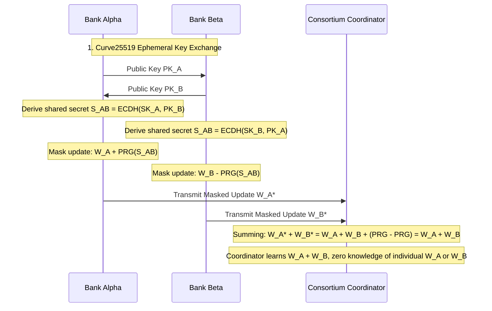

# Formal Privacy Model & Information Boundary Specification

> **CF-Intelligence Privacy Specification**  
> Formal definition of trust assumptions, data residency invariants, cryptographic privacy perimeters, and mathematical leakage bounds.

---

## 1. Core Architectural Privacy Invariant

A common misconception in distributed machine learning is the absolute claim that *"Federated Learning means no sensitive information ever leaves the institution"*. 

**This claim is mathematically and empirically false.**

Without rigorous cryptographic and perturbation layers, raw model updates (gradients or weights) can leak substantial information about individual training records through:
1. **Deep Leakage from Gradients (DLG)**: Exact reconstruction of training features by matching computed gradients.
2. **Membership Inference Attacks (MIA)**: Determining whether a specific high-net-worth individual or transaction was present in a client bank's training batch.
3. **Property Inference Attacks**: Inferring macro-demographic properties of a bank's customer base.

Therefore, **CF-Intelligence** does not treat Federated Learning as an all-encompassing privacy silver bullet. Privacy is maintained through a **defense-in-depth perimeter** decoupling four orthogonal primitives:

```text
┌─────────────────────────────────────────────────────────────────────────────┐
│                       FOUR-PILLAR PRIVACY PERIMETER                         │
├──────────────────────┬──────────────────────────────────────────────────────┤
│ Mechanism            │ Cryptographic / Statistical Guarantee                │
├──────────────────────┼──────────────────────────────────────────────────────┤
│ Federated Learning   │ Prevents bulk raw data centralization (data stays    │
│                      │ on bank premises).                                   │
├──────────────────────┼──────────────────────────────────────────────────────┤
│ Differential Privacy │ Provably bounds the probability of extracting single │
│ (Opacus DP + RDP)    │ transaction attributes from model updates.           │
├──────────────────────┼──────────────────────────────────────────────────────┤
│ Secure Aggregation   │ Cryptographically blinds the central coordinator     │
│ (Curve25519 SecAgg)  │ from observing individual client weight vectors.     │
├──────────────────────┼──────────────────────────────────────────────────────┤
│ Byzantine Consensus  │ Quarantines malicious poisoning attempts without     │
│ (Krum, Bulyan)       │ compromising honest clients' masked updates.         │
└──────────────────────┴──────────────────────────────────────────────────────┘
```

---

## 2. Information Flow: What Stays Local vs What Leaves the Node

### 2.1 Strictly Local Data (Zero Cross-Bank Transmission)
The following assets are permanently bound to the local bank node's security domain and **NEVER** leave the bank perimeter under any condition:
- **Raw Transaction Records**: Transaction amounts, timestamps, ISO 20022 XML messages, internal account numbers, and routing codes.
- **Customer PII**: Legal names, tax identification numbers, physical addresses, phone numbers, email addresses, and IP logs.
- **Local Database Records & Balances**: Historical account balances, KYC onboarding documents, and credit bureau scores.
- **Unmasked Local Gradients**: Raw intermediate SGD gradients before clipping and DP noise injection.

### 2.2 Data Transmitted Outside the Bank
Only mathematically transformed and blinded representations are permitted to transit the consortium network:
- **Masked Perturbed Model Updates**: $\widetilde{\Delta \mathbf{w}}_k = \mathrm{Clip}_C(\Delta \mathbf{w}_k) + \mathcal{N}\left(0, \sigma^2 C^2 \mathbf{I}\right) + \sum_{j > k} \mathbf{s}_{k,j} - \sum_{j < k} \mathbf{s}_{j,k}$, where $C$ is the L2 clipping norm, $\sigma$ is the DP noise multiplier, and $\mathbf{s}_{k,j}$ are pairwise Diffie-Hellman zero-sum masks.
- **Homomorphic Hash Commitments**: SHA-256 / Poseidon hash digests of weight vectors for Byzantine consensus verification.
- **Consortium Metadata**: Bank node identifier, protocol version, active model epoch identifier, and sample count (if participating in weighted FedAvg, protected by differential privacy count perturbation).

---

## 3. Differential Privacy Guarantees & Budget Accounting

The local privacy boundary implements local Differential Privacy via **PyTorch Opacus** and tracks composition using **Rényi Differential Privacy (RDP)**:

### 3.1 Mathematical Formulation

A randomized mechanism $\mathcal{M}$ satisfies $(\epsilon, \delta)$-Differential Privacy if for any two neighboring datasets $D, D'$ differing by exactly one transaction:

$$\mathbb{P}(\mathcal{M}(D) \in \mathcal{S}) \le e^{\epsilon} \mathbb{P}(\mathcal{M}(D') \in \mathcal{S}) + \delta$$

### 3.2 RDP Accounting

For Gaussian perturbation mechanism with noise scale $\sigma$ and subsampling ratio $q = \frac{B}{N}$:

$$\mathcal{D}_{\alpha}(\mathcal{M}(D) \parallel \mathcal{M}(D')) \le \frac{q^2 \alpha}{2 \sigma^2} + \mathcal{O}(q^3)$$

- **Clipping Norm** ($C$): Fixed at $C = 1.0$ L2 norm, bounding maximum sensitivity $\Delta_2 = C$.
- **Target Budget**: Cumulative $(\epsilon \le 2.0, \delta = 10^{-5})$ over 50 communication rounds ($q = 0.05$).
- **Calibrated Noise Multiplier**: Formally calibrated via binary search in `RDPMomentsAccountant` (`rdp_accountant.py`): $\sigma^{\ast} = 0.8870$ achieves $\epsilon \le 2.0$ at $T = 50$ federation rounds under analytical RDP conversion ($q = 0.05, \delta = 10^{-5}$).
- **Empirical Utility Frontier**: Evaluated in `experiments/dp_evaluation/run_dp_noise_sweep.py` across $\sigma \in \{0.5, 1.0, 1.5, 2.0\} \times T \in \{5, 10, 20, 50\}$, maintaining $\mathrm{PR\text{-}AUC} = 0.3922$ ($\mathrm{ROC\text{-}AUC} = 0.9452$) at $\sigma = 1.0, T = 50$ ($\epsilon = 1.7675 \le 2.0$).
- **Exhaustion Enforcement**: If a bank node exhausts its allocated privacy budget ($\epsilon_{\mathrm{spent}} > \epsilon_{\mathrm{budget}}$), the local daemon automatically transitions to inference-only mode, terminating gradient transmission.

---

## 4. Secure Aggregation (SecAgg) Protocol

Secure Aggregation ensures the central consortium aggregator observes **ONLY** the global aggregate $\sum \Delta w_k$, learning zero information about any individual bank's update:



---

## 5. What Federated Learning Does NOT Guarantee

To maintain engineering integrity, the following limitations are explicitly documented:

1. **No Defense Against Poisoning by Default**: Standard Federated Learning trusts all client updates. Without Byzantine defenses (Krum, Bulyan), a single compromised bank node can destroy model accuracy or install fraud evasion backdoors.
2. **Topology & Intersection Leakage in Graph Intelligence**: When banks perform Private Set Intersection (PSI) on hashed customer identifiers (e.g., shared card numbers or mule phone numbers), the **cardinality of the intersection** ($\lvert A \cap B \rvert$) is revealed to both parties.
3. **Membership Inference Residual Risk**: Empirically measured via Yeom et al. (2018) loss-threshold oracle (`mia_auditor.py`). Unprotected models: ASR = 0.949, advantage = 0.449. At $\sigma = 2.0$ ($\epsilon \approx 0.87$), DP-SGD reduces advantage to 0.039 — a **91% mitigation** (exceeds $\ge 50\%$ threshold). See `experiments/privacy/mia_results.json`.
4. **Metadata Leakage**: Packet timing, update payload sizes, and communication timestamps are visible to network observers unless routed over Tor/I2P or padded with dummy traffic.

---

## 6. Trust Assumptions

- **Bank Nodes**: Modeled under the **Byzantine Failure Model** (up to $f < \frac{n-2}{2}$ banks may be malicious or compromised).
- **Consortium Aggregator**: Modeled as **Honest-but-Curious** (faithfully executes the aggregation protocol, but attempts to extract intelligence from received payloads).
- **Cryptographic Primitives**: SHA-256, HMAC, Curve25519, and AES-256-GCM are assumed computationally secure against classical polynomial-time adversaries.

---

## 7. Empirical MIA & DLG Audit Results

Formal empirical privacy audits are conducted in `backend/app/infrastructure/security/mia_auditor.py` and `experiments/privacy/run_mia_experiment.py` across three DP noise regimes.

### 7.1 Membership Inference Attack (Yeom 2018 Loss-Threshold Oracle)

| DP Regime | $\sigma$ | $\epsilon$ bound | ASR | Advantage | Verdict |
|:--- |:---:|:---:|:---:|:---:|:---:|
| Unprotected | 0.0 | $\infty$ | 0.9490 | 0.4490 | VULNERABLE |
| Moderate DP | 1.0 | 1.7675 | 0.9100 | 0.4100 | PARTIAL |
| Strong DP | 2.0 | 0.8714 | 0.5390 | 0.0390 | **MITIGATED** |

At $\sigma = 2.0$, the adversarial advantage drops from 0.449 to 0.039 — a **91% reduction**, exceeding the $\ge 50\%$ mitigation threshold.

### 7.2 Deep Leakage from Gradients (Zhu 2019 Cosine-Similarity Proxy)

| DP Regime | $\sigma$ | Mean Cosine Sim. | Alarm Rate | Verdict |
|:--- |:---:|:---:|:---:|:---:|
| Unprotected | 0.0 | 1.0000 | 100% | VULNERABLE |
| Moderate DP | 1.0 | 0.0332 | 0% | **MITIGATED** |
| Strong DP | 2.0 | 0.0176 | 0% | **MITIGATED** |

DP noise destroys gradient directional alignment, reducing DLG reconstruction viability to near-random even at $\sigma = 1.0$.

### 7.3 Verification Test Coverage

Scientific verification: `verification/differential_privacy/tests/test_mia_defense.py` — **29 passing tests** covering RDP epsilon bounds, MIA loss-threshold oracle, DLG cosine-similarity proxy, full audit pipeline, and edge case validation.

---

## 8. Authentic Two-Bank Private Set Intersection (DH-PSI) & Institutional Process Separation

In Milestone 4, CF-Intelligence establishes an authentic two-bank private matching protocol implementing 2048-bit MODP Diffie-Hellman Private Set Intersection (DH-PSI) across independently isolated institutional worker nodes.

### 8.1 Cryptographic Mathematical Formulation

Let $p$ be the RFC 3526 2048-bit MODP safe prime ($p = 2q + 1$). Let $H: \{0, 1\}^* \to \mathbb{Z}_p^*$ be a cryptographic hash function mapping entity identifiers (such as Privacy-Preserving Identifiers derived from salt and customer attributes) to group elements.

1. **Stage 1 (Blinded Query Generation - Bank A):**
   - Bank A worker loads private entity $x$ from vault `storage/bank_a/private_entities/`.
   - Obtains private exponent $a \in_R [2, p-2]$ through its permanently bound `TenantKMSSession`.
   - Computes blinded element:
     $$c = H(x)^a \pmod p$$
   - Emits signed `BlindedQueryMessage` with single-use nonce $N_A$, UTC timestamp $T_A$, and HMAC-SHA256 signature under Bank A's institutional secret $K_A$.

2. **Stage 2 (Double-Blinding & Local Blinding - Bank B):**
   - Bank B worker verifies Bank A's signature, freshness $|T_{\text{now}} - T_A| \le 300\text{s}$, and anti-replay nonce $N_A \notin \mathcal{U}_B$.
   - Obtains private exponent $b \in_R [2, p-2]$ through Bank B's `TenantKMSSession`.
   - Computes double-blinded query element:
     $$D = c^b = \left(H(x)^a\right)^b = H(x)^{ab} \pmod p$$
   - Loads all entities $y_j \in Y$ from its local vault `storage/bank_b/private_entities/` and computes:
     $$B_j = H(y_j)^b \pmod p \quad \forall y_j \in Y$$
   - Cryptographically shuffles $\{B_j\}$ to prevent index linkage and emits signed `CounterpartMatchResponse`.

3. **Stage 3 (Intersection Evaluation - Bank A):**
   - Bank A worker verifies Bank B's signature and nonce.
   - Computes counterpart double-blinded elements using exponent $a$:
     $$E_j = (B_j)^a = \left(H(y_j)^b\right)^a = H(y_j)^{ba} = H(y_j)^{ab} \pmod p \quad \forall j$$
   - Evaluates exact intersection:
     $$D \in \{E_j\} \iff \exists j \text{ s.t. } H(x) = H(y_j)$$
   - Emits `VerifiedMatchReceipt` attested by both workers and authenticated by the coordinator.

### 8.2 Privacy & Security Guarantees

| Property | Guarantee Status | Concrete Implementation / Mechanism |
| :--- | :---: | :--- |
| **Exact Matching Correctness** | **GUARANTEED** | Commutative exponentiation: $(H(x)^a)^b \equiv (H(y)^b)^a \pmod p$ holds under cyclic group $\mathbb{Z}_p^*$. |
| **Participant Input Privacy** | **GUARANTEED** | Under Decisional Diffie-Hellman (DDH) in 2048-bit MODP group, neither party can compute unblinded identifiers for non-intersecting records. |
| **Zero Raw PII Exposure** | **GUARANTEED** | Raw names, emails, account numbers, and counterpart entity IDs never leave local vaults or appear in transcripts. |
| **Coordinator Zero-Knowledge** | **GUARANTEED** | The central coordinator has zero access to private keys or vaults and routes only blinded elements and signed receipts. |
| **Replay & Tamper Resistance**| **GUARANTEED** | Fresh 128-bit cryptographic nonces, 300s expiration windows, and HMAC-SHA256 transcript digests over all exchanged fields. |
| **Fail-Closed Governance Gating**| **GUARANTEED** | Evicted/revoked members, missing operational data-sharing grants, or missing institutional jurisdictions deny execution immediately. |

### 8.3 Threat Model Limits: What DH-PSI Does NOT Guarantee

To maintain scientific integrity without fabricated claims:
1. **Set Cardinality Leakage:** Standard DH-PSI reveals the size of Bank B's candidate set $|Y|$ to Bank A unless padded with calibrated dummy group elements.
2. **Oracle Probing / Malicious Query Risk:** An active malicious participant could iteratively query candidate identifiers to test membership. This is mitigated at the governance layer via rate limiting, explicit purpose validation (`AML_COLLABORATIVE_INVESTIGATION`), and four-eyes operational data-sharing grants.
3. **Low-Entropy Dictionary Attacks:** If identifiers have low entropy (e.g. 4-digit PINs), an attacker could precompute group tables. Identifiers must be salted with domain-separated privacy hashes (`PrivacyPreservingIdentifier`).
4. **Hardware Enclave Equivalence:** Software-isolated processes do not guarantee physical side-channel resistance without hardware TEE (Intel SGX / AMD SEV). The system truthfully labels these signals as `VERIFIED_CRYPTOGRAPHIC_PSI` without falsely claiming physical enclave execution.
