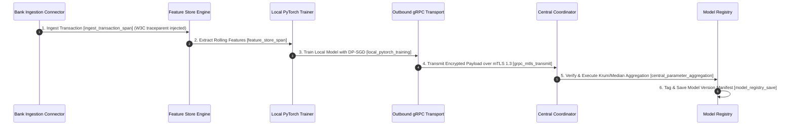
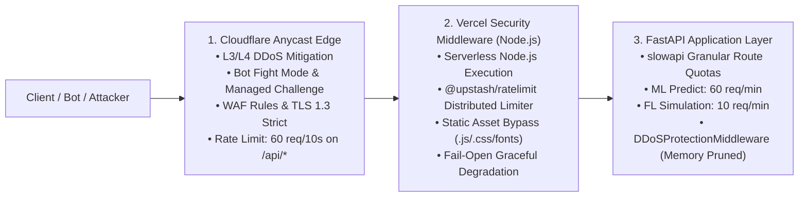

# Collaborative Fraud Intelligence Platform - System Design

## 1. System Requirements & Goals

### 1.1 Functional Requirements
*   **Decentralized Collaboration:** Multiple banks train a collaborative ML model for credit card fraud detection without sharing raw transactions.
*   **Privacy Guarantees:** Support Local Differential Privacy (LDP) with budget composition and Secure Aggregation pairwise masking.
*   **Byzantine Fault Tolerance:** Protect server aggregation from malicious node model/weight poisoning attacks.
*   **Real-time Collaborative AML:** Generate alerts on suspicious activity, hash identity values using HMAC-SHA256, resolve entities across banks, and build network graphs dynamically.
*   **Canary Quality Gate:** Validate newly trained global models on holdout validation data before promoting them to active production.
*   **Drift Monitoring:** Measure and alert on Feature Drift (data shift) and Concept Drift (relationship changes) across bank populations.

### 1.2 Non-Functional Requirements
*   **Stateless Scaling:** All API, graph resolution, and training orchestration services must remain stateless, delegating state to PostgreSQL/Redis.
*   **Fault Tolerance:** Active simulations must handle Celery worker restarts, DB connection drops, and Redis failures gracefully.
*   **Low Latency API Gateway:** Screen transactions with attributions (SHAP) under low latency constraints.

---

## 2. High-Level Architecture & Deployment Topologies

The Collaborative Fraud Intelligence (CFI) platform supports 3 flexible deployment topologies:
1. **Production Unified Stack (`docker-compose.yml`):** Enterprise production deployment coupling Nginx Gateway (ports 80/443), React 19 SPA, FastAPI Clean Architecture application server (port 8000), PostgreSQL 16 (port 5432), and Redis 7.2 (port 6379).
2. **Decoupled Microservices / Dev Grid (`docker-compose.dev.yml` & Helm):** Decomposes functional planes across dedicated containers orchestrated via `gateway.py` path prefix routing.
3. **Distributed Multi-Node Consortium (`docker-compose.multinode.yml`):** Multi-bank cluster deploying the central coordinator (port 50051 / 8000) alongside isolated bank client daemons (`bank-a`, `bank-b`, `bank-c`) communicating strictly over outbound-only gRPC mTLS.

### 2.1 Microservices Topology & Service Matrix

```
                          [ Client Browser / UI ]
                                    │
                                    ▼ (HTTPS / WSS)
                           [ Gateway Service ]
                                    │
         ┌──────────────────────────┼─────────────────────────┐
         ▼ (Routing)                ▼ (Routing)               ▼ (Routing)
  [ fl-coordinator ]         [ identity-graph ]         [ fraud-alert ]
   (Training & FL)            (Entity & React Flow)      (Risk & Cases)
         │                          │                         │
         └──────────────────────────┼─────────────────────────┘
                                    ▼
                     [ Redis Cache & Event Broker ]
                                    ▼
                      [ PostgreSQL Relational DB ]
```

1.  **`gateway` (Port 8000):** Acts as the reverse proxy (`backend/app/presentation/routers/gateway.py`). It implements token rate-limiting, request logs, and path prefix routing to downstream services.
2.  **`fl-coordinator` (Port 8001):** Houses PyTorch training loops, secure aggregation, client dropouts, and the Flower/Ray adapters.
3.  **`identity-graph` (Port 8002):** Manages HMAC hash resolution and parses resolved entities into dynamic React Flow elements.
4.  **`fraud-alert` (Port 8003):** Houses the 9-Signal Risk Scoring Engine, explainability (SHAP), and case resolution.

### 2.2 Version 2.0 & 3.0 Core Production Subsystems
*   **P2P Curve25519 SecAgg (`p2p_secagg_driver.py`):** Client-side zero-sum pairwise vector perturbation via X25519 ECDH + HKDF-SHA256.
*   **Shamir Secret Sharing (`shamir_engine.py`):** Galois polynomial threshold secret sharing over $\mathbb{Z}_p$ for dropout-resilient mask recovery.
*   **HSM Root Key Binding (`vault_hsm_pki_binder.py`):** FIPS 140-2 Level 3 HSM PKCS#11 enclave binding for Vault Root CA key isolation.
*   **Multi-Sig Coordinator (`GnosisSafeMultiSigCoordinator.sol`):** Gnosis Safe 2-of-3 EIP-712 threshold multi-sig governance contract.
*   **Flower P2P Integration (`flower_p2p_engine.py`):** Serverless peer-to-peer FL training rounds with Ring and Mesh P2P gossip strategies.
*   **Real-Time Graph Streaming (`flink_graph_streaming.py`):** Apache Flink sub-second stateful graph stream accumulators ($W(t, 500\text{ms})$) with $<50\text{ms}$ SLA.
*   **zk-SNARK Model Weight Attestation (`zk_snark_verifier.py` & `weight_attestation.circom`):** Groth16 / PlonK zero-knowledge proof verification over BN254 elliptic curve with $O(1)$ constant time bilinear pairing verification ($<5\text{ms}$ SLA).
*   **Autonomous Agentic AML Copilot (`aml_agentic_copilot.py`):** Ingests Neo4j subgraphs, SHAP attributions, and ISO 20022 payloads to synthesize 5-paragraph FinCEN SAR narratives and 4-Eyes supervisor briefings.
*   **Confidential Federated Unlearning (`federated_unlearning_engine.py`):** Exact Re-Aggregation across retained participants and Lineage Subtraction gradient erasure for departing or revoked banks without full model retraining from scratch.
*   **Post-Quantum Cryptography (`pqc_secagg_driver.py`):** NIST FIPS 203 (CRYSTALS-Kyber-768 KEM) and FIPS 204 (CRYSTALS-Dilithium-3 signatures) hybrid quantum-safe P2P SecAgg key exchange driver ($<1.5\text{ms}$ SLA).
*   **Cross-Chain Inter-Bank Settlement (`layer2_crosschain_bridge.py`):** Chainlink CCIP `EVM2AnyMessage` and LayerZero V2 multi-ledger settlement bridge for Arbitrum, Optimism, Canton, and Hyperledger Fabric ($<1\text{s}$ L2 finality).
*   **Adaptive DP Auto-Scaler (`adaptive_dp_autoscaler.py`):** Rényi Differential Privacy (RDP) and PRV dual accountant dynamically adjusting noise multipliers ($\sigma_t$) to prevent over-noising and maintain $>0.94$ AUC-ROC.

### 2.3 2026 Enterprise Production Enhancements
*   **Real Dataset Ingestion Studio & GE 1.x Gating (`datasets.py` & `piiSanitizer.ts`):** Interactive CSV/Parquet drag-and-drop ingestor featuring client-side Luhn PAN checking, IBAN/TCKN regex, Type-Salted HMAC Zero-PII sanitization, 12-rule Great Expectations data contract gating, quarantine CSV isolation, and Non-IID Dirichlet class concentration estimation ($\alpha = 0.52$).
*   **Interactive Chaos & Adversarial Attack Simulator (`ChaosAttackInjectorPanel.tsx` & `scenarios.py`):** Real-time attack panel injecting 500 tx/s smurfing bursts (intercepted by GraphSAGE + LSH-PSI) and Byzantine poisoned gradients ($\Delta w \times -10.0$) triggering instant Krum quarantine ($\Delta = 48.2 > 14.1$) with live continuous proxy telemetry (explicitly labeled in UI/docs as a Simulated Demo Proxy based on gradient cosine alignment and boundary strain, rather than offline holdout dataset AUC).
*   **Playwright Real-Browser Multi-Device E2E Suite (`frontend/e2e-workflows/`):** 10 automated end-to-end browser workflows executing against Chromium and Firefox (Desktop 1440, Laptop 1280, iPhone 13, Pixel 7) testing session tokens, live FL convergence, Four-Eyes SAR signing, attack injection, and custom dataset ingestion.
*   **One-Click Enterprise On-Premises Docker Stack (`docker-compose.yml`):** Unified multi-container orchestration deploying Nginx Gateway, React 19 SPA, FastAPI monolith, PostgreSQL 16, and Redis 7.2 in under 30 seconds with same-origin routing and 86400s WebSocket keepalive.
*   **Alembic Dual-Revision Migrations & Dynamic Tenant Discovery (`migration_manager.py` & `env.py`):** Linear two-step migration pipeline (`001_production_domain_tables` $\to$ `002_core_and_aml_tables`) with dynamic tenant discovery from `tenant_configs` across both PostgreSQL schemas (sanitized `search_path`) and isolated SQLite databases, featuring batch SQLite migration support, zero-downtime offline `--sql` mode, and automatic schema adoption (`_ensure_migrated_or_stamped`).
*   **Multi-Tenant KMS Key Lifecycle & Versioned Envelopes (`kms_service.py`):** Hardware/Vault-backed envelope encryption utilizing versioned AES-256-GCM tokens (`v2:{iv_b64}:{tag_b64}:{ciphertext_b64}`), live vs. simulated Vault status probing, automated background re-encryption pipelines, and cron-triggered key rotation (`POST /v1/cron/rotate-keys`).
*   **Atomic Quota Metering & 3-State Idempotency (`tenant_metering.py` & `idempotency.py`):** Test-and-increment locking in `acquire_quota` eliminating check-then-act race conditions under high concurrent banking streams, paired with Redis `SETNX` 3-state idempotency reservation (`ACQUIRED` $\to$ `IN_PROGRESS` $\to$ `HIT`).
*   **Automated FinCEN SAR XML 2.0 Export (`POST /api/v1/cases/export/fincen-xml`):** Regulatory filing synthesizer producing schema-validated BSA SAR XML packages with SHA-256 digital signatures, 4-Eyes supervisor verification, and Splunk/SIEM forwarding.
*   **Zero-Vulnerability Security Floor:** Pinned and hardened dependencies resolving all 20 historical CVE advisories (`urllib3 >= 2.6.3`, `jinja2 >= 3.1.6`, `aiohttp >= 3.13.3`, `cryptography >= 46.0.5`, `opacus >= 1.5.4`).

---

## 3. Core Component Design

### 3.1 Data Flow: Streaming Screening & Explanation
```
[Transaction JSON] ──► [fraud-alert] ──► [Risk Engine] (9 Signals)
                                               │
               ┌───────────────────────────────┴───────────────┐
               ▼ (Risk Score >= 600)                           ▼ (Attributions)
      [Generate Alert]                               [Integrated Gradients]
               │                                               │
               ▼ (HMAC-SHA256)                                 ▼
      [Send Hash Entity]                                [SHAP Attributions]
               │                                               │
               ▼                                               ▼
      [identity-graph] ──► [React Flow Chart]        [Explainability Chart]
```

### 3.2 State Management & Cache Resilience
Services write states to `RedisStore`. In development environments, `RedisStore`, `CacheService`, `RedisBankClientListener`, and the core lifespan startup probes implement dual-layer credential auto-healing and container host re-routing (mapping Docker container hostname `redis` to `127.0.0.1` and reconciling development credential variations between `.env` and local scripts). If Redis is completely offline or unconfigured, `RedisStore` catches the exception and routes reads/writes to a thread-safe, in-memory Python dictionary backend. This ensures the demo interface and local test suites remain stable under transient failures.

### 3.3 Enterprise Model Registry & Governance (SR 11-7 Compliance)
*   **Production Admission Gating (`validate_production_admission`):** Before any candidate model can be promoted to active production serving, it must pass rigorous automated quality gates:
    - **PR-AUC Degradation Boundary:** $\text{PR-AUC}_{\text{cand}} \ge \text{PR-AUC}_{\text{champ}} - 0.005$.
    - **ROC-AUC Floor:** $\text{ROC-AUC}_{\text{cand}} \ge 0.65$.
    - **False Positive Rate Ceiling:** $\text{FPR}_{\text{cand}} \le 5\%$ ($0.05$).
    - **Inference Latency SLA:** $p95 \le 200\text{ms}$ under production benchmark load.
    - **Fairness Disparity Guardrails:** Demographic Parity and Equal Opportunity disparity across demographic/regional slices bounded by $\le 0.10$.
    - **Finite Tensor Weight Verification:** All parameter tensors strictly validated via `torch.isfinite()` to eliminate NaN/Inf contamination.
    - **Holdout Canary Gate:** Evaluated against an isolated, non-training verification holdout set. Candidates failing any admission condition remain registered in historical audit archives but are blocked from deployment.
*   **Four-Eyes Dual Sign-off Workflow:** Promotion to Champion or Challenger is gated behind cryptographic approval from distinct institutional roles: an ML Engineer (`ROLE_ML_ENGINEER`) and a Compliance Officer (`ROLE_COMPLIANCE_OFFICER`). Dual signatures are recorded immutably with role verification and timestamps.
*   **Production Serving Isolation & Safe Deserialization:**
    - Runtime isolation between Champion (active production decision-maker) and Challenger (shadow routing) execution paths.
    - Safe model weight loading strictly enforcing `torch.load(..., weights_only=True)` to prevent arbitrary code execution vulnerabilities.
    - Atomic on-disk symlink updates (`global_model.pt`) leveraging temporary file creation (`tempfile.NamedTemporaryFile`) and atomic replacement (`os.replace`) to eliminate partial read or torn read hazards under high-concurrency inference streams.
*   **Instant Cross-Worker Cache Invalidation:**
    - Redis Sentinel Pub/Sub broadcasts eviction messages (`MODEL_PROMOTED`, `MODEL_ROLLBACK`, `MODEL_REVOKED`) across all distributed API worker instances.
    - On receiving an invalidation event, workers purge warm in-memory model caches and reload the new champion model within sub-100ms, completely closing stale serving windows.
*   **Fail-Closed Serving Invariants (SR 11-7 & `AGENTS.md`):** Real-time scoring routes (`POST /v1/inference/score`) strictly enforce fail-closed behavior. If no valid champion model is available, if a model has been revoked, or if scoring fails, the endpoint returns `HTTP 503 Service Unavailable` with `ModelNotAvailableError`. The system strictly prohibits synthetic, random, or heuristic score fallbacks.
*   **Shadow Routing & Performance Monitoring:** Routes 100% of live traffic to the Challenger model silently, logging comparative performance statistics. A randomized 10% slice of decision-making traffic can be routed to Challenger predictions for production A/B testing.
*   **Lineage & Reproducibility Audits:** Each saved model tracks Git commit SHA, dataset SHA-256 hashes, differential privacy noise configuration ($\epsilon, \delta, \sigma$), and training receipt signatures to guarantee an unbroken chain-of-custody.
*   **Automated Rollback Engine:** Tracks live performance metrics on a sliding window. Automatically triggers rollback to the last known stable champion version if active model telemetry breaches:
    - ROC-AUC drops below `0.65`
    - Scoring latency exceeds `200ms`
    - False Positive Rate (FPR) exceeds `5%` ($0.05$)

### 3.4 Physical Multi-Tenancy & Cryptographic Key Isolation (SOC2 / PCI-DSS)
To guarantee data sovereignty and strict database-level boundaries required by banking regulations (SOC2, PCI-DSS):
*   **Dual-Engine Multi-Tenancy Isolation:**
    - **PostgreSQL Production Mode:** Strict schema-level partitioning where each institution's tables live in a dedicated schema (`bank_a`, `bank_b`, `bank_c`). The active engine dynamically sets `SET search_path = <sanitized_bank_id>` on checked-out connections using regex-validated identifiers (`_pg_quote_identifier`), preventing cross-tenant SQL bleed or schema tampering.
    - **SQLite Local / Standalone Mode:** File-level physical database isolation where each bank possesses a dedicated database file in `_STORAGE_ROOT / f"cfi_{sanitized_bank_id}.db"`. The central coordinator queries `cfi_central.db` and has zero direct query access to bank ledgers.
*   **Dynamic Alembic Migrations:** Alembic dual revisions (`001_production_domain_tables` and `002_core_and_aml_tables`) dynamically discover active tenant schemas from `tenant_configs` during migration execution and execute batch alterations safely across both SQLite and PostgreSQL.
*   **Versioned Key Management Service (KMS/HSM):** Key material is isolated into per-tenant cryptographic vaults (`storage/{bank_id}/kms/keys.json`) and versioned envelopes (`v2:{iv}:{tag}:{ciphertext}`). Per-bank HMAC keys (for entity hashing), DH-PSI private exponents, and secure aggregation seeds are generated lazily inside the bank boundary, with automated re-encryption pipelines during key rotation.
*   **Private Model Registry & Vaults:** During local training, intermediate PyTorch model weights and local GNN updates are saved strictly to the bank's local vault directory (`storage/{bank_id}/model_vault/`). Only the aggregated model gradients participating in active rounds are exposed temporarily to the central coordinator.
*   **Tenant-Isolated Log files:** Application logs and transaction audit trails are filtered dynamically based on the active tenant context and written to bank-specific files (`storage/logs/{bank_id}.log`), preventing cross-tenant information leakage in centralized logging backends.

### 3.5 Dynamic Policy & Rule Engine (DSL)
For real-time compliance and transaction control:
*   **JSON AST Compilation:** Employs a recursive parser supporting logical combinators (`and`, `or`, `not`) and comparison operators (`==`, `!=`, `>`, `>=`, `<`, `<=`, `in`, `not in`) over transaction payloads.
*   **Hot-Reloadable Registry:** Allows risk analysts to add, delete, and toggle rule execution states via API endpoints. The engine instantly evaluates new rules without requiring service redeployments.
*   **Gateway Blocking:** When a rule action evaluates to `BLOCK_TRANSACTION`, the transaction endpoint `/predict` overrides default routing parameters to set `policy_action` to blocked status, ensuring immediate threat containment.

### 3.6 Web3 & CBDC Smart Contract Incentive Settlement
For automated economic governance and fair contribution reward distribution across participating banks:
*   **Solidity Smart Contract (`ConsortiumIncentiveSettlement.sol`)**: Deployed on an EVM-compatible consortium network (Sepolia/Hardhat/Local). Features OpenZeppelin `ReentrancyGuard`, 18-decimal wei fixed math, and on-chain node quarantine mapping (`quarantinedNodes`).
*   **Shapley Value & Variance Allocation**: Leave-One-Out (LOO) Shapley marginal contributions are computed off-chain in Python (`smart_contract_driver.py`); the smart contract itself is an escrow/settlement ledger that verifies pool balance conservation, prevents double-claiming, and enforces quarantine zero-payout rules over the pre-computed allocations. Nodes with zero update variance or $SV_i \le -0.05$ trigger on-chain quarantine (`setNodeQuarantine()`), freezing their wallet claims.
*   **Python Web3 Driver (`smart_contract_driver.py`)**: Singleton class managing EVM connections, contract compilation via `py-solc-x`, contract deployment, automated batch payouts (`distributeIncentives()`), and block event listening.
*   **Immutable Audit Ledger Binding**: Settlement transaction hashes (`settlement_tx_hash`) and block numbers (`settlement_block_number`) are immutably linked directly into the cryptographic SHA-256 audit ledger (`immutable_audit_chain.py`).

### 3.7 Standalone Bank Client Daemon & Zero-Inbound Egress Topology
For zero-trust deployment within financial network perimeters:
*   **Standalone Daemon (`cfi-bank-client`)**: Dedicated Python client daemon (`backend/app/infrastructure/client_daemon/daemon.py` / `BankClientDaemon`) and CLI tooling (`scripts/cfi_cli.py`) that operates inside each bank's internal network perimeter without opening incoming network ports.
*   **Zero-Inbound Port Architecture**: Firewalls strictly prohibit inbound connections to bank networks. The daemon initiates an outbound-only mTLS channel (port 50051) to the `fl-coordinator`, receiving streaming job instructions and streaming local updates back.
*   **Encrypted Local Vault Storage (`local_vault.py`)**: Protects local PyTorch model checkpoints, training datasets, and session tokens on disk using AES-256-GCM with PBKDF2 key derivation (100,000 iterations).
*   **Exponential Backoff Reconnector (`ExponentialBackoffReconnector`)**: Handles network drops gracefully using randomized exponential backoff with full jitter to preserve session context and prevent server connection storms.

### 3.8 Real-Time Streaming Feature Store Engine
For high-frequency sliding-window behavioral aggregations across continuous payment streams:
*   **Ingestion Pipeline Sequence**:
    1. Raw `NormalizedTransaction` received from Bank Connector.
    2. Schema validation via `DataContractValidator` (`backend/app/domain/data_validator.py`).
    3. Transaction deduplication via `BloomFilterDeduplicator` (`backend/app/infrastructure/feature_store/bloom_filter.py`).
    4. Feature extraction & rolling aggregations via `RollingFeatureAggregator` (`backend/app/infrastructure/feature_store/rolling_aggregators.py`).
    5. Persistence to feature vector cache via `StreamingFeatureStore` (`backend/app/infrastructure/feature_store/store.py`).
*   **Calculated Rolling Feature Specifications**:
    - `account_age_days`: Time elapsed since account creation.
    - `merchant_velocity_1h`: Sliding 60-minute window transaction counter grouped by `(account_id, merchant_category_code)`.
    - `device_entropy`: Normalized Shannon diversity index calculated across IP subnets, device fingerprints, and channel types.
    - `country_risk_score`: FATF high-risk jurisdiction mapping weights (e.g., North Korea/Iran = 1.0, Syria = 0.75, US/DE = 0.05).
    - `hour_of_day_cos` & `hour_of_day_sin`: Cyclical time encodings ($\cos(2\pi \cdot \text{hour}/24)$, $\sin(2\pi \cdot \text{hour}/24)$).
    - `rolling_amount_zscore_24h`: Z-score of transaction amount relative to account's 24-hour rolling mean and standard deviation ($Z = (x - \mu) / \sigma$).
    - `previous_alerts_30d`: Count of prior AML SARs (Suspicious Activity Reports) triggered in the last 30 days.

### 3.9 Production Training Provenance & Execution Authority

To guarantee mathematical reproducibility, eliminate phantom execution claims, and provide cryptographically verifiable training provenance:

*   **Transactional Job Authority Backends (`training_authority_backends.py`):**
    - **`PostgresTrainingJobAuthority` (Production ACID Authority):** Coordinates federated training jobs and round assignments using transactional row-level locks (`SELECT ... FOR UPDATE`). Eliminates check-then-act race conditions, duplicate job execution attempts, and phantom round submissions under high-concurrency multi-bank scheduling.
    - **`InMemoryTrainingJobAuthority` (Development/Testing):** Thread-safe, lock-synchronized execution authority backend used for deterministic unit testing and local developer workflows without database dependencies.
*   **Asymmetric Ed25519 Execution Receipts (`IsolatedReceiptSigningAuthority`):**
    - Client banks generate cryptographically verifiable execution receipts signed via isolated Ed25519 asymmetric key pairs (`training_provenance_service.py`).
    - Receipts bind immutable tuples: `(job_id, round_number, epoch_index, bank_id, parameter_hash, timestamp, signature)`.
    - Central coordinator validates every receipt against an authoritative public key registry; receipts signed with unknown, forged, or revoked keys are rejected immediately.
*   **Sequential Epoch Reconciliation (`reconcile_job_completion_evidence`):**
    - Enforces strict canonical epoch sequence verification across submitted receipts before round aggregation.
    - Requires contiguously ordered epochs $[1..E]$ without skips, gaps, duplicates, or out-of-order execution claims.
    - Prevents planned-only or partial execution claims from being credited as complete training runs.
*   **Parameter Update Digest Anti-Replay Verification:**
    - Coordinator cryptographically computes and validates the SHA-256 digest of submitted parameter updates against execution receipt hashes before aggregating weights.
    - Detects and rejects replay attacks where an adversarial or lagging participant attempts to reuse previous rounds' updates or cross-round cached parameters.
*   **OS-Level Multi-Process Vault File Locking (`BankPrivateStorageVault`):**
    - Prevents concurrent process race conditions and write corruption on local bank model vaults, checkpoints, and credentials.
    - Employs Windows `CreateFileW` with `FILE_SHARE_READ` and `LOCKFILE_EXCLUSIVE_LOCK` via Win32 API.
    - Employs POSIX `fcntl.flock(LOCK_EX | LOCK_NB)` on Linux/macOS systems.
    - Ensures atomic, single-writer multi-reader integrity across distributed container daemons and background Celery workers.

### 3.10 OpenTelemetry Distributed Tracing & Span Lifecycle Architecture

OpenTelemetry (OTel) distributed tracing (`backend/app/infrastructure/telemetry/otel_tracer.py`) instruments end-to-end request flows across distributed bank nodes and central coordinator microservices:



* **W3C Trace Context Propagation**: Propagates `traceparent` (`00-{trace_id}-{span_id}-01`) and `tracestate` headers across HTTP, gRPC, and AMQP channels.
* **OpenTelemetry Exporters**: Exports traces via OTLP/gRPC to Jaeger/Tempo (`:4317`) and Prometheus gauges (`/metrics`).
### 3.11 Multi-Layer Perimeter & Gateway Defense-in-Depth Architecture

The platform enforces a 3-layer perimeter defense architecture to withstand volumetric attacks, malicious scraping, and distributed denial-of-service attempts without overloading core ML scoring engines:



1. **Layer 1 (Cloudflare Perimeter)**:
   - Automated L3/L4 volumetric attack absorption on Cloudflare's global Anycast network.
   - Bot Fight Mode, Browser Integrity Checks, and Custom WAF Rules challenging high-threat score traffic.
   - Terraform IaC templates available in `deployments/terraform/cloudflare/`.
2. **Layer 2 (Vercel Security Middleware)**:
   - Node.js runtime middleware (`frontend/middleware.ts`) powered by `@upstash/ratelimit` and `@upstash/redis`.
   - Halts flooding traffic before it ever incurs downstream backend compute costs.
3. **Layer 3 (FastAPI Application Layer)**:
   - In-process `slowapi` limiter singleton (`backend/app/infrastructure/security/rate_limiter.py`) reading `CF-Connecting-IP` / `X-Real-IP`.
   - Endpoint-specific quotas: `/api/v1/predict` (60 req/min), `/api/v1/simulations` (10 req/min), `/api/v1/alerts` (120 req/min).

---

### 3.12 Broken Object Level Authorization (BOLA/IDOR) & Multi-Tenant Isolation

To prevent Broken Access Control (OWASP API1:2023), the platform implements cryptographic tenant isolation across all presentation routers:

1. **Tenant Identity Resolution Hierarchy**:
   - `Authorization: Bearer <JWT>`: Decoded via `OIDCAuthenticator` to extract subject claims, bank affiliations, and role assignments.
   - `X-Tenant-ID` / `X-Bank-ID`: Explicit enterprise tenant headers.
   - API Key metadata: `key_id:bank_id:role`.
2. **Interception & Enforcement Middleware**:
   - `TenantAccessControlMiddleware` intercepts incoming requests and rejects cross-tenant URL parameter tampering (`?bank_id=other_bank`) with `HTTP 403 Forbidden` (`https://cfi-platform.org/errors/TenantAccessDenied`).
   - Routers invoke `enforce_tenant_isolation(caller_tenant, target_bank_id)` across alert, entity, and case endpoints.
3. **Role-Based Cross-Institution Bypass**:
   - Authorized consortium roles (`super_admin`, `cross_bank_investigator`, `compliance_auditor`) are granted audited access across institutional boundaries.


---

## 4. Telemetry & Observability

CFI includes a complete observability stack:
*   **OpenTelemetry:** Instruments FastAPI handlers, injecting span contexts into requests.
*   **Jaeger:** Traces transactions and training queries.
*   **Prometheus:** Scrapes `/metrics` from all microservices, tracking API latency, active Celery tasks, and memory budgets.
*   **MLflow:** Logs learning metrics (accuracy, precision, recall, loss, AUC-ROC) to a local server at `http://localhost:5000` for deep comparison.
*   **Grafana:** Pre-built CFI Overview dashboard visualizing platform metrics in real time.

